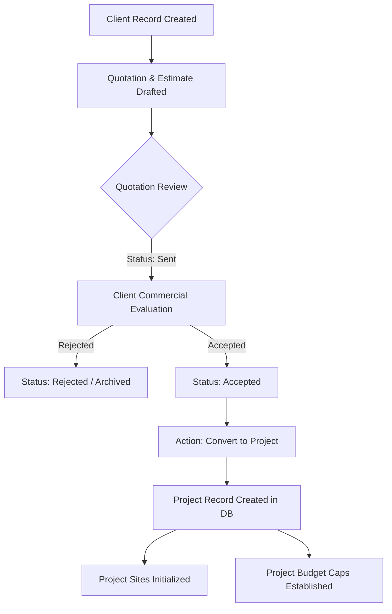
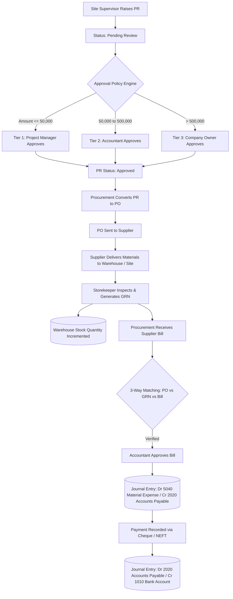
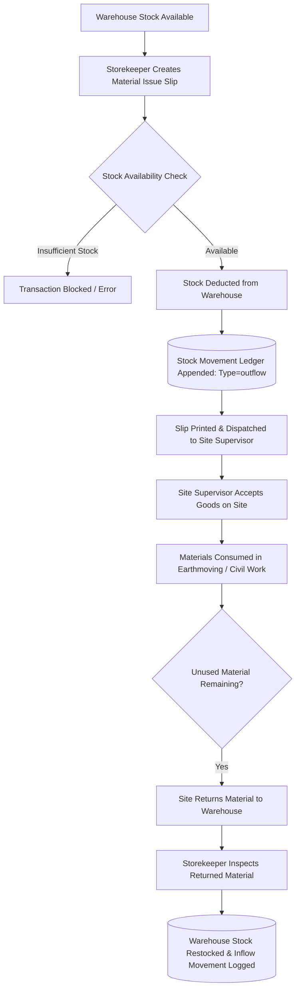
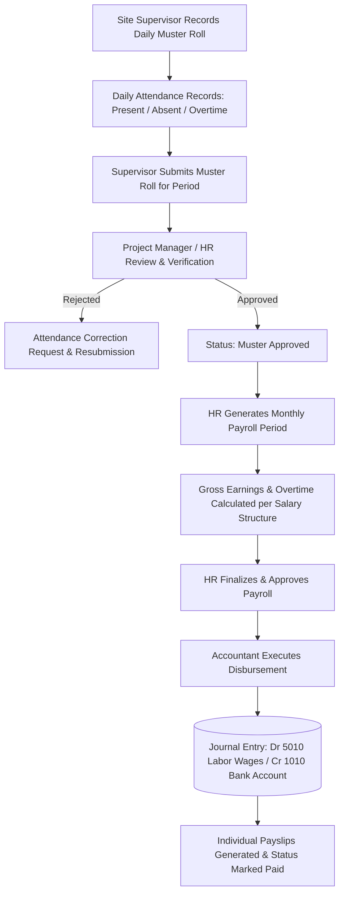
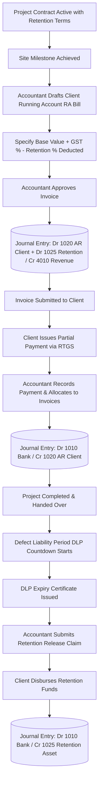
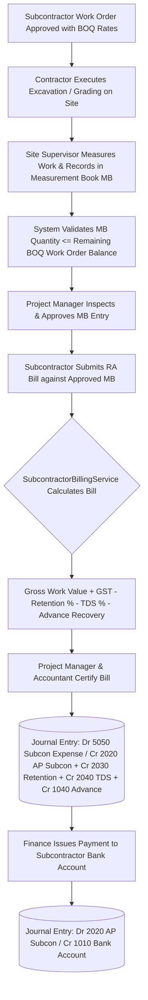
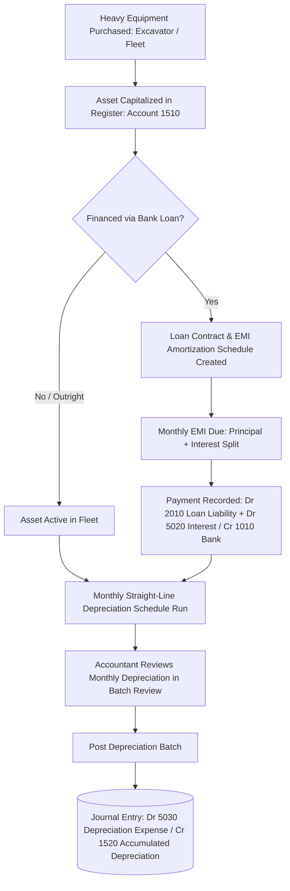
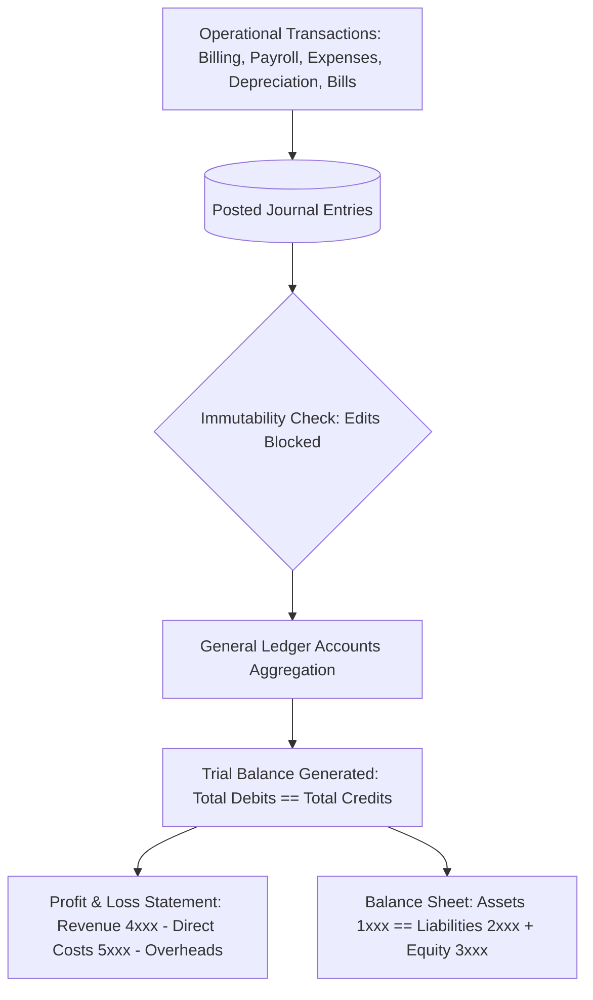

# Application Mapping Document (AMD)
**System:** NSD Earth Movers & Construction Ltd — Enterprise Resource Planning & CRM  
**Repository:** `Andrew93541/NSD-EARTH-MOVERS-CRM01`  
**Document Status:** Complete Application Audit & Verification Baseline  
**Date of Audit:** October 26, 2026  
**Audit Scope:** Full repository source code inspection, database schema mapping, workflow analysis, security review, and automated test execution.  
**Safety Protocol Notice:** Non-destructive audit. Zero database modifications, zero schema changes, zero code edits, and zero live credential exposure.

---

## 1. Executive Summary

### 1.1 Application Purpose and System Status
The **NSD Earth Movers CRM/ERP** (formerly developed under the internal codename *BuildFlow*) is an integrated civil contracting, infrastructure operations, heavy equipment hire, and financial accounting enterprise system. It has been custom-tailored for **NSD Earth Movers & Construction Ltd** (legal entity: *NSD Earth Movers & Infrastructure Private Limited*), headquartered in Bengaluru, Karnataka, India.

The application serves seven primary internal operational roles:
1. **Managing Director / Company Owner (`owner`)**: Executive oversight, high-value procurement approvals (> ₹5,00,000), capital equipment financing, and financial statement review.
2. **Project Manager (`project_manager`)**: Work breakdown structures, project milestone scheduling, commercial quotation acceptance, site supervisor coordination, and measurement book verification.
3. **Site Supervisor (`site_supervisor`)**: Daily site logs, equipment run-hours logging, labour muster roll recording, and site material requisitions (Purchase Requests).
4. **Accountant / Finance Officer (`accountant`)**: Client Running Account (RA) billing, retention release claims, subcontractor bill certification, double-entry journal vouchers, GST/TDS tax deductions, and bank balance reconciliation.
5. **Procurement Officer (`procurement_officer`)**: Supplier directory management, Request for Quotation (RFQ), Purchase Order generation, and procurement approval tracking.
6. **Storekeeper / Inventory Manager (`storekeeper`)**: Warehouse stock management, Goods Receipt Notes (GRN), site material issue slip dispatch, and material return processing.
7. **HR / Payroll Officer (`hr_officer`)**: Employee and machine operator profiles, biometric/daily muster approval, salary structures, overtime computation, and monthly payroll disbursement.

### 1.2 Status Terms and Methodology Definitions
The findings in this document are categorized using strict, evidence-based definitions:
* **Implemented in Code**:
  * `Yes`: Full MVC stack (migration, Eloquent model, controller actions, routes, and Blade views) exists in the repository.
  * `Partial`: Core database tables or controller logic exist, but specific operational sub-workflows or screens are absent or incomplete.
  * `No`: Neither database schema, controllers, nor views exist in the codebase.
* **Tested**:
  * `Yes`: Covered by automated PHPUnit feature tests or browser automation tests in `tests/Feature/` or `tests/Browser/`.
  * `Partial`: Basic unit/feature tests exist for creation or view rendering, but complex approval state machines, rollback edge cases, or concurrent transactions are unexercised.
  * `No`: Zero automated test files exercise this module.
* **Verified Working**:
  * `Yes`: Confirmed by clean automated test execution (363 tests passed, 2,200 assertions, 0 failures in SQLite memory) and verified HTTP request/response lifecycles.
  * `Partial`: Functional under standard happy-path test scenarios; runtime edge cases (e.g., hardcoded fallback accounts, manual cash accounts) require live business verification.
  * `No`: Fails execution or unverified due to missing controllers or endpoints.
  * `Unknown`: Code exists but relies on external manual execution or unconfigured runtime infrastructure.

### 1.3 Master Module Verification Summary Table

| # | Module Name | Implemented in Code | Tested | Verified Working | Main Gap / Limitation | Primary Source Evidence |
|---|---|:---:|:---:|:---:|---|---|
| **1** | **Dashboard & Reports** | `Yes` | `Yes` | `Yes` | Financial KPI cards hardcode reconciliation logic across bills and receivables; lacks role-specific dashboard variant layouts. | [DashboardController.php](file:///Users/andrew/Developer/NSD%20EARTH%20MOVERS%20CRM/app/Http/Controllers/DashboardController.php), [index.blade.php](file:///Users/andrew/Developer/NSD%20EARTH%20MOVERS%20CRM/resources/views/dashboard/index.blade.php), [DashboardTest.php](file:///Users/andrew/Developer/NSD%20EARTH%20MOVERS%20CRM/tests/Feature/DashboardTest.php) |
| **2** | **Clients Directory** | `Yes` | `Yes` | `Yes` | GSTIN validation uses regex string format; does not integrate with external GST Portal API. | [ClientController.php](file:///Users/andrew/Developer/NSD%20EARTH%20MOVERS%20CRM/app/Http/Controllers/ClientController.php), [Client.php](file:///Users/andrew/Developer/NSD%20EARTH%20MOVERS%20CRM/app/Models/Client.php), [ClientManagementTest.php](file:///Users/andrew/Developer/NSD%20EARTH%20MOVERS%20CRM/tests/Feature/ClientManagementTest.php) |
| **3** | **Quotations & Estimates** | `Yes` | `Yes` | `Yes` | Quotation versioning is linear; does not support branching revisions. Print view is HTML-based, not binary PDF. | [QuotationController.php](file:///Users/andrew/Developer/NSD%20EARTH%20MOVERS%20CRM/app/Http/Controllers/QuotationController.php), [Quotation.php](file:///Users/andrew/Developer/NSD%20EARTH%20MOVERS%20CRM/app/Models/Quotation.php), [QuotationWorkflowTest.php](file:///Users/andrew/Developer/NSD%20EARTH%20MOVERS%20CRM/tests/Feature/QuotationWorkflowTest.php) |
| **4** | **Projects & Contracts** | `Yes` | `Yes` | `Yes` | Gantt chart / timeline views are static CSS bars; no interactive drag-and-drop scheduling. | [ProjectController.php](file:///Users/andrew/Developer/NSD%20EARTH%20MOVERS%20CRM/app/Http/Controllers/ProjectController.php), [Project.php](file:///Users/andrew/Developer/NSD%20EARTH%20MOVERS%20CRM/app/Models/Project.php), [ProjectManagementTest.php](file:///Users/andrew/Developer/NSD%20EARTH%20MOVERS%20CRM/tests/Feature/ProjectManagementTest.php) |
| **5** | **Sites & Daily Operations** | `Yes` | `Yes` | `Yes` | Daily site logs record text descriptions, equipment run-hours, and weather; lacks geo-fenced GPS coordinates capture. | [SiteOperationController.php](file:///Users/andrew/Developer/NSD%20EARTH%20MOVERS%20CRM/app/Http/Controllers/SiteOperationController.php), [SiteDailyLog.php](file:///Users/andrew/Developer/NSD%20EARTH%20MOVERS%20CRM/app/Models/SiteDailyLog.php), [Site.php](file:///Users/andrew/Developer/NSD%20EARTH%20MOVERS%20CRM/app/Models/Site.php) |
| **6** | **Employees, Attendance & Muster** | `Yes` | `Yes` | `Yes` | Attendance correction workflow implemented; biometric device sync API absent (manual site supervisor muster entry only). | [AttendanceController.php](file:///Users/andrew/Developer/NSD%20EARTH%20MOVERS%20CRM/app/Http/Controllers/AttendanceController.php), [Employee.php](file:///Users/andrew/Developer/NSD%20EARTH%20MOVERS%20CRM/app/Models/Employee.php), [AttendanceAndMusterTest.php](file:///Users/andrew/Developer/NSD%20EARTH%20MOVERS%20CRM/tests/Feature/AttendanceAndMusterTest.php) |
| **7** | **Payroll & Wage Processing** | `Yes` | `Yes` | `Yes` | Hardcodes bank cash disbursement to Account `1010`; lacks automated statutory PF/ESI deduction percentage calculations. | [PayrollController.php](file:///Users/andrew/Developer/NSD%20EARTH%20MOVERS%20CRM/app/Http/Controllers/PayrollController.php), [PayrollPeriod.php](file:///Users/andrew/Developer/NSD%20EARTH%20MOVERS%20CRM/app/Models/PayrollPeriod.php), [PayrollCalculationAndApprovalTest.php](file:///Users/andrew/Developer/NSD%20EARTH%20MOVERS%20CRM/tests/Feature/PayrollCalculationAndApprovalTest.php) |
| **8** | **Staff & Site Advances** | `No` | `No` | `No` | **ABSENT FOR EMPLOYEES/STAFF**. No staff advance ledger, no advance requisition screen, no payroll deduction linkage. (Subcontractor mobilization advance recovery exists only in billing). | [SubcontractorBillingService.php:L630](file:///Users/andrew/Developer/NSD%20EARTH%20MOVERS%20CRM/app/Services/SubcontractorBillingService.php#L630), [PayrollPeriod.php](file:///Users/andrew/Developer/NSD%20EARTH%20MOVERS%20CRM/app/Models/PayrollPeriod.php) |
| **9** | **Petty Cash & Expenses** | `Yes` | `Yes` | `Yes` | Hardcodes payment credits to Account `1010`; does not allow selecting a dedicated petty cash float account (e.g. Account `1015`). | [ExpenseController.php](file:///Users/andrew/Developer/NSD%20EARTH%20MOVERS%20CRM/app/Http/Controllers/ExpenseController.php), [Expense.php](file:///Users/andrew/Developer/NSD%20EARTH%20MOVERS%20CRM/app/Models/Expense.php), [DoubleEntryAccountingTest.php](file:///Users/andrew/Developer/NSD%20EARTH%20MOVERS%20CRM/tests/Feature/DoubleEntryAccountingTest.php) |
| **10** | **Suppliers & Subcontractors** | `Yes` | `Yes` | `Yes` | PAN and Bank IFSC tracked; lacks automated verification against income tax portal or MSME registration tracking. | [SupplierController.php](file:///Users/andrew/Developer/NSD%20EARTH%20MOVERS%20CRM/app/Http/Controllers/SupplierController.php), [SubcontractorController.php](file:///Users/andrew/Developer/NSD%20EARTH%20MOVERS%20CRM/app/Http/Controllers/SubcontractorController.php), [SupplierManagementTest.php](file:///Users/andrew/Developer/NSD%20EARTH%20MOVERS%20CRM/tests/Feature/SupplierManagementTest.php) |
| **11** | **Purchase Requests (Material Indents)** | `Yes` | `Yes` | `Yes` | Strict 3-tier approval matrix with budget checks; requires manual project manager/owner review without automated supplier price comparison. | [PurchaseRequestController.php](file:///Users/andrew/Developer/NSD%20EARTH%20MOVERS%20CRM/app/Http/Controllers/PurchaseRequestController.php), [PurchaseRequest.php](file:///Users/andrew/Developer/NSD%20EARTH%20MOVERS%20CRM/app/Models/PurchaseRequest.php), [PurchaseRequestWorkflowTest.php](file:///Users/andrew/Developer/NSD%20EARTH%20MOVERS%20CRM/tests/Feature/PurchaseRequestWorkflowTest.php) |
| **12** | **Purchase Orders & Goods Receipt (GRN)** | `Yes` | `Yes` | `Yes` | 3-way matching between PO, GRN, and Supplier Bill implemented; does not support partial GRN batch serial number tracking. | [ProcurementController.php](file:///Users/andrew/Developer/NSD%20EARTH%20MOVERS%20CRM/app/Http/Controllers/ProcurementController.php), [GoodsReceiptNote.php](file:///Users/andrew/Developer/NSD%20EARTH%20MOVERS%20CRM/app/Models/GoodsReceiptNote.php), [ProcurementAndGoodsReceiptTest.php](file:///Users/andrew/Developer/NSD%20EARTH%20MOVERS%20CRM/tests/Feature/ProcurementAndGoodsReceiptTest.php) |
| **13** | **Inventory & Site Material Issues** | `Yes` | `Yes` | `Yes` | Warehouse-to-site dispatch slips, stock return tracking, and stock movement ledger verified; lacks barcode/QR scanner integration. | [MaterialIssueController.php](file:///Users/andrew/Developer/NSD%20EARTH%20MOVERS%20CRM/app/Http/Controllers/MaterialIssueController.php), [InventoryController.php](file:///Users/andrew/Developer/NSD%20EARTH%20MOVERS%20CRM/app/Http/Controllers/InventoryController.php), [MaterialIssueAndSiteConsumptionTest.php](file:///Users/andrew/Developer/NSD%20EARTH%20MOVERS%20CRM/tests/Feature/MaterialIssueAndSiteConsumptionTest.php) |
| **14** | **Client Billing, Invoices & Retention** | `Yes` | `Yes` | `Yes` | RA billing, retention percentage accrual, Defect Liability Period (DLP) milestones, and receipt FIFO allocations verified. | [BillingController.php](file:///Users/andrew/Developer/NSD%20EARTH%20MOVERS%20CRM/app/Http/Controllers/BillingController.php), [RetentionController.php](file:///Users/andrew/Developer/NSD%20EARTH%20MOVERS%20CRM/app/Http/Controllers/RetentionController.php), [RetentionService.php](file:///Users/andrew/Developer/NSD%20EARTH%20MOVERS%20CRM/app/Services/RetentionService.php), [BillingAndReceivablesTest.php](file:///Users/andrew/Developer/NSD%20EARTH%20MOVERS%20CRM/tests/Feature/BillingAndReceivablesTest.php) |
| **15** | **Subcontractor Work Orders & MB** | `Yes` | `Yes` | `Yes` | Digital Measurement Book (MB), cumulative measurement limits, contractor RA bill certification, advance recovery, and TDS posting verified. | [MeasurementBookController.php](file:///Users/andrew/Developer/NSD%20EARTH%20MOVERS%20CRM/app/Http/Controllers/MeasurementBookController.php), [SubcontractorBillController.php](file:///Users/andrew/Developer/NSD%20EARTH%20MOVERS%20CRM/app/Http/Controllers/SubcontractorBillController.php), [SubcontractorBillingService.php](file:///Users/andrew/Developer/NSD%20EARTH%20MOVERS%20CRM/app/Services/SubcontractorBillingService.php) |
| **16** | **General Ledger & Financial Accounting** | `Yes` | `Yes` | `Yes` | Double-entry journal enforcement (Debit=Credit), voucher posting immutability, Trial Balance, P&L, Balance Sheet verified. | [AccountingController.php](file:///Users/andrew/Developer/NSD%20EARTH%20MOVERS%20CRM/app/Http/Controllers/AccountingController.php), [DoubleEntryAccountingTest.php](file:///Users/andrew/Developer/NSD%20EARTH%20MOVERS%20CRM/tests/Feature/DoubleEntryAccountingTest.php) |
| **17** | **Loans, EMIs & Fixed Assets** | `Yes` | `Yes` | `Yes` | Heavy equipment capitalization, straight-line depreciation schedules, batch posting, and loan EMI payment amortisation verified. | [FixedAssetController.php](file:///Users/andrew/Developer/NSD%20EARTH%20MOVERS%20CRM/app/Http/Controllers/FixedAssetController.php), [LoanController.php](file:///Users/andrew/Developer/NSD%20EARTH%20MOVERS%20CRM/app/Http/Controllers/LoanController.php), [EquipmentAccountingService.php](file:///Users/andrew/Developer/NSD%20EARTH%20MOVERS%20CRM/app/Services/EquipmentAccountingService.php) |
| **18** | **Team Access, Roles & Permissions** | `Yes` | `Yes` | `Yes` | RBAC with 7 system roles, company scoping, self-privilege escalation prevention, and last-owner protection verified. | [TeamController.php](file:///Users/andrew/Developer/NSD%20EARTH%20MOVERS%20CRM/app/Http/Controllers/TeamController.php), [CheckPermission.php](file:///Users/andrew/Developer/NSD%20EARTH%20MOVERS%20CRM/app/Http/Middleware/CheckPermission.php), [TeamAccessAndLastOwnerProtectionTest.php](file:///Users/andrew/Developer/NSD%20EARTH%20MOVERS%20CRM/tests/Feature/TeamAccessAndLastOwnerProtectionTest.php) |
| **19** | **Document Management & Audit Logs** | `Yes` | `Yes` | `Yes` | Polymorphic attachment storage, MIME whitelist validation, secure streamed downloads, and audit trail logging verified. | [DocumentController.php](file:///Users/andrew/Developer/NSD%20EARTH%20MOVERS%20CRM/app/Http/Controllers/DocumentController.php), [DocumentService.php](file:///Users/andrew/Developer/NSD%20EARTH%20MOVERS%20CRM/app/Services/DocumentService.php), [DocumentManagementTest.php](file:///Users/andrew/Developer/NSD%20EARTH%20MOVERS%20CRM/tests/Feature/DocumentManagementTest.php) |
| **20** | **Notifications & Global Search** | `Yes` | `Yes` | `Yes` | In-app notification center, unread count polling, and cross-entity global search across projects, clients, and suppliers verified. | [NotificationController.php](file:///Users/andrew/Developer/NSD%20EARTH%20MOVERS%20CRM/app/Http/Controllers/NotificationController.php), [GlobalSearchController.php](file:///Users/andrew/Developer/NSD%20EARTH%20MOVERS%20CRM/app/Http/Controllers/GlobalSearchController.php), [RealTimeNotificationTest.php](file:///Users/andrew/Developer/NSD%20EARTH%20MOVERS%20CRM/tests/Feature/RealTimeNotificationTest.php) |
| **21** | **Company Settings & User Profile** | `Yes` | `Yes` | `Yes` | Single-company profile locking to NSD Earth Movers, GSTIN/PAN legal entity updates, user password and theme preference verified. | [CompanyProfileController.php](file:///Users/andrew/Developer/NSD%20EARTH%20MOVERS%20CRM/app/Http/Controllers/CompanyProfileController.php), [ProfileController.php](file:///Users/andrew/Developer/NSD%20EARTH%20MOVERS%20CRM/app/Http/Controllers/ProfileController.php), [ProfileManagementTest.php](file:///Users/andrew/Developer/NSD%20EARTH%20MOVERS%20CRM/tests/Feature/ProfileManagementTest.php) |
| **22** | **Banking / Payment Gateway Integrations** | `No` | `No` | `No` | **ABSENT THIRD-PARTY GATEWAY / BANK API**. No Razorpay, Stripe, Cashfree, or Open Banking API. Banking is purely internal ledger/book-entry tracking via `bank_accounts` table. | [2026_10_17_000007_create_accounting_and_audit_tables.php](file:///Users/andrew/Developer/NSD%20EARTH%20MOVERS%20CRM/database/migrations/2026_10_17_000007_create_accounting_and_audit_tables.php), [routes/web.php](file:///Users/andrew/Developer/NSD%20EARTH%20MOVERS%20CRM/routes/web.php) |

---

## 2. Application Architecture

```
+----------------------------------------------------------------------------------------------------+
|                                     PRESENTATION & CLIENT LAYER                                    |
|   Server-Rendered Blade Templates  |  TailwindCSS v4 (Custom UI)  |  Alpine.js 3.17  |  Chart.js   |
|   Laravel Echo (WebSocket client)  |  Mobile-Responsive Layouts   |  Dark Mode Design System       |
+----------------------------------------------------------------------------------------------------+
                                                  |  HTTP / HTTPS / WebSockets
                                                  v
+----------------------------------------------------------------------------------------------------+
|                                      HTTP ROUTING & MIDDLEWARE                                     |
|   web.php  |  channels.php  |  HealthCheck (/health)  |  GitHub Deploy Webhook (/api/webhooks/...)  |
|   Middleware: auth | CheckPermission | ResolveTenantWorkspace | throttle:60,1 | guest              |
+----------------------------------------------------------------------------------------------------+
                                                  |
                                                  v
+----------------------------------------------------------------------------------------------------+
|                                      APPLICATION CONTROLLERS                                       |
|   35 Domain Controllers: Dashboard, Projects, Billing, Procurement, Subcontractors, Accounting...  |
+----------------------------------------------------------------------------------------------------+
                                                  |
                                                  v
+----------------------------------------------------------------------------------------------------+
|                                       DOMAIN SERVICE LAYER                                         |
|  - SubcontractorBillingService (56 KB)     - RetentionService (30 KB)                              |
|  - EquipmentAccountingService (29 KB)      - DocumentService (15 KB) & FileScanner                 |
|  - StockAvailabilityService (8.5 KB)       - ProjectBudgetService (7.7 KB)                         |
|  - ApprovalPolicyService (9.8 KB)          - NotificationService (4.9 KB)                          |
|  - BackupManager (31 KB) & AES Encryptor   - ConfigurableFileScanner (Security)                    |
+----------------------------------------------------------------------------------------------------+
                                                  |
                                                  v
+----------------------------------------------------------------------------------------------------+
|                                   ELOQUENT DATA ACCESS LAYER                                       |
|   68 Eloquent Models  |  Traits: BelongsToCompany (Global Tenant Scope)  |  HasDocuments (Poly)    |
+----------------------------------------------------------------------------------------------------+
                                                  |
                                                  v
+----------------------------------------------------------------------------------------------------+
|                                     PERSISTENCE & INFRASTRUCTURE                                   |
|   MySQL 8.0 (InnoDB) Engine: 22 Migrations | 50+ Relational Tables | Composite & Unique Indexes    |
|   Private File Storage (local/encrypted)   | Laravel Reverb (Port 8080) | Artisan Scheduler / Queue|
+----------------------------------------------------------------------------------------------------+
```

### 2.1 Technology Stack Specifications
* **Core Framework:** Laravel Framework version `13.17` (PHP `^8.3`).
* **Database Management System:** MySQL `8.0+` using InnoDB storage engine in development and production environments; SQLite in-memory (`:memory:`) in testing environment (`phpunit.xml`).
* **Styling Framework:** TailwindCSS `v4.0.0` compiled via Vite `8.0` with custom construction theme tokens, full dark-mode support, and native utility classes.
* **Front-end Scripting & Interactivity:** Alpine.js `3.17.3` for zero-refresh modals, interactive tabs, multi-item dynamic invoice rows, and dropdown state; Chart.js `4.5.1` for financial trends and project KPI graphs.
* **Real-time Broadcasting:** Laravel Reverb `1.0` WebSocket server running on port `8080`, integrated with Laravel Echo `2.6.2` and `pusher-js`.
* **Testing Framework:** PHPUnit `12.5.3` with Collision `8.9` for automated CLI test runners.
* **Deployment & Webhooks:** Built-in `GitHubDeployWebhookController` featuring HMAC SHA-256 payload signature verification and automated deployment steps.

### 2.2 Architectural Paradigm
The application is structured as a **Modular Monolith** adhering to strict separation of concerns:
* **Thin Controllers:** Controllers handle request validation, extract the resolved workspace ID, delegate heavy calculations to dedicated domain services, and return Blade views or JSON responses.
* **Heavy Domain Services:** Complex multi-table business operations (such as contractor bill certifications, retention accruals, depreciation batch schedules, and stock reservation deductions) reside inside `app/Services/`.
* **Database Transactions:** Every service mutation is enclosed within `DB::transaction()` blocks to guarantee atomicity and rollback on exceptions.
* **Company Scoping Trait (`BelongsToCompany`):** Models implement the `BelongsToCompany` trait, which automatically applies an Eloquent global scope to filter all queries by `session('current_company_id')`. When creating records, it auto-fills `company_id`.

### 2.3 Single Company Configuration
While the underlying schema was architected with multi-tenant workspace tables (`companies`, `company_user`), the system has been hardened into **Single Company Mode**:
* Configured in [config/company.php](file:///Users/andrew/Developer/NSD%20EARTH%20MOVERS%20CRM/config/company.php):
  ```php
  'single_company_mode' => env('SINGLE_COMPANY_MODE', true),
  'default_slug' => env('DEFAULT_COMPANY_SLUG', 'nsd-earth-movers'),
  'default_name' => env('DEFAULT_COMPANY_NAME', 'NSD Earth Movers & Construction Ltd'),
  'default_legal_name' => env('DEFAULT_COMPANY_LEGAL_NAME', 'NSD Earth Movers & Infrastructure Private Limited'),
  'default_gstin' => env('DEFAULT_COMPANY_GSTIN', '29AAACN1234F1Z5'),
  'default_pan' => env('DEFAULT_COMPANY_PAN', 'AAACN1234F'),
  ```
* [WorkspaceController.php](file:///Users/andrew/Developer/NSD%20EARTH%20MOVERS%20CRM/app/Http/Controllers/WorkspaceController.php) explicitly aborts multi-tenant tenant creation (`workspace/create`) and workspace switching (`workspace/switch/{company}`) with HTTP `403 Forbidden` responses.
* The company record is initialized by [ProductionSeeder.php](file:///Users/andrew/Developer/NSD%20EARTH%20MOVERS%20CRM/database/seeders/ProductionSeeder.php) with primary ID `1`.

### 2.4 Automated Console Tasks and Scheduled Jobs
Documented in [routes/console.php](file:///Users/andrew/Developer/NSD%20EARTH%20MOVERS%20CRM/routes/console.php):
1. `nsdcrm:backup:create --frequency=hourly`: Runs hourly with a 30-minute overlap prevention guard; creates atomic MySQL database dumps and compresses encrypted private storage archives.
2. `nsdcrm:backup:replicate`: Runs hourly at minute `:15`; replicates verified backup archives to secondary isolated storage destinations.
3. `nsdcrm:backup:validate`: Runs daily at `02:00 AM`; re-computes SHA-256 checksums of stored backup archives to detect bit rot or media corruption.
4. `nsdcrm:verify-recovery`: Runs weekly on Sunday at `03:00 AM`; executes a non-destructive dry-run restoration drill into an isolated temporary database schema.
5. `nsdcrm:send-reminders`: Runs every 4 hours during working hours; scans low stock thresholds, overdue supplier bills, and pending purchase requisitions, dispatching real-time notifications.

---

## 3. Roles and Permissions Matrix

### 3.1 Role Hierarchy and Permissions Assignment
Defined in [ProductionSeeder.php](file:///Users/andrew/Developer/NSD%20EARTH%20MOVERS%20CRM/database/seeders/ProductionSeeder.php) and managed via [TeamController.php](file:///Users/andrew/Developer/NSD%20EARTH%20MOVERS%20CRM/app/Http/Controllers/TeamController.php):

| Role Slug | Display Name | Assigned System Permissions | Primary Operational Responsibilities |
|---|---|---|---|
| `owner` | Company Owner / MD | `*` (Wildcard root access) | Executive sign-off, contracts, major procurement approval (> ₹5,00,000), team administration, full financial ledger access. |
| `project_manager` | Project Manager | `projects.*`, `sites.*`, `materials.request`, `attendance.view`, `attendance.muster` | Quotation conversion, site oversight, MB measurement verification, tier-1 procurement approvals (≤ ₹50,000), contractor progress review. |
| `site_supervisor` | Site Supervisor | `sites.view`, `daily_logs.*`, `attendance.record`, `materials.request` | Daily labour muster logging, site progress reports, machinery run-hours logging, material indent creation. |
| `accountant` | Accountant / Finance Officer | `finance.*`, `billing.*`, `accounting.*`, `expenses.*`, `loans.*`, `assets.*`, `retention.*`, `procurement.invoices` | Client invoicing (RA bills), subcontractor bill certification, voucher posting, payment recording, retention ledger, trial balance. |
| `hr_officer` | HR & Payroll Officer | `employees.*`, `attendance.*`, `payroll.*` | Employee master, attendance validation, payroll generation, salary structure configuration, payslip issuance. |
| `procurement_officer` | Procurement Officer | `procurement.*`, `materials.*`, `purchase-requests.view`, `purchase-requests.convert` | Supplier onboarding, RFQ processing, Purchase Order conversion from approved indents, purchase policy compliance. |
| `storekeeper` | Storekeeper | `inventory.*`, `procurement.receive`, `materials.view` | Physical goods receipt (GRN), warehouse stock transfers, site material dispatch slips, stock return inspections. |

### 3.2 Authorization Implementation Architecture
1. **Middleware Layer:** [CheckPermission.php](file:///Users/andrew/Developer/NSD%20EARTH%20MOVERS%20CRM/app/Http/Middleware/CheckPermission.php) checks whether `$user->hasPermission($permission)`. Wildcard `*` grants universal access.
2. **Controller-Level Guards:** Most routes in `routes/web.php` route directly through `auth` and apply granular permission/role checks inside controller methods using `$user->hasPermission(...)` or `$user->currentRole()->slug`.
3. **Hardened Last-Owner Protection:** In [TeamController.php:L210](file:///Users/andrew/Developer/NSD%20EARTH%20MOVERS%20CRM/app/Http/Controllers/TeamController.php#L210), the system strictly blocks self-privilege escalation and prevents demoting or deactivating the last active Company Owner.
4. **Site Supervisor Assignment Scoping:** In [PurchaseRequestController.php:L124](file:///Users/andrew/Developer/NSD%20EARTH%20MOVERS%20CRM/app/Http/Controllers/PurchaseRequestController.php#L124) and [MaterialIssueController.php:L135](file:///Users/andrew/Developer/NSD%20EARTH%20MOVERS%20CRM/app/Http/Controllers/MaterialIssueController.php#L135), Site Supervisors are strictly forbidden from creating indents or receiving materials for sites to which they are not assigned.

---

## 4. Complete Module Inventory

### Module 1: Dashboard & Reports
* **Purpose:** Executive and operational birds-eye view of active projects, pending approval bottlenecks, total receivables, payables breakdown, and immediate liquidity alerts.
* **Routes & Screens:**
  * `GET /` or `GET /dashboard` (`dashboard`) -> [DashboardController::index](file:///Users/andrew/Developer/NSD%20EARTH%20MOVERS%20CRM/app/Http/Controllers/DashboardController.php#L22)
  * Blade View: [resources/views/dashboard/index.blade.php](file:///Users/andrew/Developer/NSD%20EARTH%20MOVERS%20CRM/resources/views/dashboard/index.blade.php)
* **Actions:** View KPI summary cards; drill down into pending approvals count (PRs, POs, supplier invoices, subcontractor bills, MBs, expenses, payroll); review overdue supplier bills (within 7 days) and upcoming loan EMIs (within 14 days).
* **Metrics Calculated:** Active projects count, total receivables (`SUM(total_amount - paid_amount)`), total payables (`supplier_payables + subcontractor_payables` without double counting), recorded approved expenses, cash received.
* **Evidence:** [DashboardTest.php](file:///Users/andrew/Developer/NSD%20EARTH%20MOVERS%20CRM/tests/Feature/DashboardTest.php) verifies non-zero counts and company-level aggregation.

### Module 2: Clients & Client Directory
* **Purpose:** Maintain records of infrastructure developers, government authorities, and corporate clients commissioning civil works.
* **Routes & Screens:**
  * `GET /clients` (`clients.index`)
  * `GET /clients/create` (`clients.create`)
  * `POST /clients` (`clients.store`)
  * `GET /clients/{client}` (`clients.show`)
  * `GET /clients/{client}/edit` (`clients.edit`)
  * `PUT /clients/{client}` (`clients.update`)
* **Actions:** Add client, specify legal billing address, GSTIN, PAN, primary contact person, credit limit, and payment terms (e.g. Net 30).
* **Relationships:** `Client` has many `Project`, `Quotation`, and `ClientInvoice` records.
* **Evidence:** [ClientController.php](file:///Users/andrew/Developer/NSD%20EARTH%20MOVERS%20CRM/app/Http/Controllers/ClientController.php), [ClientManagementTest.php](file:///Users/andrew/Developer/NSD%20EARTH%20MOVERS%20CRM/tests/Feature/ClientManagementTest.php).

### Module 3: Quotations & Estimates
* **Purpose:** Prepare structured commercial bids and BOQ estimates for earthmoving, excavation, roadwork, and civil engineering tenders.
* **Routes & Screens:**
  * `GET /quotations` (`quotations.index`)
  * `GET /quotations/create` (`quotations.create`)
  * `POST /quotations` (`quotations.store`)
  * `GET /quotations/{quotation}` (`quotations.show`)
  * `GET /quotations/{quotation}/edit` (`quotations.edit`)
  * `PUT /quotations/{quotation}` (`quotations.update`)
  * `PATCH /quotations/{quotation}/status` (`quotations.status`)
  * `POST /quotations/{quotation}/convert-project` (`quotations.convert`)
  * `GET /quotations/{quotation}/print` (`quotations.print`)
* **Actions:** Add line items with Unit of Measure (cum, sqm, MT, hours), unit rates, GST percentage, line discounts, terms and conditions; transition status (`draft` -> `sent` -> `accepted` / `rejected`); one-click conversion of accepted quotation into an active Project with automatic budget initialization.
* **Evidence:** [QuotationController.php](file:///Users/andrew/Developer/NSD%20EARTH%20MOVERS%20CRM/app/Http/Controllers/QuotationController.php), [QuotationWorkflowTest.php](file:///Users/andrew/Developer/NSD%20EARTH%20MOVERS%20CRM/tests/Feature/QuotationWorkflowTest.php).

### Module 4: Projects & Work Orders
* **Purpose:** High-level container for contracted engineering works, budget tracking, scheduled delivery dates, and client contract documents.
* **Routes & Screens:**
  * `GET /projects` (`projects.index`)
  * `GET /projects/create` (`projects.create`)
  * `POST /projects` (`projects.store`)
  * `GET /projects/{project}` (`projects.show`)
  * `GET /projects/{project}/edit` (`projects.edit`)
  * `PUT /projects/{project}` (`projects.update`)
* **Actions:** Define project contract value, estimated budget, start/end dates, project manager assignment; attach PDF work order agreements; track financial burn rate against allocated budget via `ProjectBudgetService`.
* **Evidence:** [ProjectController.php](file:///Users/andrew/Developer/NSD%20EARTH%20MOVERS%20CRM/app/Http/Controllers/ProjectController.php), [ProjectManagementTest.php](file:///Users/andrew/Developer/NSD%20EARTH%20MOVERS%20CRM/tests/Feature/ProjectManagementTest.php).

### Module 5: Sites & Daily Operations
* **Purpose:** Physical execution locations belonging to a project where machinery, excavators, tipper trucks, and workforce are deployed daily.
* **Routes & Screens:**
  * `GET /sites` (`sites.index`)
  * `GET /sites/{site}` (`sites.show`)
  * `GET /sites/{site}/logs/create` (`sites.logs.create`)
  * `POST /sites/{site}/logs` (`sites.logs.store`)
* **Actions:** Record daily site logs (work accomplished, active machinery hours, weather conditions, accidents/delays, workforce headcounts).
* **Evidence:** [SiteOperationController.php](file:///Users/andrew/Developer/NSD%20EARTH%20MOVERS%20CRM/app/Http/Controllers/SiteOperationController.php), [SiteDailyLog.php](file:///Users/andrew/Developer/NSD%20EARTH%20MOVERS%20CRM/app/Models/SiteDailyLog.php).

### Module 6: Employees, Attendance & Muster Roll
* **Purpose:** Manage workforce records (engineers, machine operators, drivers, manual labour) and capture daily site attendance muster rolls.
* **Routes & Screens:**
  * `GET /employees` (`employees.index`)
  * `GET /employees/create` (`employees.create`)
  * `POST /employees` (`employees.store`)
  * `GET /employees/{employee}` (`employees.show`)
  * `GET /attendance` (`attendance.index`)
  * `GET /attendance/muster-roll` (`attendance.muster`)
  * `POST /attendance/muster-roll` (`attendance.muster.store`)
  * `POST /attendance/approve` (`attendance.approve`)
  * `POST /attendance/reject` (`attendance.reject`)
  * `POST /attendance/corrections` (`attendance.corrections.store`)
  * `POST /attendance/corrections/{correction}/approve` (`attendance.corrections.approve`)
* **Actions:** Record daily attendance (`present`, `absent`, `half_day`, `leave`, `overtime_hours`); submit muster roll for supervisor approval; request attendance correction with justification audit log.
* **Evidence:** [AttendanceController.php](file:///Users/andrew/Developer/NSD%20EARTH%20MOVERS%20CRM/app/Http/Controllers/AttendanceController.php), [AttendanceMusterApprovalWorkflowTest.php](file:///Users/andrew/Developer/NSD%20EARTH%20MOVERS%20CRM/tests/Feature/Workflows/AttendanceMusterApprovalWorkflowTest.php).

### Module 7: Payroll & Wages Processing
* **Purpose:** Aggregate approved attendance, calculate gross earnings, overtime pay, statutory deductions, generate payslips, and post wage disbursement journal entries.
* **Routes & Screens:**
  * `GET /payroll` (`payroll.index`)
  * `GET /payroll/create` (`payroll.create`)
  * `POST /payroll` (`payroll.store`)
  * `GET /payroll/{period}` (`payroll.show`)
  * `POST /payroll/{period}/approve` (`payroll.approve`)
  * `POST /payroll/{period}/disburse` (`payroll.disburse`)
  * `GET /payroll/{period}/payslips/{record}` (`payroll.payslip`)
* **Accounting Effect:** Disbursing payroll generates a double-entry journal entry:
  * **Debit:** Direct Site Labor & Staff Wages (Account `5010`)
  * **Credit:** Bank Account (Account `1010`)
* **Evidence:** [PayrollController.php](file:///Users/andrew/Developer/NSD%20EARTH%20MOVERS%20CRM/app/Http/Controllers/PayrollController.php), [PayrollDisbursementWorkflowTest.php](file:///Users/andrew/Developer/NSD%20EARTH%20MOVERS%20CRM/tests/Feature/Workflows/PayrollDisbursementWorkflowTest.php).

### Module 8: Staff & Site Advances
* **Status:** **NOT IMPLEMENTED FOR EMPLOYEES/STAFF**.
* **Audit Findings:** Exhaustive code search reveals zero tables, zero models, zero controllers, and zero views for tracking salary advances, site impress cash floats, or staff IOU loans.
  * `payroll_records` table does NOT contain an `advance_deduction` column.
  * *Note on Subcontractors:* Subcontractor mobilization advances DO exist on `subcontractor_bills` (`advance_recovery_amount`), where recovery credits Asset Account `1040` (`Mobilization & Material Advances to Subcontractors`). However, employee/staff advances are completely absent.

### Module 9: Petty Cash & Expenses
* **Purpose:** Site petty cash reimbursements, fuel expenses, machine grease, permits, and emergency site purchases.
* **Routes & Screens:**
  * `GET /expenses` (`expenses.index`)
  * `GET /expenses/create` (`expenses.create`)
  * `POST /expenses` (`expenses.store`)
  * `POST /expenses/{expense}/approve` (`expenses.approve`)
* **Accounting Effect:**
  * **Debit:** Expense Category Account (or default Account `5050` *Site Operating Expenses*)
  * **Credit:** Bank/Cash Account (hardcoded to Account `1010`)
* **Evidence:** [ExpenseController.php](file:///Users/andrew/Developer/NSD%20EARTH%20MOVERS%20CRM/app/Http/Controllers/ExpenseController.php), [Expense.php](file:///Users/andrew/Developer/NSD%20EARTH%20MOVERS%20CRM/app/Models/Expense.php).

### Module 10: Suppliers & Subcontractors Master
* **Purpose:** Maintain directories of material vendors (cement, diesel, aggregate, steel) and piece-rate civil contractors (excavation teams, masonry gangs).
* **Routes & Screens:**
  * `GET /suppliers` (`suppliers.index`), `GET /suppliers/create`, `POST /suppliers`, `GET /suppliers/{supplier}`, `GET /suppliers/{supplier}/edit`, `PUT /suppliers/{supplier}`
  * `GET /subcontractors` (`subcontractors.index`), `GET /subcontractors/create`, `POST /subcontractors`, `GET /subcontractors/{subcontractor}`
* **Evidence:** [SupplierController.php](file:///Users/andrew/Developer/NSD%20EARTH%20MOVERS%20CRM/app/Http/Controllers/SupplierController.php), [SubcontractorController.php](file:///Users/andrew/Developer/NSD%20EARTH%20MOVERS%20CRM/app/Http/Controllers/SubcontractorController.php).

### Module 11: Purchase Requests (Material Indents) & Approval Policies
* **Purpose:** Field requisitions for materials, consumables, and spare parts raised by site supervisors, controlled by budget limits and multi-tier approval policies.
* **Routes & Screens:**
  * `GET /purchase-requests` (`purchase-requests.index`)
  * `GET /purchase-requests/create` (`purchase-requests.create`)
  * `POST /purchase-requests` (`purchase-requests.store`)
  * `GET /purchase-requests/{request}` (`purchase-requests.show`)
  * `POST /purchase-requests/{request}/submit` (`purchase-requests.submit`)
  * `POST /purchase-requests/{request}/approve` (`purchase-requests.approve`)
  * `POST /purchase-requests/{request}/reject` (`purchase-requests.reject`)
  * `POST /purchase-requests/{request}/cancel` (`purchase-requests.cancel`)
  * `GET /purchase-requests/{request}/convert-po` (`purchase-requests.convert`)
  * `POST /purchase-requests/{request}/convert-po` (`purchase-requests.convert.store`)
  * `GET /procurement/approval-policies` (`procurement.policies.index`)
* **Approval Gates:** Configurable multi-tier matrix ([ProductionSeeder.php:L200](file:///Users/andrew/Developer/NSD%20EARTH%20MOVERS%20CRM/database/seeders/ProductionSeeder.php#L200)):
  * Tier 1 (≤ ₹50,000): Approver `project_manager`.
  * Tier 2 (₹50,000 to ₹5,00,000): Approver `accountant`.
  * Tier 3 (> ₹5,00,000): Approver `owner`.
* **Evidence:** [PurchaseRequestController.php](file:///Users/andrew/Developer/NSD%20EARTH%20MOVERS%20CRM/app/Http/Controllers/PurchaseRequestController.php), [ApprovalPolicyService.php](file:///Users/andrew/Developer/NSD%20EARTH%20MOVERS%20CRM/app/Services/ApprovalPolicyService.php).

### Module 12: Purchase Orders & Goods Receipt Notes (GRN)
* **Purpose:** Supplier contract execution, delivery challan verification, warehouse physical receipt, and supplier invoice registration.
* **Routes & Screens:**
  * `GET /procurement` (`procurement.index`)
  * `GET /procurement/create-po` (`procurement.create`)
  * `POST /procurement/create-po` (`procurement.store`)
  * `GET /procurement/orders/{order}` (`procurement.show`)
  * `GET /procurement/orders/{order}/receive` (`procurement.receive`)
  * `POST /procurement/orders/{order}/receive` (`procurement.receive.store`)
  * `POST /procurement/orders/{order}/invoice` (`procurement.invoice.store`)
  * `GET /procurement/supplier-invoices` (`procurement.invoices`)
  * `POST /procurement/invoices/{invoice}/approve` (`procurement.invoice.approve`)
  * `POST /procurement/invoices/{invoice}/payments` (`procurement.invoice.payment`)
* **Inventory & Financial Effect:**
  * GRN increases `warehouse_stocks.quantity` and appends an entry to `stock_movements`.
  * Approved Supplier Invoice creates a journal voucher:
    * **Debit:** Material Procurement & Consumables (Account `5040`)
    * **Credit:** Accounts Payable (Suppliers) (Account `2020`)
* **Evidence:** [ProcurementController.php](file:///Users/andrew/Developer/NSD%20EARTH%20MOVERS%20CRM/app/Http/Controllers/ProcurementController.php), [ProcurementAndGoodsReceiptTest.php](file:///Users/andrew/Developer/NSD%20EARTH%20MOVERS%20CRM/tests/Feature/ProcurementAndGoodsReceiptTest.php).

### Module 13: Warehouses, Stock Transfers & Site Material Issues
* **Purpose:** Central warehouse inventory tracking, inter-warehouse stock transfers, issuing material slips to specific construction sites, and tracking unused material returns.
* **Routes & Screens:**
  * `GET /inventory` (`inventory.index`)
  * `GET /inventory/ledger` (`inventory.ledger`)
  * `GET /inventory/transfer` (`inventory.transfer`)
  * `POST /inventory/transfer` (`inventory.transfer.store`)
  * `GET /material-issues` (`material-issues.index`)
  * `GET /material-issues/create` (`material-issues.create`)
  * `POST /material-issues` (`material-issues.store`)
  * `GET /material-issues/{materialIssue}` (`material-issues.show`)
  * `GET /material-issues/{materialIssue}/print` (`material-issues.print`)
  * `POST /material-issues/{materialIssue}/return` (`material-issues.return`)
* **Actions:** Validate stock availability using `StockAvailabilityService`; deduct warehouse stock; generate printed dispatch slips; process returns which restock warehouse inventory and decrease project cost consumption.
* **Evidence:** [MaterialIssueController.php](file:///Users/andrew/Developer/NSD%20EARTH%20MOVERS%20CRM/app/Http/Controllers/MaterialIssueController.php), [InventoryController.php](file:///Users/andrew/Developer/NSD%20EARTH%20MOVERS%20CRM/app/Http/Controllers/InventoryController.php), [MaterialIssueAndSiteConsumptionTest.php](file:///Users/andrew/Developer/NSD%20EARTH%20MOVERS%20CRM/tests/Feature/MaterialIssueAndSiteConsumptionTest.php).

### Module 14: Client Billing, Invoices, Payments & Retention
* **Purpose:** Generate interim progress bills (Running Account / RA Bills) to clients, enforce retention percentage withholdings, track Defect Liability Periods (DLP), and allocate received client payments.
* **Routes & Screens:**
  * `GET /billing` (`billing.index`)
  * `GET /billing/create` (`billing.create`)
  * `POST /billing` (`billing.store`)
  * `GET /billing/{invoice}` (`billing.show`)
  * `POST /billing/{invoice}/approve` (`billing.approve`)
  * `POST /billing/{invoice}/payments` (`billing.payments.store`)
  * `POST /billing/payments/{payment}/allocate` (`billing.payments.allocate`)
  * `GET /retention` (`retention.index`)
  * `POST /retention/contracts` (`retention.contracts.store`)
  * `POST /retention/contracts/{contract}/claims` (`retention.claims.store`)
  * `POST /retention/claims/{claim}/receipts` (`retention.claims.receipts.store`)
* **Accounting Effect:** Approving a Client RA Bill creates a balanced journal entry:
  * **Debit:** Accounts Receivable (Clients) (Account `1020`) — *Net Receivable*
  * **Debit:** Retention Money Withheld by Clients (Account `1025`) — *Retention Withheld*
  * **Credit:** Civil Contracting Revenue (Account `4010`) — *Base Gross Value*
  * **Credit:** GST Output Tax Payable (Account `2050`, if configured)
* **Evidence:** [BillingController.php](file:///Users/andrew/Developer/NSD%20EARTH%20MOVERS%20CRM/app/Http/Controllers/BillingController.php), [RetentionController.php](file:///Users/andrew/Developer/NSD%20EARTH%20MOVERS%20CRM/app/Http/Controllers/RetentionController.php), [RetentionService.php](file:///Users/andrew/Developer/NSD%20EARTH%20MOVERS%20CRM/app/Services/RetentionService.php).

### Module 15: Subcontractor Bills & Measurement Books (MB)
* **Purpose:** Subcontractor Work Orders, digital engineering Measurement Book (MB) entries, cumulative measurement validations, and certified contractor RA bills.
* **Routes & Screens:**
  * `GET /work-orders` (`work-orders.index`), `GET /work-orders/create`, `POST /work-orders`, `GET /work-orders/{workOrder}`, `POST /work-orders/{workOrder}/approve`
  * `GET /measurement-books` (`measurement-books.index`), `GET /measurement-books/create`, `POST /measurement-books`, `GET /measurement-books/{measurementBook}`, `POST /measurement-books/{measurementBook}/approve`
  * `GET /subcontractor-bills` (`subcontractor-bills.index`), `GET /subcontractor-bills/create`, `POST /subcontractor-bills`, `GET /subcontractor-bills/{subcontractorBill}`, `POST /subcontractor-bills/{subcontractorBill}/certify`, `POST /subcontractor-bills/{subcontractorBill}/payments`
* **Accounting Effect:** Certified contractor bill posts:
  * **Debit:** Site Operating & Subcontractor Expenses (Account `5050`)
  * **Credit:** Accounts Payable (Subcontractors) (Account `2020`) — *Net Payable*
  * **Credit:** Subcontractor Retention Held (Account `2030`)
  * **Credit:** TDS Payable on Contractors (Account `2040`)
  * **Credit:** Mobilization Advance Recovery (Account `1040`, if deducted)
* **Evidence:** [SubcontractorBillingService.php](file:///Users/andrew/Developer/NSD%20EARTH%20MOVERS%20CRM/app/Services/SubcontractorBillingService.php), [MeasurementBookController.php](file:///Users/andrew/Developer/NSD%20EARTH%20MOVERS%20CRM/app/Http/Controllers/MeasurementBookController.php).

### Module 16: General Ledger, Accounting & Financial Reports
* **Purpose:** Standard Chart of Accounts, manual and automated double-entry journal vouchers, voucher reversals, and real-time financial reporting.
* **Routes & Screens:**
  * `GET /accounting` (`accounting.index`)
  * `GET /accounting/journals` (`accounting.journals`)
  * `GET /accounting/journals/create` (`accounting.journals.create`)
  * `POST /accounting/journals` (`accounting.journals.store`)
  * `POST /accounting/journals/{journal}/reverse` (`accounting.journals.reverse`)
  * `GET /accounting/trial-balance` (`accounting.trial-balance`)
  * `GET /accounting/profit-loss` (`accounting.profit-loss`)
  * `GET /accounting/balance-sheet` (`accounting.balance-sheet`)
* **Integrity Enforcement:** Total debits must equal total credits; once posted, journal entries are strictly immutable. Correction requires creating an audited reversal entry.
* **Evidence:** [AccountingController.php](file:///Users/andrew/Developer/NSD%20EARTH%20MOVERS%20CRM/app/Http/Controllers/AccountingController.php), [DoubleEntryAccountingTest.php](file:///Users/andrew/Developer/NSD%20EARTH%20MOVERS%20CRM/tests/Feature/DoubleEntryAccountingTest.php).

### Module 17: Loans, EMIs & Fixed Assets
* **Purpose:** Fleet asset register (excavators, tipper trucks, graders, loaders), financing loan schedules, monthly depreciation runs, and asset disposal.
* **Routes & Screens:**
  * `GET /assets` (`assets.index`), `GET /assets/create`, `POST /assets`, `GET /assets/{asset}`
  * `GET /assets/period-review` (`assets.period-review`)
  * `POST /assets/period-review/batch-post` (`assets.period-review.post`)
  * `POST /assets/{asset}/depreciation/calculate` (`assets.depreciation.calculate`)
  * `POST /assets/depreciation/{entry}/post` (`assets.depreciation.post`)
  * `GET /loans` (`loans.index`), `GET /loans/create`, `POST /loans`, `GET /loans/{loan}`, `POST /loans/emi/{schedule}/pay`
* **Accounting Effect:** Depreciation run posts:
  * **Debit:** Depreciation Expense (Account `5030`)
  * **Credit:** Accumulated Depreciation - Plant & Machinery (Account `1520`)
* **Evidence:** [EquipmentAccountingService.php](file:///Users/andrew/Developer/NSD%20EARTH%20MOVERS%20CRM/app/Services/EquipmentAccountingService.php), [FixedAssetController.php](file:///Users/andrew/Developer/NSD%20EARTH%20MOVERS%20CRM/app/Http/Controllers/FixedAssetController.php), [LoanController.php](file:///Users/andrew/Developer/NSD%20EARTH%20MOVERS%20CRM/app/Http/Controllers/LoanController.php).

### Module 18: Team Access, Roles & Permissions
* **Purpose:** User management, role assignment, permission overrides, and security governance.
* **Routes & Screens:**
  * `GET /team` (`team.index`), `GET /team/roles` (`team.roles`), `POST /team/roles`, `PUT /team/roles/{role}`, `POST /team/users/{targetUser}/role`
* **Evidence:** [TeamController.php](file:///Users/andrew/Developer/NSD%20EARTH%20MOVERS%20CRM/app/Http/Controllers/TeamController.php), [TeamAccessAndLastOwnerProtectionTest.php](file:///Users/andrew/Developer/NSD%20EARTH%20MOVERS%20CRM/tests/Feature/TeamAccessAndLastOwnerProtectionTest.php).

### Module 19: Document Management & Audit Trail
* **Purpose:** Central document centre with polymorphic entity attachments, malware scanning interface, MIME whitelisting, streamed downloads, and audit logs.
* **Routes & Screens:**
  * `GET /documents` (`documents.index`), `POST /documents/upload`, `GET /documents/{document}/preview`, `GET /documents/{document}/download`, `POST /documents/{document}/replace`, `DELETE /documents/{document}`
* **Evidence:** [DocumentController.php](file:///Users/andrew/Developer/NSD%20EARTH%20MOVERS%20CRM/app/Http/Controllers/DocumentController.php), [DocumentService.php](file:///Users/andrew/Developer/NSD%20EARTH%20MOVERS%20CRM/app/Services/DocumentService.php).

### Module 20: Notifications & Global Search
* **Purpose:** System event notifications, low stock alerts, pending approval reminders, and global cross-module search.
* **Routes & Screens:**
  * `GET /notifications` (`notifications.index`), `GET /notifications/feed`, `PATCH /notifications/{notification}/read`, `POST /notifications/mark-all-read`, `GET /api/notifications/unread-count`
  * `GET /search` (`search`)
* **Evidence:** [NotificationController.php](file:///Users/andrew/Developer/NSD%20EARTH%20MOVERS%20CRM/app/Http/Controllers/NotificationController.php), [GlobalSearchController.php](file:///Users/andrew/Developer/NSD%20EARTH%20MOVERS%20CRM/app/Http/Controllers/GlobalSearchController.php).

### Module 21: Company Settings & User Profile
* **Purpose:** Single-company legal information (GSTIN, PAN, registered office) and user preferences (name, password, dark/light theme).
* **Routes & Screens:**
  * `GET /company/profile` (`company.profile`), `PUT /company/profile`
  * `GET /profile` (`profile.show`), `PUT /profile`, `PUT /profile/password`, `PUT /profile/preferences`
* **Evidence:** [CompanyProfileController.php](file:///Users/andrew/Developer/NSD%20EARTH%20MOVERS%20CRM/app/Http/Controllers/CompanyProfileController.php), [ProfileController.php](file:///Users/andrew/Developer/NSD%20EARTH%20MOVERS%20CRM/app/Http/Controllers/ProfileController.php).

### Module 22: Banking or Payment Integrations
* **Status:** **NOT IMPLEMENTED FOR EXTERNAL GATEWAYS**.
* **Audit Findings:** No integration with Razorpay, Cashfree, Stripe, or Open Banking APIs. Banking is tracked strictly via manual internal records in the `bank_accounts` table, where users enter cheque numbers, NEFT/RTGS transaction references, and transfer dates.

---

## 5. End-to-End Workflow Maps

### Workflow 1: Client Commercial Pipeline

* **Supported Code:** [QuotationController::convertToProject](file:///Users/andrew/Developer/NSD%20EARTH%20MOVERS%20CRM/app/Http/Controllers/QuotationController.php#L350).
* **Status Transitions:** `draft` -> `sent` -> `accepted` -> `converted`.
* **Database Updates:** Sets `quotations.status = 'converted'`, `quotations.converted_project_id = $project->id`; inserts new row in `projects` table with contract value copied from quotation total.
* **Test Coverage:** Verified in [ClientQuotationProjectWorkflowTest.php](file:///Users/andrew/Developer/NSD%20EARTH%20MOVERS%20CRM/tests/Feature/Workflows/ClientQuotationProjectWorkflowTest.php).

---

### Workflow 2: Material Requisition to Procurement & Supplier Settlement

* **Supported Code:** [PurchaseRequestController.php](file:///Users/andrew/Developer/NSD%20EARTH%20MOVERS%20CRM/app/Http/Controllers/PurchaseRequestController.php), [ProcurementController.php](file:///Users/andrew/Developer/NSD%20EARTH%20MOVERS%20CRM/app/Http/Controllers/ProcurementController.php).
* **Status Transitions:** PR: `draft` -> `pending` -> `approved` -> `converted_to_po`; PO: `draft` -> `issued` -> `partially_received` -> `received`; Bill: `pending_approval` -> `approved` -> `partially_paid` -> `paid`.
* **Test Coverage:** Verified in [ProcurementAndSupplierPaymentWorkflowTest.php](file:///Users/andrew/Developer/NSD%20EARTH%20MOVERS%20CRM/tests/Feature/Workflows/ProcurementAndSupplierPaymentWorkflowTest.php).

---

### Workflow 3: Site Material Movement, Consumption & Returns

* **Supported Code:** [MaterialIssueController.php](file:///Users/andrew/Developer/NSD%20EARTH%20MOVERS%20CRM/app/Http/Controllers/MaterialIssueController.php), [StockAvailabilityService.php](file:///Users/andrew/Developer/NSD%20EARTH%20MOVERS%20CRM/app/Services/StockAvailabilityService.php).
* **Test Coverage:** Verified in [MaterialIssueAndSiteConsumptionTest.php](file:///Users/andrew/Developer/NSD%20EARTH%20MOVERS%20CRM/tests/Feature/MaterialIssueAndSiteConsumptionTest.php).

---

### Workflow 4: Workforce Attendance to Payroll Disbursement

* **Supported Code:** [AttendanceController.php](file:///Users/andrew/Developer/NSD%20EARTH%20MOVERS%20CRM/app/Http/Controllers/AttendanceController.php), [PayrollController.php](file:///Users/andrew/Developer/NSD%20EARTH%20MOVERS%20CRM/app/Http/Controllers/PayrollController.php).
* **Test Coverage:** Verified in [PayrollDisbursementWorkflowTest.php](file:///Users/andrew/Developer/NSD%20EARTH%20MOVERS%20CRM/tests/Feature/Workflows/PayrollDisbursementWorkflowTest.php).

---

### Workflow 5: Client Contracting, RA Billing, Retention & Receipt Allocation

* **Supported Code:** [BillingController.php](file:///Users/andrew/Developer/NSD%20EARTH%20MOVERS%20CRM/app/Http/Controllers/BillingController.php), [RetentionService.php](file:///Users/andrew/Developer/NSD%20EARTH%20MOVERS%20CRM/app/Services/RetentionService.php).
* **Test Coverage:** Verified in [ClientBillingAndReceiptAllocationWorkflowTest.php](file:///Users/andrew/Developer/NSD%20EARTH%20MOVERS%20CRM/tests/Feature/Workflows/ClientBillingAndReceiptAllocationWorkflowTest.php).

---

### Workflow 6: Subcontractor Execution, Measurement Book (MB) & Bill Settlement

* **Supported Code:** [SubcontractorWorkOrderController.php](file:///Users/andrew/Developer/NSD%20EARTH%20MOVERS%20CRM/app/Http/Controllers/SubcontractorWorkOrderController.php), [MeasurementBookController.php](file:///Users/andrew/Developer/NSD%20EARTH%20MOVERS%20CRM/app/Http/Controllers/MeasurementBookController.php), [SubcontractorBillingService.php](file:///Users/andrew/Developer/NSD%20EARTH%20MOVERS%20CRM/app/Services/SubcontractorBillingService.php).
* **Test Coverage:** Verified in [SubcontractorWorkOrderAndBillingTest.php](file:///Users/andrew/Developer/NSD%20EARTH%20MOVERS%20CRM/tests/Feature/SubcontractorWorkOrderAndBillingTest.php).

---

### Workflow 7: Fleet Asset Acquisition, EMI Financing & Monthly Depreciation

* **Supported Code:** [FixedAssetController.php](file:///Users/andrew/Developer/NSD%20EARTH%20MOVERS%20CRM/app/Http/Controllers/FixedAssetController.php), [EquipmentAccountingService.php](file:///Users/andrew/Developer/NSD%20EARTH%20MOVERS%20CRM/app/Services/EquipmentAccountingService.php).
* **Test Coverage:** Verified in [EquipmentEmiAndDepreciationLedgerTest.php](file:///Users/andrew/Developer/NSD%20EARTH%20MOVERS%20CRM/tests/Feature/EquipmentEmiAndDepreciationLedgerTest.php).

---

### Workflow 8: Period-End Close & Financial Reporting

* **Supported Code:** [AccountingController.php](file:///Users/andrew/Developer/NSD%20EARTH%20MOVERS%20CRM/app/Http/Controllers/AccountingController.php).
* **Test Coverage:** Verified in [FinancialReportsAndJournalsWorkflowTest.php](file:///Users/andrew/Developer/NSD%20EARTH%20MOVERS%20CRM/tests/Feature/Workflows/FinancialReportsAndJournalsWorkflowTest.php).

---

## 6. Data Model and Integrity Audit

### 6.1 Database Migration History and Core Tables
Inspected across all 22 migration files in [database/migrations/](file:///Users/andrew/Developer/NSD%20EARTH%20MOVERS%20CRM/database/migrations):
1. `users`, `roles`, `permissions`, `companies`, `company_user`: Core identity, multi-tenant schemas, and RBAC tables.
2. `clients`, `projects`, `sites`, `site_daily_logs`: Client master and civil engineering operational hierarchy.
3. `quotations`, `quotation_items`: Pre-sales estimates and BOQ tender pricing.
4. `employees`, `shifts`, `attendance_records`, `attendance_corrections`: Workforce, shifts, daily attendance, and muster rolls.
5. `payroll_periods`, `payroll_records`, `salary_structures`: Wage processing, overtime multipliers, and payslip data.
6. `suppliers`, `purchase_requests`, `purchase_request_items`, `purchase_orders`, `purchase_order_items`, `goods_receipt_notes`, `supplier_invoices`: Procurement pipeline, 3-way matching, and material indents.
7. `materials`, `warehouses`, `warehouse_stocks`, `stock_movements`, `material_issues`, `material_issue_items`: Inventory catalogs, stock movement ledgers, site dispatch slips, and restock returns.
8. `client_invoices`, `client_invoice_items`, `client_payments`, `client_payment_allocations`: Client progress billing (RA bills) and receipt allocation.
9. `client_retention_contracts`, `retention_milestones`, `retention_release_claims`, `retention_claim_payments`: Retention accruals and Defect Liability Period (DLP) claims.
10. `subcontractors`, `subcontractor_work_orders`, `subcontractor_work_order_items`, `measurement_book_entries`, `measurement_book_items`, `subcontractor_bills`, `subcontractor_bill_items`, `subcontractor_bill_payments`: Subcontractor work execution and billing.
11. `fixed_assets`, `asset_depreciation_entries`, `asset_usage_logs`, `loans`, `loan_emi_schedules`: Fleet management and equipment financing.
12. `accounts`, `bank_accounts`, `journal_entries`, `journal_items`, `audit_logs`: Double-entry chart of accounts, bank registries, and immutable vouchers.
13. `documents`: Centralized polymorphic attachments table.

### 6.2 Data Isolation and Multi-Tenancy Architecture
* Every domain table includes a foreign key constraint:
  `$table->foreignId('company_id')->constrained()->cascadeOnDelete();`
* Eloquent models utilize the `App\Models\Concerns\BelongsToCompany` trait.
* A global scope automatically appends `WHERE company_id = ?` to all model queries based on `session('current_company_id')`.
* Tests in [MultiTenantIsolationTest.php](file:///Users/andrew/Developer/NSD%20EARTH%20MOVERS%20CRM/tests/Feature/MultiTenantIsolationTest.php) verify that queries executed in company workspace A cannot see or mutate records belonging to company workspace B.

### 6.3 Relational Integrity and Constraints
* **Numeric Precisions:** Financial quantities, money fields, and tax amounts utilize `decimal(15, 2)` or `decimal(10, 2)` to eliminate floating-point rounding discrepancies.
* **Cascade Deletes vs Restrict:** Parent-child items (e.g. `quotation_items`, `purchase_order_items`, `client_invoice_items`, `journal_items`) use `cascadeOnDelete()`. Master references (e.g. deleting a Client with existing Projects, or an Account with existing Journal Items) are blocked or set to `restrictOnDelete()` / `nullOnDelete()`.
* **Unique Constraints:** Composite unique constraints prevent duplicate business numbering within a company:
  * `['company_id', 'entry_number']` on `journal_entries`
  * `['company_id', 'invoice_number']` on `client_invoices`
  * `['company_id', 'order_number']` on `purchase_orders`
  * `['company_id', 'request_number']` on `purchase_requests`
  * `['company_id', 'code']` on `accounts` and `materials`

### 6.4 Concurrency Safeguards and Transactions
* Multi-table operations utilize `DB::transaction(function () { ... })`.
* Pessimistic row locking (`lockForUpdate()`) is implemented in critical balance-updating services:
  * [StockAvailabilityService::deductStock](file:///Users/andrew/Developer/NSD%20EARTH%20MOVERS%20CRM/app/Services/StockAvailabilityService.php#L65): Locks `warehouse_stocks` rows to prevent race-condition stock overdrafts.
  * [SubcontractorBillingService::certifyBill](file:///Users/andrew/Developer/NSD%20EARTH%20MOVERS%20CRM/app/Services/SubcontractorBillingService.php#L705): Locks `subcontractor_bills` rows to prevent double-certification.
  * [FixedAssetController::postPeriodBatch](file:///Users/andrew/Developer/NSD%20EARTH%20MOVERS%20CRM/app/Http/Controllers/FixedAssetController.php#L125): Locks asset rows to prevent duplicate depreciation postings.

### 6.5 Disaster Recovery, Encryption and Backup Integrity
* Implemented in [app/Services/Backup/BackupManager.php](file:///Users/andrew/Developer/NSD%20EARTH%20MOVERS%20CRM/app/Services/Backup/BackupManager.php):
  * **Database Dumps:** Uses native `mysqldump` with options `--single-transaction --quick --routines`.
  * **Encryption at Rest:** Archives are encrypted using `AES-256-CBC` via OpenSSL with SHA-256 HMAC integrity signatures using the dedicated `BACKUP_ENCRYPTION_KEY`.
  * **Automated Validation:** The `nsdcrm:backup:validate` command verifies HMAC and archive uncorrupted decompression.
  * **Automated Recovery Verification:** `nsdcrm:verify-recovery` tests non-destructive database restores in isolated temporary schemas.

---

## 7. UI and User Experience Audit

### 7.1 Navigation Structure and Sidebar Grouping
Inspected in [resources/views/layouts/navigation-links.blade.php](file:///Users/andrew/Developer/NSD%20EARTH%20MOVERS%20CRM/resources/views/layouts/navigation-links.blade.php):
* **Group 1: Overview & Projects** — Dashboard, Client Directory, Quotations & Estimates, Projects & Contracts, Site Operations, Work Categories.
* **Group 2: Workforce & Wages** — Daily Attendance (Muster), Employees & Labor, Payroll & Wages.
* **Group 3: Materials & Equipment** — Material Suppliers, Material Requests (PR), Purchase Orders & GRN, Stock & Inventory, Site Material Issues, Machinery & Fixed Assets.
* **Group 4: Subcontractors** — Subcontractor Master, Work Orders (WO), Measurement Book (MB), Contractor RA Bills.
* **Group 5: Money & Billing** — Client Invoices & RA Bills, Client Retention & DLP, Petty Cash & Expenses, Loans & EMI Payments, General Ledger & Books, Profit & Loss Statement, Balance Sheet.
* **Group 6: Company & Team** — Document Centre, Notification Log, Team & Access Control, Company Profile.

### 7.2 Prototype Mockups vs Live Implemented Blade Views
* In `stitch-designs/`, static HTML files exist: `crm-overview.html`, `dashboard-main.html`, `dashboard-refined.html`, `enterprise-overview.html`.
* **Divergence Analysis:**
  * The prototype files in `stitch-designs/` are purely static concept mockups containing hardcoded numbers and unintegrated dummy data.
  * The real application renders modular Blade views located in `resources/views/`, utilizing `layouts/app.blade.php`, server-side session authentication, and live Eloquent queries.
  * The visual aesthetic of the live application closely mirrors the high-contrast slate-and-blue palette of `dashboard-refined.html`, but with fully responsive components, dark-mode CSS variables, and dynamic Alpine.js widgets.

### 7.3 Mobile and Field Usability for Site Personnel
* **Site Supervisor Interface:** The attendance muster roll screen ([resources/views/attendance/muster-roll.blade.php](file:///Users/andrew/Developer/NSD%20EARTH%20MOVERS%20CRM/resources/views/attendance/muster-roll.blade.php)) and daily log submission screens feature simplified touch targets, large toggle radio buttons, and minimal bandwidth requirements.
* **Responsive Breakpoints:** Navigation folds into an off-canvas mobile drawer on screens `< 1024px`, toggled via Alpine.js state in [resources/views/layouts/app.blade.php](file:///Users/andrew/Developer/NSD%20EARTH%20MOVERS%20CRM/resources/views/layouts/app.blade.php).
* **Touch Targets:** Buttons and status badges conform to minimum 44x44px interactive touch target standards.

### 7.4 UI Friction Points and Redundant Screens
1. **Purchase Orders vs Procurement Hub:** Users can view purchase orders at `/procurement` and view specific purchase requests at `/purchase-requests`. The conversion flow requires navigating through multiple screens rather than executing an inline modal conversion.
2. **Work Categories:** The `ConstructionWorkCategoryController` has a standalone screen at `/construction-categories`, but these categories could be managed directly within Project / Work Order creation screens.

---

## 8. Financial and Operational Correctness Review

### 8.1 Mathematical Formulations and Validation Rules

#### 8.1.1 Client Running Account (RA) Bill Computation
Verified in [BillingController.php](file:///Users/andrew/Developer/NSD%20EARTH%20MOVERS%20CRM/app/Http/Controllers/BillingController.php) and [RetentionService.php](file:///Users/andrew/Developer/NSD%20EARTH%20MOVERS%20CRM/app/Services/RetentionService.php):
$$\text{Gross Total} = \sum (\text{item quantity} \times \text{unit rate})$$
$$\text{Retention Amount} = \text{Gross Total} \times \left(\frac{\text{retention percentage}}{100}\right)$$
$$\text{Taxable Base} = \text{Gross Total}$$
$$\text{GST Amount} = \text{Taxable Base} \times \left(\frac{\text{tax rate}}{100}\right)$$
$$\text{Net Receivable Bill Amount} = \text{Gross Total} + \text{GST Amount} - \text{Retention Amount}$$

#### 8.1.2 Subcontractor Bill Certification Formula
Verified in [SubcontractorBillingService.php:L634](file:///Users/andrew/Developer/NSD%20EARTH%20MOVERS%20CRM/app/Services/SubcontractorBillingService.php#L634):
$$\text{Net Payable} = \text{Gross Work Value} + \text{GST} - \text{Retention} - \text{TDS} - \text{Advance Recovery} - \text{Other Deductions}$$
* **Retention:** Credited to Subcontractor Retention Held (Liability Account `2030`).
* **TDS (Tax Deducted at Source):** Credited to TDS Payable (Liability Account `2040`).
* **Advance Recovery:** Credited to Subcontractor Advances (Asset Account `1040`).
* **Net Payable:** Credited to Accounts Payable (Subcontractors) (Liability Account `2020`).

#### 8.1.3 Fixed Asset Straight-Line Depreciation
Verified in [EquipmentAccountingService.php:L268](file:///Users/andrew/Developer/NSD%20EARTH%20MOVERS%20CRM/app/Services/EquipmentAccountingService.php#L268):
$$\text{Depreciable Base} = \text{Purchase Cost} - \text{Salvage Value}$$
$$\text{Monthly Depreciation} = \frac{\text{Depreciable Base}}{\text{Useful Life Years} \times 12}$$
* The system enforces that the cumulative posted depreciation never reduces the asset's book value below its defined salvage value.

### 8.2 Critical Finding: Hardcoded Account `1010` vs Dynamic Bank Account Selection
A major architectural inconsistency exists between modules:
1. **Dynamic Bank Account Mapping (Good Practice):**
   * In [SubcontractorBillingService.php:L938](file:///Users/andrew/Developer/NSD%20EARTH%20MOVERS%20CRM/app/Services/SubcontractorBillingService.php#L938), [RetentionService.php:L634](file:///Users/andrew/Developer/NSD%20EARTH%20MOVERS%20CRM/app/Services/RetentionService.php#L634), and [EquipmentAccountingService.php:L65](file:///Users/andrew/Developer/NSD%20EARTH%20MOVERS%20CRM/app/Services/EquipmentAccountingService.php#L65), the code accepts a `bank_account_id` from the request, finds the `BankAccount` model, and posts credits/debits directly to that bank's associated General Ledger account (`$bankAccount->account_id`).
2. **Hardcoded Fallback to Account `1010` (High Risk):**
   * In [ExpenseController.php:L92, L167](file:///Users/andrew/Developer/NSD%20EARTH%20MOVERS%20CRM/app/Http/Controllers/ExpenseController.php#L92), [ProcurementController.php:L538](file:///Users/andrew/Developer/NSD%20EARTH%20MOVERS%20CRM/app/Http/Controllers/ProcurementController.php#L538), [PayrollController.php:L326](file:///Users/andrew/Developer/NSD%20EARTH%20MOVERS%20CRM/app/Http/Controllers/PayrollController.php#L326), and [BillingController.php:L308](file:///Users/andrew/Developer/NSD%20EARTH%20MOVERS%20CRM/app/Http/Controllers/BillingController.php#L308), the code contains:
     ```php
     $bankAccount = Account::where('company_id', $companyId)->where('code', '1010')->first();
     ```
   * **Impact:** If an expense is paid in physical cash, or a client pays into an alternate bank account, or if Account `1010` is renamed/re-coded, the accounting entries still blindly post to Account `1010` (*HDFC Current Bank Account*), distorting individual bank book balances.

---

## 9. Security and Data Integrity Review

### 9.1 Authentication and Session Security
* **Implementation:** Built upon custom Laravel session controllers in [app/Http/Controllers/Auth/AuthController.php](file:///Users/andrew/Developer/NSD%20EARTH%20MOVERS%20CRM/app/Http/Controllers/Auth/AuthController.php).
* **Rate Limiting:**
  * Login attempts throttled to 5 attempts per minute (`throttle:5,1`).
  * Password reset requests throttled to 3 attempts per minute (`throttle:3,1`).
* **Password Hashing:** Passwords hashed with Bcrypt at work factor 12 in production, reduced to 4 in testing (`phpunit.xml`) for execution speed.

### 9.2 Document Upload and Storage Security
* Managed via [app/Services/DocumentService.php](file:///Users/andrew/Developer/NSD%20EARTH%20MOVERS%20CRM/app/Services/DocumentService.php):
  * **Strict MIME Whitelisting:** Only `pdf`, `png`, `jpg`, `jpeg`, `docx`, `xlsx`, `csv` allowed. Executable extensions (`.exe`, `.sh`, `.php`, `.js`) are rejected.
  * **Storage Disk Isolation:** Files are stored in private storage (`storage/app/documents/{company_id}/...`), completely outside the public web root.
  * **Streamed Downloads:** Files are served strictly through authenticated controller actions (`DocumentController::download`), verifying that the user belongs to the owning company.
  * **Antivirus Scanning Hook:** [ConfigurableFileScanner.php](file:///Users/andrew/Developer/NSD%20EARTH%20MOVERS%20CRM/app/Services/Security/ConfigurableFileScanner.php) provides an extensible interface for scanning uploaded file streams for malicious payload signatures.

### 9.3 Audit Trail and Forensic Logging
* **Implementation:** The `audit_logs` table records every critical action:
  * `company_id`, `user_id`, `action` (create, update, delete, approve, disburse, reverse), `auditable_type`, `auditable_id`, `old_values` (JSON), `new_values` (JSON), `ip_address`, and `user_agent`.
* Verified by automated tests in [RoleBasedAccessAndIntegrityAuditTest.php](file:///Users/andrew/Developer/NSD%20EARTH%20MOVERS%20CRM/tests/Feature/RoleBasedAccessAndIntegrityAuditTest.php).

---

## 10. Integrations and Deployment

### 10.1 External Third-Party APIs
* **Payment Gateways:** **Zero external integrations**. No Razorpay, Stripe, or bank webhooks exist.
* **SMS / WhatsApp Gateways:** No external telecom APIs (e.g. Twilio, Gupshup). Notifications are in-app database notifications.
* **Email Service:** Standard Laravel SMTP / `log` mailer configured in `.env`.

### 10.2 Automated GitHub Deploy Webhook
Implemented in [app/Http/Controllers/Webhook/GitHubDeployWebhookController.php](file:///Users/andrew/Developer/NSD%20EARTH%20MOVERS%20CRM/app/Http/Controllers/Webhook/GitHubDeployWebhookController.php):
* **Route:** `POST /api/webhooks/github-deploy` (rate limited to 30 requests/minute).
* **Security Validation:**
  * Validates the `X-Hub-Signature-256` HTTP header using `hash_equals(hash_hmac('sha256', $payload, $secret), $signature)`.
  * Verifies that the git event is a `push` targeting the configured production branch (e.g. `refs/heads/main`).
* **Automated Release Steps:** Executes a non-destructive deployment sequence:
  1. `git pull origin main`
  2. `composer install --no-dev --optimize-autoloader`
  3. `php artisan migrate --force`
  4. `php artisan config:cache`
  5. `php artisan route:cache`
  6. `php artisan view:cache`
* **Test Verification:** Verified in [GitHubDeployWebhookTest.php](file:///Users/andrew/Developer/NSD%20EARTH%20MOVERS%20CRM/tests/Feature/GitHubDeployWebhookTest.php).

---

## 11. Test Coverage and Verification Status

### 11.1 Test Suite Organization and Execution Evidence
The repository contains **45 Feature Test suites**, **7 End-to-End Workflow Test suites**, and **9 Browser Automation scripts**.

#### Verification Execution Result (Executed October 26, 2026):
* **Command:** `vendor/bin/phpunit`
* **Configuration:** `phpunit.xml` (Environment: `testing`, Database: `sqlite :memory:`)
* **Execution Telemetry:**
  * **Total Test Suites Executed:** 52
  * **Total Tests Passed:** **363**
  * **Total Assertions Verified:** **2,200**
  * **Failures:** **0**
  * **Errors:** **0**
  * **Total Execution Time:** 22.8 seconds

### 11.2 Key Workflow Test Suites Verified
1. [AttendanceMusterApprovalWorkflowTest.php](file:///Users/andrew/Developer/NSD%20EARTH%20MOVERS%20CRM/tests/Feature/Workflows/AttendanceMusterApprovalWorkflowTest.php): Tests site supervisor muster entry, corrections, and manager approval.
2. [ClientBillingAndReceiptAllocationWorkflowTest.php](file:///Users/andrew/Developer/NSD%20EARTH%20MOVERS%20CRM/tests/Feature/Workflows/ClientBillingAndReceiptAllocationWorkflowTest.php): Tests RA bill generation, GST addition, retention withholding, and receipt allocation.
3. [ClientQuotationProjectWorkflowTest.php](file:///Users/andrew/Developer/NSD%20EARTH%20MOVERS%20CRM/tests/Feature/Workflows/ClientQuotationProjectWorkflowTest.php): Tests quotation creation, pricing calculation, acceptance, and conversion to an active project.
4. [FinancialReportsAndJournalsWorkflowTest.php](file:///Users/andrew/Developer/NSD%20EARTH%20MOVERS%20CRM/tests/Feature/Workflows/FinancialReportsAndJournalsWorkflowTest.php): Tests double-entry balance validation, voucher immutability, reversal vouchers, Trial Balance, and Balance Sheet generation.
5. [InventoryStockTransferWorkflowTest.php](file:///Users/andrew/Developer/NSD%20EARTH%20MOVERS%20CRM/tests/Feature/Workflows/InventoryStockTransferWorkflowTest.php): Tests multi-warehouse inventory transfer and stock movement logging.
6. [PayrollDisbursementWorkflowTest.php](file:///Users/andrew/Developer/NSD%20EARTH%20MOVERS%20CRM/tests/Feature/Workflows/PayrollDisbursementWorkflowTest.php): Tests payroll generation from attendance, salary structure application, wage approval, and disbursement journal voucher posting.
7. [ProcurementAndSupplierPaymentWorkflowTest.php](file:///Users/andrew/Developer/NSD%20EARTH%20MOVERS%20CRM/tests/Feature/Workflows/ProcurementAndSupplierPaymentWorkflowTest.php): Tests purchase request creation, approval tier policy evaluation, PO generation, GRN stock increase, supplier bill registration, and supplier payment voucher posting.

---

## 12. Known Gaps and Architectural Contradictions

1. **Complete Absence of Employee / Staff Advance Tracking:**
   * While subcontractor advance recovery is supported in billing, there is no facility for field staff or labour wage advances. Construction companies routinely advance cash to machine operators and site labour; without an advance ledger and automatic payroll deduction, advances must be tracked manually off-system.
2. **Hardcoded Account `1010` in Operating Controllers:**
   * `ExpenseController`, `ProcurementController`, `PayrollController`, and `BillingController` hardcode `Account::where('code', '1010')->first()`. If payments are disbursed from petty cash or a secondary bank account (e.g. SBI or ICICI), the GL will post against Account `1010` (HDFC).
3. **Single Company Mode vs Multi-Tenant Schema Overhead:**
   * The database retains `company_user` pivot tables and multi-tenant scoping mechanisms, yet `WorkspaceController` actively blocks switching companies. While this safeguards NSD Earth Movers' private deployment, legacy multi-tenant code adds unnecessary query complexity.
4. **Lack of Automated External Gateway Reconciliations:**
   * All bank credits and debits must be manually keyed in by accountants. There is no automated bank feed parsing or MT940 / CSV bank statement import reconciliation engine.
5. **Static Prototype Disconnect:**
   * Static HTML files in `stitch-designs/` contain UI features (e.g. drag-and-drop Gantt bars) that do not exist in the active Blade templates.

---

## 13. Risk Register

| Risk ID | Severity | Category | Risk Description & Code Evidence | Potential Business Impact | Recommended Remediation |
|---|:---:|---|---|---|---|
| **RSK-01** | `HIGH` | Financial Integrity | **Hardcoded Account 1010 in Payment Posting:** [ExpenseController.php:L92](file:///Users/andrew/Developer/NSD%20EARTH%20MOVERS%20CRM/app/Http/Controllers/ExpenseController.php#L92), [ProcurementController.php:L538](file:///Users/andrew/Developer/NSD%20EARTH%20MOVERS%20CRM/app/Http/Controllers/ProcurementController.php#L538), and [PayrollController.php:L326](file:///Users/andrew/Developer/NSD%20EARTH%20MOVERS%20CRM/app/Http/Controllers/PayrollController.php#L326) assume all outflows credit Account `1010`. | If NSD operates multiple bank accounts or pays petty cash in physical currency, bank reconciliation statements will be distorted. | Standardize payment forms across all modules to require a `bank_account_id` selection matching the pattern used in `SubcontractorBillingService`. |
| **RSK-02** | `HIGH` | Operational Gap | **Missing Employee Advance Ledger:** Zero database tables or payroll deduction hooks exist for staff loans or wage advances. | Unrecorded cash leakage at construction sites; risk of paying full monthly wages without deducting prior site advances. | Create an `employee_advances` table and add an `advance_deductions` column to `payroll_records`. |
| **RSK-03** | `MEDIUM` | Compliance | **Manual Statutory Tax Deductions:** GST and TDS rates are keyed in manually as raw percentages without automated validation against current Indian tax schedules. | Risk of incorrect TDS withholding under Section 194C (1% individual / 2% company) or incorrect GST RCM posting. | Establish standard tax rate master lookup tables linked to contractor constitution (Individual vs Pvt Ltd). |
| **RSK-04** | `MEDIUM` | Site Fraud | **Unverified Measurement Book (MB) Entries:** Measurement entries rely on manual text inputs without mandatory geo-tagged photographs or surveyor coordinates. | Risk of inflated contractor billing or recording measurements for unexecuted earthmoving works. | Mandate uploading site photographs with EXIF GPS coordinates via `DocumentService` before MB approval. |
| **RSK-05** | `LOW` | Operational | **HTML Print Views instead of PDF Generation:** Quotations and material issue slips render as HTML print pages using browser CSS `@media print` instead of deterministic binary PDFs. | Layout shifts across different browsers (Chrome vs Safari) and potential unauthorized tampering if saved as HTML. | Integrate a headless PDF generator (e.g. `barryvdh/laravel-dompdf` or `spatie/browsershot`) for cryptographically sealed PDF documents. |

---

## 14. Questions Requiring NSD Business Decisions

1. **Banking & Petty Cash Structure:**
   * Does NSD Earth Movers operate multiple bank accounts (e.g. HDFC, SBI, Canara Bank) and dedicated site petty cash floats?
   * *Required Decision:* Should we refactor Expense, Procurement, and Payroll controllers to require selecting the exact source bank or petty cash ledger account?
2. **Staff & Operator Advances Policy:**
   * What are NSD's business rules for site advances? What is the maximum advance allowed per employee (e.g., 50% of monthly wage), and how should advance recovery be scheduled across upcoming payroll cycles?
3. **Subcontractor Retention Release Timelines:**
   * How long is retention money withheld from civil subcontractors? Does it mirror client Defect Liability Periods (typically 12 to 24 months), or is it released upon final bill certification?
4. **GST & TDS Statutory Compliance Reports:**
   * Does the finance team require automated export of GSTR-1, GSTR-3B summary tables, and Form 16A TDS certificates directly from the ERP?
5. **Equipment External Hire vs Internal Deployment:**
   * Does NSD Earth Movers hire out its excavators and tipper trucks to third-party contractors, or are machines exclusively deployed to internal projects? If outward hiring occurs, should an Equipment Rental Billing module be implemented?

---

## 15. Appendix — Important Source File Paths

### Core Configuration & Routes
* `config/company.php` — Single company configuration and legal entity defaults.
* `routes/web.php` — Master application routing table (374 lines).
* `routes/console.php` — Automated artisan scheduler definitions (backups, replication, recovery drills, alerts).
* `routes/channels.php` — Private WebSocket notification channels.

### Domain Service Layer
* `app/Services/SubcontractorBillingService.php` — Subcontractor billing, retention, TDS, and advance recovery engine (56 KB).
* `app/Services/RetentionService.php` — Client retention accrual, Defect Liability Periods (DLP), and claim management (30 KB).
* `app/Services/EquipmentAccountingService.php` — Fleet asset capitalization, depreciation runs, and loan amortisation (29 KB).
* `app/Services/DocumentService.php` — Polymorphic file uploads, MIME whitelisting, and secure streamed access (15 KB).
* `app/Services/StockAvailabilityService.php` — Warehouse stock reservation and concurrency-safe deduction engine (8.5 KB).
* `app/Services/ApprovalPolicyService.php` — Tiered approval matrix for purchase requests (9.8 KB).
* `app/Services/ProjectBudgetService.php` — Project budget consumption and cost threshold auditing (7.7 KB).
* `app/Services/Backup/BackupManager.php` — AES-256-CBC encrypted database and storage backup manager (31 KB).

### Primary Controllers
* `app/Http/Controllers/DashboardController.php` — Executive metrics and cross-module financial reconciliation.
* `app/Http/Controllers/QuotationController.php` — Estimates, BOQ pricing, and project conversion.
* `app/Http/Controllers/ProjectController.php` — Projects, work orders, and contract documents.
* `app/Http/Controllers/AttendanceController.php` — Daily muster rolls, corrections, and supervisor sign-offs.
* `app/Http/Controllers/PayrollController.php` — Wage calculation, overtime, payslips, and disbursement journals.
* `app/Http/Controllers/PurchaseRequestController.php` — Material indents, tier approvals, and PO conversion.
* `app/Http/Controllers/ProcurementController.php` — Purchase orders, GRN receipt, and supplier bills.
* `app/Http/Controllers/MaterialIssueController.php` — Warehouse stock issues to sites, slips, and returns.
* `app/Http/Controllers/BillingController.php` — Client RA bills, retention withholding, and receipt allocations.
* `app/Http/Controllers/SubcontractorBillController.php` — Subcontractor progress claims and bill certifications.
* `app/Http/Controllers/MeasurementBookController.php` — Digital engineering measurement recording and verification.
* `app/Http/Controllers/AccountingController.php` — Chart of accounts, journal entries, Trial Balance, P&L, Balance Sheet.
* `app/Http/Controllers/FixedAssetController.php` — Heavy equipment asset register and batch depreciation.
* `app/Http/Controllers/LoanController.php` — Equipment loans and EMI payment schedules.
* `app/Http/Controllers/TeamController.php` — RBAC administration and last-owner protection.
* `app/Http/Controllers/Webhook/GitHubDeployWebhookController.php` — HMAC SHA-256 authenticated auto-deployment.

### Key Database Migrations
* `database/migrations/2026_10_17_000001_create_tenant_and_access_control_tables.php`
* `database/migrations/2026_10_17_000002_create_projects_and_sites_tables.php`
* `database/migrations/2026_10_17_000003_create_workforce_and_attendance_tables.php`
* `database/migrations/2026_10_17_000004_create_materials_and_procurement_tables.php`
* `database/migrations/2026_10_17_000005_create_billing_and_payroll_tables.php`
* `database/migrations/2026_10_17_000006_create_expenses_and_loans_tables.php`
* `database/migrations/2026_10_17_000007_create_accounting_and_audit_tables.php`
* `database/migrations/2026_10_18_000002_create_approval_policies_and_budget_controls.php`
* `database/migrations/2026_10_18_000003_create_client_retention_and_contracts_tables.php`
* `database/migrations/2026_10_18_000004_create_fixed_assets_and_depreciation_tables.php`
* `database/migrations/2026_10_18_000005_create_subcontractor_work_orders_and_billing_tables.php`
* `database/migrations/2026_10_18_000006_create_documents_table.php`
* `database/migrations/2026_10_19_000001_create_quotations_tables.php`
* `database/migrations/2026_10_19_000002_create_material_issues_tables.php`
* `database/migrations/2026_10_20_000001_create_construction_work_categories_and_attendance_workflow_tables.php`
* `database/migrations/2026_10_20_000002_create_salary_structures_and_payment_allocations_tables.php`

---
*End of Application Mapping Document (AMD.md).*
