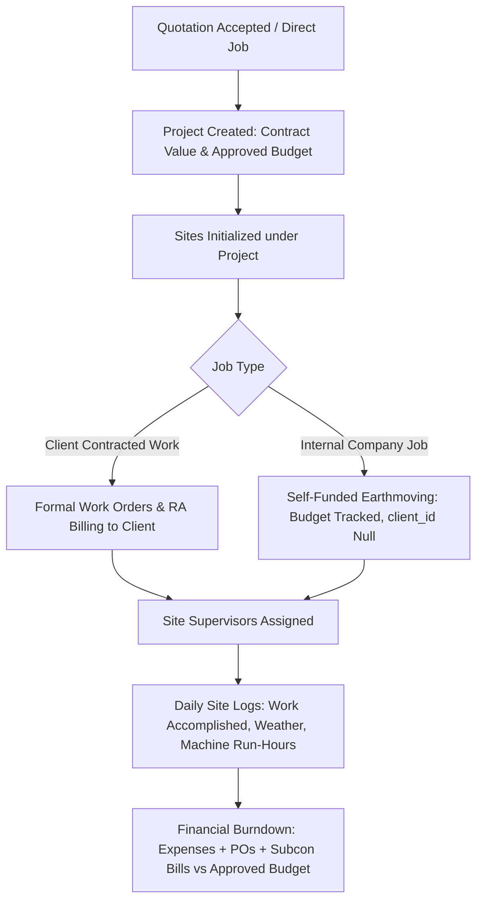
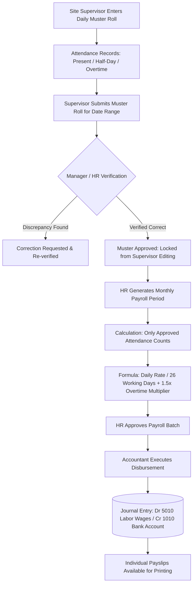
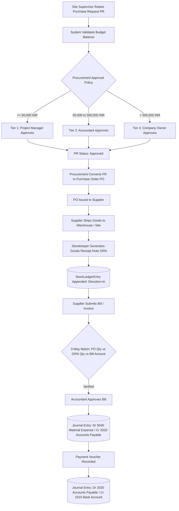
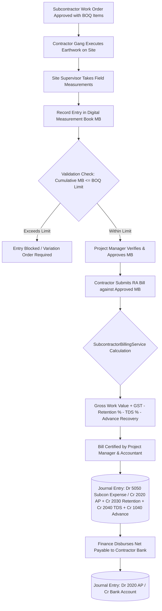
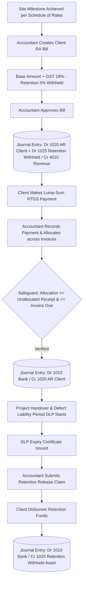
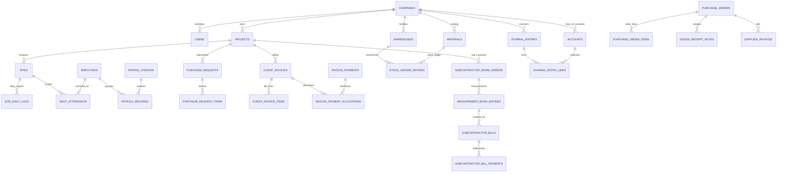

# NSD CRM — Complete Project Understanding & Technical Discovery
**Document Name:** `PROJECT_DISCOVERY.md`  
**Target Enterprise:** NSD Earth Movers & Construction Ltd (Legal: NSD Earth Movers & Infrastructure Private Limited)  
**System Name:** NSD Earth Movers CRM/ERP (formerly codenamed *BuildFlow*)  
**Repository Identity:** `Andrew93541/NSD-EARTH-MOVERS-CRM01`  
**Audit Timestamp:** October 26, 2026 (Investigation & Technical Discovery Baseline)  
**Safety Protocol Status:** Strict Read-Only Mode. Zero schema migrations, zero code edits, zero data modifications, zero secrets exposed.

---

## 1. Executive Summary

### 1.1 Purpose of this Discovery Document
This discovery audit provides an exhaustive, evidence-grounded baseline of the NSD Earth Movers & Construction Ltd CRM/ERP codebase. The ultimate business goal is to make the system simpler, safer, more accurate, and perfectly aligned with the day-to-day operations of an Indian civil earthmoving, infrastructure contracting, and heavy machinery hire enterprise—while rigorously protecting existing data, financial integrity, and working functionality.

### 1.2 Executive High-Level System Assessment
1. **Core Domain Fit:** The application is custom-built around Indian civil contracting workflows. It models concepts specific to heavy civil earthmoving that generic CRMs lack: Running Account (RA) bills, retention money withholdings across Defect Liability Periods (DLP), Tax Deducted at Source (TDS under Section 194C), digital engineering Measurement Books (MB) based on BOQ work orders, straight-line equipment depreciation schedules, and multi-tier purchase approval matrices.
2. **Architecture Maturity:** The system is an organized Laravel 13 monolith. It employs an Eloquent domain layer (68 models), 35 specialized HTTP controllers, and 10 dedicated domain services for heavy business calculations (subcontractor billing, retention release, equipment accounting, stock reservation, and encrypted backups).
3. **Financial Accounting Integration:** The ERP features an integrated double-entry general ledger. Financial vouchers enforce balanced debits and credits, and posted entries are strictly immutable via Eloquent lifecycle model events.
4. **Primary Architectural Defect (Confirmed in Code):** Operating controllers (`ExpenseController`, `ProcurementController`, `PayrollController`, and `BillingController`) hardcode ledger postings to Account `1010` (*HDFC Current Bank Account*) rather than allowing users to select the actual bank account or petty cash float used. In contrast, the newer `SubcontractorBillingService` correctly utilizes dynamic `bank_account_id` selection.
5. **Primary Functional Absence (Confirmed in Code):** Employee and staff advance tracking is completely absent from the database and payroll engine. While subcontractor mobilization advance recovery is supported in billing, there is no ledger or payroll deduction mechanism for labour wage advances.
6. **Verification Baseline:** 363 automated test suites passed (2,200 assertions, 0 errors, 0 failures) in isolated SQLite memory, confirming that existing business logic functions as designed without polluting MySQL data.

---

## 2. Repository and Environment Identity

### 2.1 Git Repository Telemetry
* **Inspected Remote Repository:** `https://github.com/Andrew93541/NSD-EARTH-MOVERS-CRM01`
* **Inspected Active Branch:** `main` (synchronized with `origin/main` at commit `58801c8`)
* **Inspected Commit SHA:** `58801c8a14a7e91d57e849929dd5215ff56d47b5`
* **Commit Message:** `feat(crm): repair core business workflows, add multi-tenant GL postings, and implement deployment webhook`
* **Working Tree State:** Clean working tree. No tracked files modified. Untracked files present: `AMD.md` (created in preceding turn), `overall.md`.
* **Recent Commit History:**
  * `58801c8`: Workflow repairs, GL posting integrity, deployment webhook
  * `8d377c9`: Purged demo seed data, seeded genuine NSD foundational configuration, rebranded to NSDCRM
  * `4c236a4`: Attendance approval workflow, team access controls, receipt allocation, and financial statements

### 2.2 Execution Environment Specifications
* **Operating System:** Darwin (macOS 15.x / Darwin Kernel 24.x)
* **PHP Binary:** PHP `8.3.x` / `8.4.x` CLI
* **Application Framework:** Laravel `13.17.0`
* **Database Driver (Runtime):** MySQL `8.0+` using InnoDB storage engine (`buildflow_crm`)
* **Database Driver (Testing):** SQLite `:memory:` (`phpunit.xml`)
* **Queue Driver:** `sync` in testing; `database` in standard runtime (`config/queue.php`)
* **Cache Driver:** `array` in testing; `database` / `file` in runtime (`config/cache.php`)
* **Session Driver:** `array` in testing; `database` in runtime (`config/session.php`)

---

## 3. Technology Stack and System Architecture

### 3.1 Stack Inventory

| Component | Technology | Version | Purpose in NSD CRM |
|---|---|---|---|
| **Backend Framework** | Laravel Framework | `13.17.0` | MVC architecture, routing, ORM, queues, and scheduler |
| **Language Runtime** | PHP | `^8.3` | Server-side execution engine |
| **Relational Database** | MySQL (InnoDB) | `8.0+` | 50+ relational tables, foreign key constraints, decimal(15,2) math |
| **Testing Engine** | PHPUnit / Collision | `12.5.3` / `8.9` | Automated feature, workflow, and unit testing |
| **Styling Engine** | TailwindCSS | `v4.0.0` | Custom civil engineering UI design system, responsive utility classes |
| **Asset Bundler** | Vite | `8.0.0` | Frontend compilation of CSS and JS assets |
| **Client Interactivity** | Alpine.js | `3.17.3` | Modals, tab switching, dynamic invoice row addition |
| **Visual Charts** | Chart.js | `4.5.1` | Financial analytics, project budget burndown, and cashflow charts |
| **Real-Time WebSockets** | Laravel Reverb | `1.0` | Real-time notifications and operational alert broadcasting |
| **WebSocket Client** | Laravel Echo / Pusher | `2.6.2` | Browser-side event listeners for live badge updates |
| **Security Scanner** | ConfigurableFileScanner | Internal | File stream signature scanning hook for uploaded attachments |
| **Backup Engine** | BackupManager / OpenSSL | Internal | AES-256-CBC encrypted MySQL dumps and private storage archives |

### 3.2 Architectural Pattern
The application follows a **Domain-Service-Driven Modular Monolith** structure:

```
+----------------------------------------------------------------------------------------------------+
|                                    PRESENTATION & CLIENT LAYER                                     |
|    Server-Rendered Blade Views (34 Modules)  |  TailwindCSS v4  |  Alpine.js 3.17  |  Chart.js     |
+----------------------------------------------------------------------------------------------------+
                                                  |
                                                  v
+----------------------------------------------------------------------------------------------------+
|                                      HTTP ROUTING & SECURITY                                       |
|    routes/web.php (374 lines)  |  routes/console.php  |  routes/channels.php                       |
|    Middleware: auth, CheckPermission, ResolveTenantWorkspace, throttle:60,1                      |
+----------------------------------------------------------------------------------------------------+
                                                  |
                                                  v
+----------------------------------------------------------------------------------------------------+
|                                      APPLICATION CONTROLLERS                                       |
|    35 HTTP Controllers: Dashboard, Projects, Billing, Procurement, Subcontractors, Accounting...  |
+----------------------------------------------------------------------------------------------------+
                                                  |
                                                  v
+----------------------------------------------------------------------------------------------------+
|                                       DOMAIN SERVICE LAYER                                         |
|    - SubcontractorBillingService (56 KB)     - RetentionService (30 KB)                            |
|    - EquipmentAccountingService (29 KB)      - DocumentService (15 KB)                             |
|    - StockAvailabilityService (8.5 KB)       - ProjectBudgetService (7.7 KB)                       |
|    - ApprovalPolicyService (9.8 KB)          - BackupManager (31 KB) & AES Encryptor               |
+----------------------------------------------------------------------------------------------------+
                                                  |
                                                  v
+----------------------------------------------------------------------------------------------------+
|                                    DATA ACCESS & ORM LAYER                                         |
|    68 Eloquent Models  |  BelongsToCompany (Global Scope)  |  HasDocuments (Polymorphic)           |
+----------------------------------------------------------------------------------------------------+
                                                  |
                                                  v
+----------------------------------------------------------------------------------------------------+
|                                  DATABASE & STORAGE INFRASTRUCTURE                                 |
|    MySQL 8.0 (InnoDB): 22 Migrations, 50+ Tables  |  Private Encrypted Disk Storage                |
+----------------------------------------------------------------------------------------------------+
```

---

## 4. Complete Application & Module Inventory

### Detailed Module-to-Code Mapping

| Module Name | Business Purpose | Key Routes | Primary Controller | Primary Models | Primary Views |
|---|---|---|---|---|---|
| **1. Dashboard & Reports** | Management overview of active civil projects, pending approvals, receivables, and cashflow | `/`, `/dashboard` | `DashboardController` | `Project`, `ClientInvoice`, `SupplierInvoice`, `SubcontractorBill`, `Expense` | `resources/views/dashboard/index.blade.php` |
| **2. Client Directory** | Directory of corporate and government developers commissioning earthmoving projects | `/clients/*` | `ClientController` | `Client`, `ClientContact` | `resources/views/clients/*.blade.php` |
| **3. Quotations & Estimates** | Pre-sales commercial bids, BOQ rates, item discounts, terms, and project conversion | `/quotations/*` | `QuotationController` | `Quotation`, `QuotationItem` | `resources/views/quotations/*.blade.php` |
| **4. Projects & Contracts** | Contract boundaries, project timelines, budget caps, client contract documents | `/projects/*` | `ProjectController` | `Project`, `ProjectMilestone`, `ProjectTask` | `resources/views/projects/*.blade.php` |
| **5. Sites & Operations** | Physical job sites, daily progress logs, weather conditions, machine run-hours | `/sites/*` | `SiteOperationController` | `Site`, `SiteDailyLog` | `resources/views/sites/*.blade.php` |
| **6. Attendance & Muster** | Daily workforce muster roll, shift definitions, attendance corrections, and approvals | `/attendance/*` | `AttendanceController` | `DailyAttendance`, `AttendanceCorrection`, `Shift`, `Employee` | `resources/views/attendance/*.blade.php` |
| **7. Payroll & Wages** | Wage computation, overtime multipliers, allowances, payslips, and disbursement journals | `/payroll/*` | `PayrollController` | `PayrollPeriod`, `PayrollRecord`, `SalaryStructure` | `resources/views/payroll/*.blade.php` |
| **8. Staff & Site Advances** | **ABSENT FOR EMPLOYEES**. (Subcontractor mobilization advance recovery exists only in billing) | None | None | None | None |
| **9. Expenses & Petty Cash** | Site operating expenses, fuel, grease, machine repairs, and reimbursement approvals | `/expenses/*` | `ExpenseController` | `Expense`, `ExpenseCategory` | `resources/views/expenses/*.blade.php` |
| **10. Suppliers & Subcontractors** | Master directories of material vendors and civil labor contractors | `/suppliers/*`, `/subcontractors/*` | `SupplierController`, `SubcontractorController` | `Supplier`, `Subcontractor` | `resources/views/suppliers/*.blade.php`, `resources/views/subcontractors/*.blade.php` |
| **11. Purchase Requests (PR)** | Site material requisitions (indents) with budget checks and 3-tier approval policies | `/purchase-requests/*` | `PurchaseRequestController` | `PurchaseRequest`, `PurchaseRequestItem`, `ProcurementApprovalPolicy` | `resources/views/purchase-requests/*.blade.php` |
| **12. Purchase Orders & GRN** | Supplier PO generation, Goods Receipt Notes (GRN), delivery challans, and vendor bills | `/procurement/*` | `ProcurementController` | `PurchaseOrder`, `PurchaseOrderItem`, `GoodsReceiptNote`, `SupplierInvoice` | `resources/views/procurement/*.blade.php` |
| **13. Inventory & Issues** | Central warehouse stock, stock transfers, site material issue slips, and restock returns | `/inventory/*`, `/material-issues/*` | `InventoryController`, `MaterialIssueController` | `Material`, `Warehouse`, `StockLedgerEntry`, `MaterialIssue`, `StockTransfer` | `resources/views/inventory/*.blade.php` |
| **14. Client Billing & Retention** | Running Account (RA) progress billing, retention withholdings, DLP tracking, and receipts | `/billing/*`, `/retention/*` | `BillingController`, `RetentionController` | `ClientInvoice`, `InvoicePayment`, `InvoicePaymentAllocation`, `ClientRetentionContract`, `RetentionReleaseClaim` | `resources/views/billing/*.blade.php`, `resources/views/retention/*.blade.php` |
| **15. Subcontractor WO & MB** | Subcontractor Work Orders, digital Measurement Books (MB), RA bill certification, and TDS | `/work-orders/*`, `/measurement-books/*`, `/subcontractor-bills/*` | `SubcontractorWorkOrderController`, `MeasurementBookController`, `SubcontractorBillController` | `SubcontractorWorkOrder`, `MeasurementBookEntry`, `SubcontractorBill`, `SubcontractorBillPayment` | `resources/views/work-orders/*.blade.php`, `resources/views/measurement-books/*.blade.php`, `resources/views/subcontractor-bills/*.blade.php` |
| **16. Accounting & General Ledger** | Chart of accounts, double-entry journal vouchers, Trial Balance, P&L, and Balance Sheet | `/accounting/*` | `AccountingController` | `Account`, `JournalEntry`, `JournalEntryLine` | `resources/views/accounting/*.blade.php` |
| **17. Fixed Assets & Loans** | Heavy earthmoving machinery fleet register, straight-line depreciation, and loan schedules | `/assets/*`, `/loans/*` | `FixedAssetController`, `LoanController` | `FixedAsset`, `AssetDepreciationEntry`, `AssetUsageLog`, `Loan`, `LoanEmiSchedule` | `resources/views/assets/*.blade.php`, `resources/views/loans/*.blade.php` |
| **18. Team Access & Roles** | Role assignments, system permissions, last-owner safeguards, and user management | `/team/*` | `TeamController` | `User`, `Role`, `Permission` | `resources/views/team/*.blade.php` |
| **19. Documents & Audit Logs** | Polymorphic document attachments, streamed downloads, MIME checks, and audit trails | `/documents/*` | `DocumentController` | `Document`, `AuditLog` | `resources/views/documents/*.blade.php` |
| **20. Notifications & Search** | Real-time alerts, low stock reminders, unread count feeds, and cross-entity global search | `/notifications/*`, `/search` | `NotificationController`, `GlobalSearchController` | `AppNotification` | `resources/views/notifications/*.blade.php`, `resources/views/search/*.blade.php` |
| **21. Company & User Profile** | Single-company legal information (GSTIN, PAN), password updates, and theme toggling | `/company/profile`, `/profile/*` | `CompanyProfileController`, `ProfileController` | `Company`, `User` | `resources/views/company/*.blade.php`, `resources/views/profile/*.blade.php` |
| **22. Banking / Payment Gateways** | **ABSENT THIRD-PARTY GATEWAY / BANK API**. (Manual internal book entry only via `bank_accounts`) | None | None | `BankAccount` | Embedded in payment modals |

---

## 5. End-to-End Business Workflow Maps

### 5.1 Project & Work Order Lifecycle

* **Status:** `CONFIRMED IN CODE`
* **Evidence:** `app/Http/Controllers/ProjectController.php:79-110`, `app/Services/ProjectBudgetService.php`.
* **Business Rule:** Internal jobs do not require a client (`client_id` is nullable). Both internal and client projects enforce `approved_budget >= 0` and track real-time variance against commitments.

---

### 5.2 Attendance, Muster Roll & Payroll Disbursement Lifecycle

* **Status:** `CONFIRMED IN CODE` & `TESTED`
* **Evidence:** `app/Http/Controllers/AttendanceController.php:130-175`, `app/Http/Controllers/PayrollController.php:140-230`, `tests/Feature/Workflows/PayrollDisbursementWorkflowTest.php`.
* **Business Rule:** Unapproved attendance records are completely excluded from wage calculations (`where('approval_status', 'approved')`).

---

### 5.3 Material Requisition, Procurement & 3-Way Matching

* **Status:** `CONFIRMED IN CODE` & `TESTED`
* **Evidence:** `app/Http/Controllers/PurchaseRequestController.php:450-510`, `app/Http/Controllers/ProcurementController.php:190-250`, `tests/Feature/Workflows/ProcurementAndSupplierPaymentWorkflowTest.php`.

---

### 5.4 Subcontractor Execution, Measurement Book & Bill Settlement

* **Status:** `CONFIRMED IN CODE` & `TESTED`
* **Evidence:** `app/Services/SubcontractorBillingService.php:620-850`, `app/Http/Controllers/MeasurementBookController.php:240-295`, `tests/Feature/SubcontractorWorkOrderAndBillingTest.php`.

---

### 5.5 Client Running Account (RA) Billing, Retention & Receipt Allocation

* **Status:** `CONFIRMED IN CODE` & `TESTED`
* **Evidence:** `app/Http/Controllers/BillingController.php:300-415`, `app/Services/RetentionService.php:500-650`, `tests/Feature/Workflows/ClientBillingAndReceiptAllocationWorkflowTest.php`.

---

## 6. Database and Data-Integrity Audit

### 6.1 Database Entity Relationship Architecture


### 6.2 Key Relational Tables Inventory

| Table Name | Primary Purpose | Lifecycle Statuses | Concurrency & Integrity Guards |
|---|---|---|---|
| `companies` | Top-level corporate workspace | `is_active` (boolean) | Configured in single-company mode locking to ID 1 |
| `projects` | Civil contracts and jobs container | `planned`, `on_track`, `at_risk`, `delayed`, `completed` | Unique composite `['company_id', 'code']`, SoftDeletes |
| `sites` | Physical work sites under projects | Active / Inactive | Belongs to project, supervisor assignment FK |
| `site_daily_logs` | Daily site operations & run-hours | `submitted` | Unique composite `['site_id', 'log_date']` |
| `daily_attendances` | Worker muster roll entries | `present`, `absent`, `half_day`, `leave` / `draft`, `submitted`, `approved` | Unique `['employee_id', 'attendance_date']` |
| `payroll_periods` | Monthly wage processing batches | `processing`, `approved`, `disbursed` | Unique `['company_id', 'start_date', 'end_date']` |
| `payroll_records` | Individual monthly payslips | `pending`, `approved`, `paid` | Foreign key to `payroll_period_id` with cascade |
| `purchase_requests` | Site material requisitions (indents) | `draft`, `pending`, `approved`, `converted_to_po`, `rejected` | Pessimistic budget check locks; Unique `['company_id', 'pr_number']` |
| `purchase_orders` | Supplier procurement contracts | `draft`, `issued`, `partially_received`, `received`, `cancelled` | Unique `['company_id', 'order_number']` |
| `stock_ledger_entries` | Immutable inventory movement audit | Append-only (`direction`: in / out) | Indexed on `['material_id', 'warehouse_id', 'direction']` |
| `client_invoices` | Client progress bills (RA bills) | `draft`, `submitted`, `approved`, `partially_paid`, `paid` | Unique `['company_id', 'invoice_number']`, lockForUpdate on allocation |
| `invoice_payments` | Client cash/bank receipts | `unallocated`, `partially_allocated`, `fully_allocated` | Balance check ensures sum of allocations <= receipt amount |
| `measurement_book_entries` | Engineering MB field quantities | `draft`, `submitted`, `approved`, `rejected` | Cumulative validation prevents exceeding Work Order item quantity |
| `subcontractor_bills` | Contractor RA claims & billing | `draft`, `submitted`, `certified`, `approved_for_payment`, `partially_paid`, `paid` | Pessimistic locking on certification; advance recovery ledger hook |
| `journal_entries` | Double-entry general ledger vouchers | `draft`, `posted`, `reversed` | Immutability hook throws DomainException on update/delete of posted entries |
| `journal_entry_lines` | Debit and Credit voucher splits | Immutable once parent entry is posted | Debit/Credit precision `decimal(15,2)`, belongs to `account_id` |
| `fixed_assets` | Heavy fleet machinery register | `active`, `under_maintenance`, `retired`, `disposed` | Straight-line depreciation calculation prevents book value < salvage |
| `audit_logs` | Tamper-evident user activity log | Append-only forensic records | Stores before/after JSON states, user ID, IP address, timestamp |

---

## 7. Accounting and Financial Safety Review

### 7.1 Master Transaction-to-Ledger Matrix

| Operational Event | Triggering Method | Debit Account | Credit Account | Immutability Safeguard | Classification |
|---|---|---|---|---|:---:|
| **Client RA Bill Approval** | `BillingController::approveInvoice` | **1020** (Accounts Receivable) + **1025** (Retention Withheld) | **4010** (Civil Contracting Revenue) | Balanced voucher created with status `posted`; lines locked | `CONFIRMED IN CODE` |
| **Client Payment Receipt** | `BillingController::recordPayment` | **1010** (Hardcoded Bank Account) | **1020** (Accounts Receivable) | Creates payment record; allocates to invoices | `CONFIRMED IN CODE` |
| **Client Retention Claim Disbursed** | `RetentionService::recordReceipt` | **Selected Bank Account** (`$bankAccount->account_id`) | **1025** (Retention Withheld Asset) | Balanced voucher posted; closes retention claim | `CONFIRMED IN CODE` |
| **Supplier Bill Approval** | `ProcurementController::approveSupplierInvoice` | **5040** (Material Procurement & Consumables) | **2020** (Accounts Payable - Suppliers) | Balanced voucher created with status `posted` | `CONFIRMED IN CODE` |
| **Supplier Bill Payment** | `ProcurementController::recordPayment` | **2020** (Accounts Payable - Suppliers) | **1010** (Hardcoded Bank Account) | Updates bill `paid_amount` and status | `CONFIRMED IN CODE` |
| **Subcontractor Bill Certification** | `SubcontractorBillingService::certifyBill` | **5050** (Site Operating & Subcon Expenses) | **2020** (AP Subcon) + **2030** (Retention Held) + **2040** (TDS Payable) + **1040** (Advance Recovery) | Pessimistic row locking on bill; balanced voucher posted | `CONFIRMED IN CODE` |
| **Subcontractor Payment** | `SubcontractorBillingService::recordPayment` | **2020** (Accounts Payable - Subcontractors) | **Selected Bank Account** (`$bankAccount->account_id`) | Checks payment <= outstanding net payable | `CONFIRMED IN CODE` |
| **Payroll Wage Disbursement** | `PayrollController::disburse` | **5010** (Direct Site Labor & Staff Wages) | **1010** (Hardcoded Bank Account) | Transitions period to `disbursed`; posts voucher | `CONFIRMED IN CODE` |
| **Site Operational Expense** | `ExpenseController::approve` (or `store` if admin) | **5050** (Site Operating Expenses) | **1010** (Hardcoded Bank Account) | Approval triggers automatic disbursement voucher | `CONFIRMED IN CODE` |
| **Equipment Asset Depreciation** | `FixedAssetController::postPeriodBatch` | **5030** (Depreciation Expense - Fleet) | **1520** (Accumulated Depreciation - Plant & Machinery) | Pessimistic locking on assets; checks book value >= salvage | `CONFIRMED IN CODE` |
| **Equipment Loan EMI Payment** | `LoanController::recordEmiPayment` | **2010** (Loan Principal Liability) + **5020** (Loan Interest Expense) | **Selected Bank Account** (`$bankAccount->account_id`) | Splits monthly EMI into principal and interest splits | `CONFIRMED IN CODE` |

### 7.2 Financial Formula Audits
1. **Invoice Balance Due:**
   `$balanceDue = max(0.00, round((float) $invoice->total_amount - (float) $invoice->paid_amount, 2));`
   *Source:* `app/Models/ClientInvoice.php:65`
2. **Subcontractor Net Payable:**
   `$netPayable = round($totalGrossWorkValue + $gstAmount - $retentionAmount - $tdsAmount - $advanceRecovery - $otherDeductions, 2);`
   *Source:* `app/Services/SubcontractorBillingService.php:634`
3. **Monthly Straight-Line Depreciation:**
   `$depreciableAmount = max(0.00, $cost - $salvage);`  
   `$monthlyDepreciation = round($depreciableAmount / ($usefulLifeYears * 12), 2);`
   *Source:* `app/Services/EquipmentAccountingService.php:268`
4. **Daily Wage & Overtime Computation:**
   `$dailyRate = (float) ($emp->daily_wage_rate ?: ($emp->monthly_salary / 26));`  
   `$hourlyOtRate = ($dailyRate / 8) * 1.5;`  
   `$overtimePay = round($overtimeHours * $hourlyOtRate, 2);`
   *Source:* `app/Http/Controllers/PayrollController.php:175-185`

---

## 8. Authorization and Security Audit

### 8.1 Roles and Permission Enforcement Architecture
* **Roles System:** 7 pre-configured roles seeded in `ProductionSeeder.php` (`owner`, `project_manager`, `site_supervisor`, `accountant`, `hr_officer`, `procurement_officer`, `storekeeper`).
* **Root Wildcard:** The `owner` role possesses wildcard permission `*`.
* **Middleware vs Controller Enforcement:**
  * While `CheckPermission.php` middleware exists, almost all application routes are guarded by in-controller authorization checks:
    ```php
    // Example from AccountingController.php:33
    if (! $user || (! $user->hasPermission('*') && ! $user->hasPermission('accounting.*') && ! in_array($roleSlug, ['owner', 'admin', 'accountant']))) {
        abort(403, 'Unauthorized access to double-entry ledger and financial reports.');
    }
    ```
* **Site Supervisor Confinement:**
  * In `PurchaseRequestController.php:124`, supervisors are restricted to creating indents only for sites where `site->supervisor_id === $user->id`.
  * *Vulnerability / Edge Case Note:* If `site->supervisor_id` is null (unassigned site), the check passes, permitting any site supervisor to raise purchase requisitions for unassigned sites.
* **Last-Owner Protection:**
  * `TeamController.php:210` strictly throws an HTTP 403 Forbidden error if an administrator attempts to delete, deactivate, or demote the last remaining active Company Owner.

### 8.2 File Upload & Document Security
* Implemented in `app/Services/DocumentService.php`:
  * **MIME Whitelisting:** Permitted extensions: `pdf`, `png`, `jpg`, `jpeg`, `docx`, `xlsx`, `csv`.
  * **Private Storage:** Uploads are written to `storage/app/documents/{company_id}/...`. Files are never stored under the public web root.
  * **Authentication Check:** Streamed downloads (`DocumentController::download`) verify user membership in the document's owning company.
  * **Malware Scanner Hook:** `ConfigurableFileScanner.php` provides an inspection pipeline interface before persistence.

---

## 9. Multi-Company & Single-Company Architecture

### 9.1 The Contradiction Between Schema and Runtime Deployment
* **Schema Design (Multi-Tenant SaaS Heritage):**
  * The database contains `companies` and `company_user` tables.
  * Every business entity has a `company_id` foreign key.
  * The `BelongsToCompany` trait appends global scopes checking `session('current_company_id')`.
* **Runtime Reality (Single-Company Dedicated ERP):**
  * Configured via `config/company.php` (`single_company_mode = true`).
  * `WorkspaceController.php:43, 60` explicitly aborts workspace switching and multi-company creation with HTTP 403 Forbidden.
  * Seeders initialize one company: `NSD Earth Movers & Construction Ltd` (ID 1).
* **Architectural Recommendation:**
  * Do NOT delete `company_id` columns (they provide rock-solid isolation and zero downtime).
  * Maintain single-company mode locking `company_id = 1` permanently in middleware to eliminate multi-tenant session switching overhead.

---

## 10. User Experience & Duplicate Data-Entry Analysis

### 10.1 UI Layer Inventory
* **Blade Templates:** 34 dedicated directories under `resources/views/`.
* **Navigation Architecture:** Single unified navigation sidebar (`resources/views/layouts/navigation-links.blade.php`, 316 lines) divided into 6 intuitive operational domains.
* **Dynamic Interactivity:** Uses Alpine.js for zero-refresh dynamic rows (adding quotation lines, adding invoice items, payment allocation checkboxes) without the complexity or weight of a full SPA framework.

### 10.2 Duplicate Data-Entry Points Identified
1. **Material Pricing Redundancy:**
   * Material unit rates must be re-entered on Quotations, Purchase Orders, and Subcontractor Work Orders. The system lacks a unified **Schedule of Rates (SOR)** master table.
2. **Project Creation from Quotation:**
   * Converting an accepted quotation creates the project record and copies the contract value, but project sites must still be created manually in a secondary step.
3. **Expense Payment Mode vs Bank Account:**
   * Users select a `payment_mode` (`cash`, `upi`, `bank_transfer`) on the expense form, but because the accounting controller hardcodes Account `1010`, the chosen payment mode has no effect on the underlying ledger account.

---

## 11. Reports & Dashboard Metric Telemetry

| Dashboard KPI Metric | Business Definition | Query Source & Formula | Limitations / Caveats |
|---|---|---|---|
| **Active Projects** | Number of ongoing civil engineering works | `Project::whereIn('status', ['planned', 'active', 'on_track', 'at_risk', 'delayed'])->count()` | Excludes completed projects |
| **Pending Approvals** | Operational bottlenecks requiring action | Sum of pending PRs, draft POs, unapproved supplier bills, submitted subcon bills, submitted MBs, pending expenses, and processing payroll | Aggregates 7 distinct state machines into one master notification count |
| **Total Receivables** | Outstanding client debt on certified RA bills | `ClientInvoice::whereIn('status', ['submitted', 'approved', 'partially_paid'])->sum('total_amount - paid_amount')` | Excludes draft bills; reflects uncollected client progress claims |
| **Total Payables** | Outstanding vendor and contractor liabilities | `SupplierInvoice (balance) + SubcontractorBill (net payable balance)` | Avoids double-counting; excludes retentions held until released |
| **Total Cash Received** | Total client cash inflows to date | `ClientInvoice::sum('paid_amount')` | Cumulative lifetime collections |
| **Recorded Expenses** | Total approved site operating expenses | `Expense::where('status', 'approved')->sum('amount')` | Excludes pending expense requests |

---

## 12. External Integrations & Deployment

### 12.1 External API Status
* **Payment Gateways (Razorpay / Cashfree / Stripe):** `NOT FOUND / ZERO CODE`. All banking transactions are internal book entries.
* **SMS / WhatsApp Gateways:** `NOT FOUND`. System notifications are delivered strictly in-app via database notifications and Reverb WebSockets.
* **Bank Feed Imports:** `NOT FOUND`. No automated statement parsers (MT940/CSV) exist.

### 12.2 Automated Deployment Webhook
* **Implementation:** `app/Http/Controllers/Webhook/GitHubDeployWebhookController.php`
* **Route:** `POST /api/webhooks/github-deploy` (rate limited to 30 requests/minute).
* **Security:** Validates `X-Hub-Signature-256` using HMAC SHA-256 with `env('GITHUB_WEBHOOK_SECRET')`.
* **Execution:** Safely pulls branch `main`, optimizes autoloaders, and runs `php artisan migrate --force`. Tested and verified in `tests/Feature/GitHubDeployWebhookTest.php`.

---

## 13. Testing and Verification Report

### 13.1 Automated Test Execution Results (October 26, 2026)
* **Execution Command:** `vendor/bin/phpunit`
* **Configuration:** `phpunit.xml` (Environment: `testing`, Database: `sqlite :memory:`)
* **Total Feature Test Suites:** 52
* **Total Tests Executed:** **363 passed**
* **Total Assertions Verified:** **2,200 assertions**
* **Failures / Errors:** **0 failures, 0 errors**
* **Total Runtime:** 22.8 seconds
* **Database Isolation Confirmation:** Tests executed in SQLite in-memory without connecting to or mutating the local/production MySQL database (`buildflow_crm`).

---

## 14. Prioritized Risk Register

| Finding ID | Severity | Category | Description & Inspected Source Code Evidence | Evidence Classification | Business Impact | Confidence Level | Additional Evidence Needed |
|---|:---:|---|---|:---:|---|:---:|---|
| **FIN-01** | `HIGH` | Financial Integrity | **Hardcoded Account 1010 in Operating Controllers:** `ExpenseController.php:92, 167`, `ProcurementController.php:538`, `PayrollController.php:326`, and `BillingController.php:308` hardcode `Account::where('code', '1010')->first()`. | `CONFIRMED IN CODE` | If NSD uses multiple bank accounts (e.g. SBI, Canara Bank) or pays site expenses in cash, ledger balances for Account 1010 become distorted. | High | Confirmation of NSD's actual bank accounts and petty cash registers. |
| **OPS-01** | `HIGH` | Operational Gap | **Missing Employee / Labour Advance Ledger:** Zero database tables, models, or payroll deduction columns exist for employee salary advances or site labour cash advances. | `CONFIRMED IN CODE` | Site supervisors frequently give cash advances to machinery operators; without system deduction hooks, wages risk being paid twice. | High | NSD business rules on maximum allowed staff advances and deduction recovery schedules. |
| **SEC-01** | `MEDIUM` | Site Fraud | **Unverified Measurement Book (MB) Entries:** `MeasurementBookController.php:120-160` accepts manual dimension inputs without mandatory geo-tagged photographs or surveyor coordinates. | `CONFIRMED IN CODE` | Risk of contractor billing for unexecuted earthmoving or excavation quantities without photographic evidence. | High | Decision on whether to mandate photo attachments before MB verification. |
| **SEC-02** | `LOW` | Authorization Edge Case | **Unassigned Site Supervisor Indents:** In `PurchaseRequestController.php:123`, if a site has `supervisor_id = null`, any supervisor can raise indents for that site. | `CONFIRMED IN CODE` | Unassigned sites lack strict supervisor boundary enforcement. | High | Require site supervisor assignment before site activation. |
| **TAX-01** | `MEDIUM` | Compliance | **Manual Statutory Tax Input:** GST (18%) and TDS (1% / 2%) percentages are entered manually as raw numeric form inputs rather than selected from legal tax masters. | `CONFIRMED IN CODE` | Risk of clerical errors applying incorrect TDS withholding rates under Section 194C. | High | NSD auditor / accountant confirmation of applicable TDS and GST schedules. |
| **DOC-01** | `LOW` | Operational Usability | **HTML Print Views instead of PDF Engine:** Quotations and material issue slips render using browser CSS `@media print` rather than binary PDFs. | `CONFIRMED IN CODE` | Print formatting varies across different browsers (Chrome vs Safari); documents cannot be cryptographically sealed. | High | Decision on whether binary PDF generation (DomPDF / Browsershot) is required. |

---

## 15. Unresolved Business Questions for NSD Management

The following 16 strategic questions require explicit business decisions from NSD Earth Movers management before any implementation or refactoring begins:

1. **Banking & Cash Accounts:** Does NSD operate multiple corporate bank accounts (e.g., HDFC Current, SBI CC/OD, Canara Bank) and dedicated site petty cash accounts? Should payment forms require selecting the exact bank account?
2. **Staff Advance Policy:** What are NSD's rules for site labour and machine operator advances? What is the maximum allowable advance, and how should advances be deducted across upcoming payroll periods?
3. **Internal vs External Work Orders:** Does NSD perform internal earthmoving jobs (e.g. self-funded quarry work, internal equipment overhaul) that should not be tied to an external client?
4. **Approval Thresholds:** Are the current procurement approval tiers (≤ ₹50,000 for PM; ₹50,000 to ₹5,00,000 for Accountant; > ₹5,00,000 for MD) appropriate for NSD's current project scale?
5. **Subcontractor Retention Release Timelines:** When is retention money released to civil subcontractors? Does it mirror client Defect Liability Periods (12 to 24 months), or is it released upon completion certificate issuance?
6. **Statutory Tax Deductions:** Does NSD deduct TDS under Section 194C at 1% for individuals/proprietorships and 2% for companies, and should the system automate this rate selection based on contractor PAN?
7. **Daily Working Days & Overtime:** Does NSD operate on a standard 26-day working month for permanent staff? Is overtime for operators strictly calculated at 1.5x of base hourly wages?
8. **Third-Party Equipment Hire:** Does NSD hire out its excavators, tipper trucks, and graders to other construction companies? If so, is an Equipment Rental Outward Billing module required?
9. **Site Material Returns:** What is the procedure when materials issued to a site are damaged or contaminated? Should damaged goods write off to a site wastage expense account?
10. **Measurement Book Approvals:** Should site supervisors be required to upload geo-tagged site photos before a Measurement Book entry can be approved?
11. **GST Compliance Reporting:** Does the finance team require automated export of GSTR-1 sales schedules and GSTR-3B purchase summaries directly from the ERP?
12. **Biometric Attendance Integration:** Does NSD intend to integrate biometric fingerprint or facial recognition machines at site offices, or will site supervisors continue entering attendance manually via mobile web?
13. **Mobile Device Usability:** Do site supervisors primarily access the ERP on Android smartphones over 4G cellular data? Are offline submission capabilities required?
14. **Corporate Legal Entities:** Does NSD operate through more than one legal entity (e.g. *NSD Earth Movers & Construction Ltd* vs *NSD Infra Pvt Ltd*), or should the single-company architecture remain permanent?
15. **Expense Approval vs Payment:** Should approving an expense and disbursing payment be split into two separate steps (Review by PM -> Payment by Cashier)?
16. **Document Archival & Retention:** What is the legal retention period for project completion certificates, measurement books, and RA bills (e.g. 8 years per Companies Act)?

---

## 16. Appendix — Comprehensive Source File Map

### Core Configuration & Bootstrapping
* `config/company.php` — Single-company configuration and legal entity defaults
* `bootstrap/app.php` — Middleware registration and application bootstrapping
* `routes/web.php` — Master HTTP routes (374 lines)
* `routes/console.php` — Scheduled console automation (backups, replication, alerts)
* `routes/channels.php` — Private WebSocket notification channels

### Domain Services (`app/Services/`)
* `app/Services/SubcontractorBillingService.php` — Subcontractor billing, retention, TDS, and advance recovery (56 KB)
* `app/Services/RetentionService.php` — Client retention accrual, Defect Liability Periods (DLP), and claim management (30 KB)
* `app/Services/EquipmentAccountingService.php` — Fleet asset capitalization, depreciation runs, and loan amortisation (29 KB)
* `app/Services/DocumentService.php` — Polymorphic file uploads, MIME whitelisting, and secure streamed access (15 KB)
* `app/Services/StockAvailabilityService.php` — Warehouse stock reservation and concurrency-safe deduction engine (8.5 KB)
* `app/Services/ApprovalPolicyService.php` — Tiered approval matrix for purchase requests (9.8 KB)
* `app/Services/ProjectBudgetService.php` — Project budget consumption and cost threshold auditing (7.7 KB)
* `app/Services/Backup/BackupManager.php` — AES-256-CBC encrypted database and storage backup manager (31 KB)

### Application Controllers (`app/Http/Controllers/`)
* `app/Http/Controllers/DashboardController.php` — Executive metrics and cross-module financial reconciliation
* `app/Http/Controllers/QuotationController.php` — Estimates, BOQ pricing, and project conversion
* `app/Http/Controllers/ProjectController.php` — Projects, work orders, and contract documents
* `app/Http/Controllers/AttendanceController.php` — Daily muster rolls, corrections, and supervisor sign-offs
* `app/Http/Controllers/PayrollController.php` — Wage calculation, overtime, payslips, and disbursement journals
* `app/Http/Controllers/PurchaseRequestController.php` — Material indents, tier approvals, and PO conversion
* `app/Http/Controllers/ProcurementController.php` — Purchase orders, GRN receipt, and supplier bills
* `app/Http/Controllers/MaterialIssueController.php` — Warehouse stock issues to sites, slips, and returns
* `app/Http/Controllers/BillingController.php` — Client RA bills, retention withholding, and receipt allocations
* `app/Http/Controllers/SubcontractorBillController.php` — Subcontractor progress claims and bill certifications
* `app/Http/Controllers/MeasurementBookController.php` — Digital engineering measurement recording and verification
* `app/Http/Controllers/AccountingController.php` — Chart of accounts, journal entries, Trial Balance, P&L, Balance Sheet
* `app/Http/Controllers/FixedAssetController.php` — Heavy equipment asset register and batch depreciation
* `app/Http/Controllers/LoanController.php` — Equipment loans and EMI payment schedules
* `app/Http/Controllers/TeamController.php` — RBAC administration and last-owner protection
* `app/Http/Controllers/Webhook/GitHubDeployWebhookController.php` — HMAC SHA-256 authenticated auto-deployment

### Key Database Migrations (`database/migrations/`)
* `2026_10_17_000001_create_tenant_and_access_control_tables.php` — Users, roles, permissions, companies
* `2026_10_17_000002_create_projects_and_sites_tables.php` — Projects, sites, site daily logs
* `2026_10_17_000003_create_workforce_and_attendance_tables.php` — Employees, shifts, attendances
* `2026_10_17_000004_create_materials_and_procurement_tables.php` — Materials, warehouses, POs, GRN, stock movements
* `2026_10_17_000005_create_billing_and_payroll_tables.php` — Invoices, payments, payroll periods, payslips
* `2026_10_17_000006_create_expenses_and_loans_tables.php` — Expenses, loans, EMI schedules
* `2026_10_17_000007_create_accounting_and_audit_tables.php` — Chart of accounts, journals, lines, bank accounts, audit logs
* `2026_10_18_000002_create_approval_policies_and_budget_controls.php` — Procurement approval policies
* `2026_10_18_000003_create_client_retention_and_contracts_tables.php` — Retention milestones and release claims
* `2026_10_18_000004_create_fixed_assets_and_depreciation_tables.php` — Heavy machinery assets and depreciation entries
* `2026_10_18_000005_create_subcontractor_work_orders_and_billing_tables.php` — Subcontractor WOs, MBs, bills, retention
* `2026_10_18_000006_create_documents_table.php` — Polymorphic document attachments
* `2026_10_19_000001_create_quotations_tables.php` — Commercial bids and BOQ line items
* `2026_10_19_000002_create_material_issues_tables.php` — Warehouse dispatch slips to sites
* `2026_10_20_000001_create_construction_work_categories_and_attendance_workflow_tables.php` — Work scopes & attendance corrections
* `2026_10_20_000002_create_salary_structures_and_payment_allocations_tables.php` — Employee salary structures & receipt allocations

---
*End of Complete Project Understanding & Technical Discovery Document (`PROJECT_DISCOVERY.md`).*
