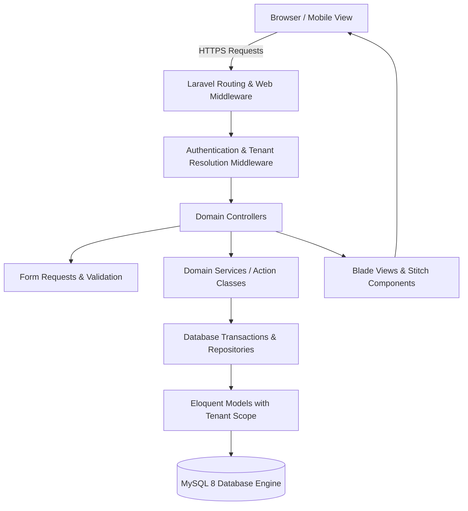

# BUILDFLOW — SYSTEM ARCHITECTURE & DESIGN SPECIFICATION

## 1. Architectural Philosophy
BuildFlow is designed as a modular, maintainable, single-tenant / multi-company Laravel monolith. It follows domain-driven principles within standard Laravel conventions to ensure maximum developer ergonomics, high performance, and strict transactional data integrity.

### Key Tenets
1. **Tenant Isolation by Construction**: Every domain entity (Projects, Sites, Employees, Inventory, Invoices, Accounts) is explicitly owned by a `company_id`. All Eloquent queries are scoped to the active tenant via global query scopes and middleware assertions.
2. **Explicit Double-Entry Principles**: 
   - Financial ledger entries must balance (`SUM(debit) == SUM(credit)`).
   - Stock ledger entries must balance (`source_warehouse -> destination_warehouse` or `supplier -> warehouse`).
3. **Auditability & Non-Destructive Corrections**:
   - Raw biometric attendance punches are immutable. Corrections create adjustment entries referencing the original punch.
   - Posted financial transactions and stock movements cannot be hard-deleted or silently mutated. Reversals create explicit offset entries.
4. **Fidelity to Stitch Design System**:
   - The user interface faithfully mirrors the approved Google Stitch screens for BuildFlow Construction CRM.

---

## 2. Layered Architecture



### Core Subsystems
- **Tenant Management**: Multi-company workspaces with custom roles and permission gates.
- **Projects & Sites**: Project milestones, daily logs, muster counts, subcontractor work orders.
- **Human Resources & Attendance**: Employees, contractors, biometric punch imports, muster rolls, deterministic payroll.
- **Supply Chain & Inventory**: Multi-warehouse stock tracking, stock transfers, purchase orders, 3-way invoice matching.
- **Billing & Receivables**: Running Account (RA) bills, retention tracking, payment allocations.
- **Financial Accounting**: Configurable chart of accounts, journal vouchers, bank reconciliation, GST reporting.
- **Loans & Equipment Finance**: Asset financing, loan amortizations, monthly EMI tracking.

---

## 3. Directory Layout
```
app/
├── Http/
│   ├── Controllers/
│   │   ├── Auth/
│   │   ├── DashboardController.php
│   │   ├── ProjectController.php
│   │   ├── SiteOperationController.php
│   │   ├── AttendanceController.php
│   │   ├── EmployeeController.php
│   │   ├── InventoryController.php
│   │   ├── ProcurementController.php
│   │   ├── BillingController.php
│   │   ├── ExpenseController.php
│   │   ├── LoanController.php
│   │   └── AccountingController.php
│   ├── Middleware/
│   │   ├── ResolveTenantWorkspace.php
│   │   └── EnforceRolePermission.php
│   └── Requests/
├── Models/
│   ├── Scopes/TenantScope.php
│   ├── Company.php
│   ├── User.php
│   ├── Project.php
│   ├── Site.php
│   ├── Employee.php
│   ├── AttendancePunch.php
│   ├── DailyAttendance.php
│   ├── Material.php
│   ├── Warehouse.php
│   ├── StockLedgerEntry.php
│   ├── PurchaseOrder.php
│   ├── SupplierInvoice.php
│   ├── ClientInvoice.php
│   ├── Account.php
│   ├── JournalEntry.php
│   └── Loan.php
├── Services/
│   ├── InventoryLedgerService.php
│   ├── PayrollCalculationService.php
│   ├── DoubleEntryAccountingService.php
│   └── EmiCalculationService.php
```
