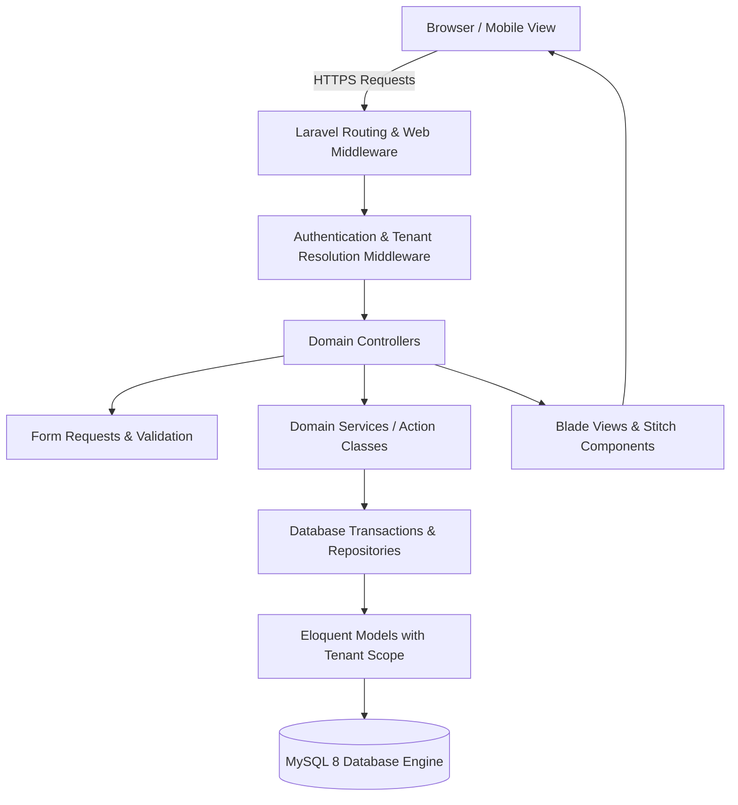
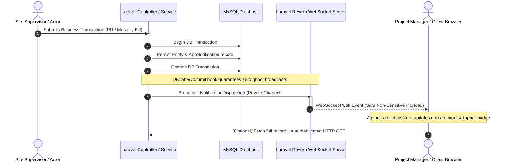
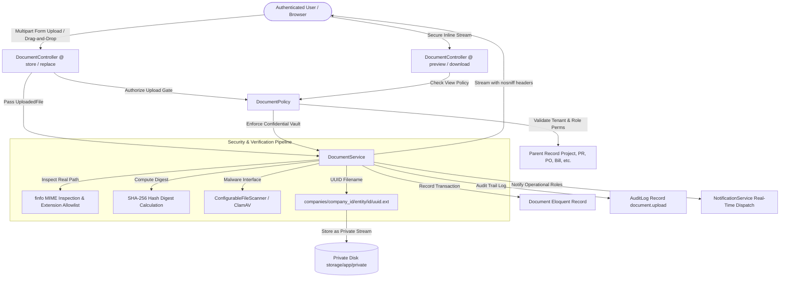
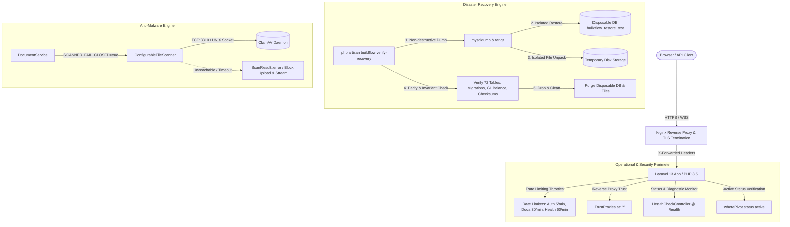
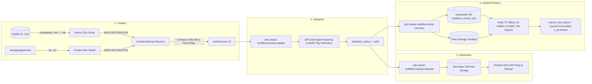

# BUILDFLOW — SYSTEM ARCHITECTURE & DESIGN SPECIFICATION

## 1. Architectural Philosophy
BuildFlow is designed as a modular, maintainable, single-tenant / multi-company Laravel monolith. It follows domain-driven principles within standard Laravel conventions to ensure maximum developer ergonomics, high performance, and strict transactional data integrity.

### Key Tenets
1. **Tenant Isolation by Construction**: Every domain entity (Projects, Sites, Employees, Inventory, Invoices, Accounts) is explicitly owned by a `company_id`. All Eloquent queries are scoped to the active tenant via global query scopes and middleware assertions.
2. **Explicit Double-Entry Principles**: 
   - Financial ledger entries must balance (`SUM(debit) == SUM(credit)`).
   - Stock ledger entries must balance (`source_warehouse -> destination_warehouse` or `supplier -> warehouse`).
3. **Auditability & Non-Destructive Corrections**:
   - Raw biometric attendance punches are immutable. Corrections create adjustment entries referencing the original punch.
   - Posted financial transactions and stock movements cannot be hard-deleted or silently mutated. Reversals create explicit offset entries.
4. **Fidelity to Stitch Design System**:
   - The user interface faithfully mirrors the approved Google Stitch screens for BuildFlow Construction CRM.

---

## 2. Layered Architecture



### Core Subsystems
- **Tenant Management**: Multi-company workspaces with custom roles and permission gates.
- **Projects & Sites**: Project milestones, daily logs, muster counts, subcontractor work orders.
- **Human Resources & Attendance**: Employees, contractors, biometric punch imports, muster rolls, deterministic payroll.
- **Supply Chain & Inventory**: Multi-warehouse stock tracking, stock transfers, purchase orders, 3-way invoice matching.
- **Billing & Receivables**: Running Account (RA) bills, retention tracking, payment allocations.
- **Financial Accounting**: Configurable chart of accounts, journal vouchers, bank reconciliation, GST reporting.
- **Loans & Equipment Finance**: Asset financing, loan amortizations, monthly EMI tracking.

---

## 3. Directory Layout
```
app/
├── Http/
│   ├── Controllers/
│   │   ├── Auth/
│   │   ├── DashboardController.php
│   │   ├── ProjectController.php
│   │   ├── SiteOperationController.php
│   │   ├── AttendanceController.php
│   │   ├── EmployeeController.php
│   │   ├── InventoryController.php
│   │   ├── ProcurementController.php
│   │   ├── PurchaseRequestController.php
│   │   ├── ProcurementApprovalPolicyController.php
│   │   ├── BillingController.php
│   │   ├── ExpenseController.php
│   │   ├── LoanController.php
│   │   └── AccountingController.php
│   ├── Middleware/
│   │   ├── ResolveTenantWorkspace.php
│   │   └── EnforceRolePermission.php
│   └── Requests/
├── Models/
│   ├── Scopes/TenantScope.php
│   ├── Company.php
│   ├── User.php
│   ├── Project.php
│   ├── Site.php
│   ├── Employee.php
│   ├── AttendancePunch.php
│   ├── DailyAttendance.php
│   ├── Material.php
│   ├── Warehouse.php
│   ├── StockLedgerEntry.php
│   ├── PurchaseRequest.php
│   ├── PurchaseRequestItem.php
│   ├── ProcurementApprovalPolicy.php
│   ├── PurchaseRequestApproval.php
│   ├── PurchaseOrder.php
│   ├── SupplierInvoice.php
│   ├── ClientInvoice.php
│   ├── Account.php
│   ├── JournalEntry.php
│   └── Loan.php
├── Services/
│   ├── InventoryLedgerService.php
│   ├── StockAvailabilityService.php
│   ├── ProjectBudgetService.php
│   ├── ApprovalPolicyService.php
│   ├── PayrollCalculationService.php
│   ├── DoubleEntryAccountingService.php
│   ├── EmiCalculationService.php
│   └── NotificationService.php
├── Events/
│   └── NotificationDispatched.php
└── Channels/
    └── routes/channels.php
```

---

## 4. Real-Time Broadcasting Subsystem (Laravel Reverb & Echo)

BuildFlow integrates an asynchronous, event-driven real-time notification layer powered by **Laravel Reverb** (WebSocket server) and **Laravel Echo** with Pusher JS client compatibility.



### Channel Topology & Multi-Tenant Isolation
All real-time communications occur over authenticated **private channels** enforced in `routes/channels.php`:
1. **User Channel** (`App.Models.User.{id}`): Dedicated to user-specific alerts (e.g. personal task assignments, direct approval requests). Authorized strictly for `$user->id === (int) $id`.
2. **Company Channel** (`company.{companyId}`): Company-wide alerts isolated to active tenant members. Subscriptions validated against the user's active company membership (`$user->companies()->where('companies.id', $companyId)->wherePivot('status', 'active')->exists()`).
3. **Role Channel** (`company.{companyId}.role.{roleSlug}`): Targeted operational broadcasts (e.g. `project_manager`, `accountant`, `procurement_officer`). Validated against active company membership and role slug assignment.
4. **Project Channel** (`project.{projectId}`): Project-scoped updates. Validated through project assignment or wildcard company permission.
5. **Site Channel** (`site.{siteId}`): Site-scoped field alerts. Validated against site assignment or management permissions.

### High Availability & HTTP Fallback
- **Post-Commit Guarantee**: Event broadcasting strictly implements `$afterCommit = true` and `DB::afterCommit(...)`. If a transaction rolls back, no broadcast is ever transmitted.
- **Fail-Safe Dispatching**: Broadcast calls in `NotificationService` are wrapped in try-catch handlers. If the Reverb daemon is offline or restarting, standard HTTP transactions proceed normally without raising errors or dropping database records.
- **Automatic Reconciliation**: On client reconnection or window focus, Alpine triggers `/notifications/feed` via protected HTTP request to reconcile missed notifications and synchronize unread counts.

---

## 5. Document & File Upload Management Subsystem (Phase 10)

BuildFlow integrates an enterprise-grade, secure, multi-tenant document management foundation across all operational and financial modules, matching Google Stitch project `15768566540196779944`.



### Storage Topology & Tenant Isolation
1. **Private by Default**: All business and financial attachments reside on the `'local'` private disk (`storage/app/private`). No public symlinks exist.
2. **Deterministic Partitioning**: Files are partitioned by active tenant, entity slug, and primary key:
   `companies/{company_id}/{entity_folder}/{record_id}/{uuid}.{ext}`
3. **Randomized Storage Names**: User-supplied filenames are never used for filesystem operations. Filenames are sanitized into metadata while physical storage uses UUID v4 strings.
4. **Authorized Streaming Only**: Downloads and previews stream strictly through authenticated application endpoints (`/documents/{document}/preview` and `/documents/{document}/download`) with `X-Content-Type-Options: nosniff`, `X-Frame-Options: SAMEORIGIN`, and private cache-control headers.

### Immutability & Lifecycle Rules
- **Statutory Audit Lock**: Documents attached to posted/reversed `JournalEntry` records, certified/paid `SubcontractorBill` records, or settled `Loan` records are locked from deletion or direct replacement.
- **Controlled Supersession**: When a draft or active record's attachment is revised, `replaceDocument()` creates version `v+1`, transitions the prior document to `status = 'superseded'`, sets `superseded_by_id`, and retains the original file intact for statutory audit inspection.
- **Confidential Personnel Vault**: Documents marked `is_confidential = true` (or belonging to Employee/Payroll entities) are strictly inaccessible to general site personnel and restricted exclusively to `owner`, `admin`, `hr_officer`, and `accountant` roles.

---

## 6. Production Hardening, Disaster Recovery & Operational Readiness (Phase 11)

BuildFlow enforces enterprise operational readiness guarantees, isolated disaster recovery verification, and fail-closed security controls.



### Disaster Recovery Topology
1. **Isolated Verification**: DR verification never runs on the live business database. It provisions an ephemeral disposable database (`buildflow_restore_test`) and an isolated temporary filesystem directory.
2. **Schema & Data Parity**: Validates 100% table parity (all 72 tables), identical row counts, and migration status alignment.
3. **Financial Ledger Reconciliation**: Validates that all posted journal vouchers remain balanced ($\sum \text{Debits} == \sum \text{Credits}$) and Trial Balance integrity is perfectly maintained post-restore.
4. **Binary Checksum Invariance**: Verifies that private document attachments match their ingest SHA-256 binary hash digests after backup and restore.
5. **Clean Teardown**: Automatically purges temporary database schemas and storage archives upon verification completion.

### Operational Monitoring (`GET /health`)
- Health monitoring endpoint provides real-time JSON diagnostics for external uptime checkers, load balancers, and Kubernetes probes.
- Reports:
  - **Database**: Connection status, selected database, query response latency (ms).
  - **Storage**: Free filesystem disk space (GB), private disk write capability.
  - **Cache**: Operational cache driver status.
  - **Reverb**: WebSocket daemon connectivity, port availability.
  - **Scanner**: Configured engine, fail-closed enforcement status, daemon reachability.
- Zero Secret Disclosure: Credentials, database passwords, internal file paths, and environment tokens are strictly filtered out of diagnostic responses.

### Fail-Closed Scanner Architecture
- In production (`SCANNER_FAIL_CLOSED=true`), files are quarantined or rejected if the scanner daemon is unreachable, times out, or encounters errors.
- Unscanned, infected, or error-state files are blocked with `HTTP 423 Locked` at the streaming and download endpoints, preventing any unverified binary from being rendered or executed on client machines.

---

## 7. Durable Automated Backups, AEAD Cryptography & Disaster Recovery (Phases 13 & 14)

BuildFlow enforces an automated, persistent backup and recovery architecture distinguishing four separate lifecycle operations:



### The 4 Distinct Operations

1. **Durable Backup Creation (`buildflow:backup:create`)**:
   - Executes non-destructive, atomic exports of the live MySQL database and private document repository.
   - Database dumps write to `.tmp` files and atomically rename to `.sql` upon successful mysqldump exit (preventing partial dumps from being recognized as valid).
   - Document files (`storage/app/private`) are packed into a compressed tarball (`storage.tar.gz`).
   - OpenSSL AEAD AES-256-GCM envelope encryption protects data at rest when `BACKUP_ENCRYPT=true`.
   - Generates an immutable, atomic `manifest.json` (version 2) recording backup ID, timestamps, table counts, migration states, archive sizes, and SHA-256 checksums.
   - Enforces atomic job locking via `Cache::lock('buildflow_backup_running_lock')` to prevent overlapping runs (returns exit code `2` on lock collision).
   - Prunes expired retention copies (24 hourly, 30 daily, 12 monthly) while unconditionally protecting the last verified recovery copy.

2. **Durable Backup Validation (`buildflow:backup:validate`)**:
   - Verifies structural integrity of the backup manifest and existence of required archives.
   - Recalculates SHA-256 checksums of database and storage files and matches against manifest records.
   - Authenticates AEAD tags (`aes-256-gcm`) and verifies archive readability (`tar -tzf`).
   - Updates `validation_status` (`valid` or `invalid`) and records `last_validated_at` in the manifest.

3. **Secondary Off-Host Replication (`buildflow:backup:replicate`)**:
   - Replicates validated snapshots to secondary storage (`BackupReplicationInterface`).
   - Re-computes SHA-256 checksums at destination and matches against source files before generating an atomic `replication_receipt.json`.
   - Retries on transient failure with backoff and prunes secondary retention.

4. **Isolated Disposable Restore (`buildflow:verify-recovery`)**:
   - Provisions an isolated, disposable database schema (`buildflow_restore_test`) and scratch storage directory.
   - Active Database Protection: Refuses to restore if target database matches active production database.
   - Restores database schema and records from the durable SQL dump using `proc_open` with `MYSQL_PWD` (no passwords in CLI arguments).
   - Validates 100% table parity (all 72 tables), row count parity, and 16 migrations.
   - Executes General Ledger invariant check: verifies Trial Balance balance ($\sum \text{Debits} == \sum \text{Credits}$).
   - Unpacks private documents and verifies SHA-256 binary hash digests against active document records.
   - Bounded Protection: Flags the backup manifest with `restore_test_status: 'passed'` and `is_protected: true` (retaining the latest 2 verified copies while rolling over older verified baselines).
   - Drops the disposable database and purges scratch files automatically.

### Backup Manifest Schema (`manifest.json` Version 2)
```json
{
  "manifest_version": 2,
  "backup_id": "backup_20261018_121120_hourly",
  "created_at": "2026-10-18T12:11:20+00:00",
  "frequency": "hourly",
  "database": {
    "name": "buildflow_crm",
    "tables_count": 72,
    "rows_count": 262,
    "migrations_count": 16,
    "dump_file": "database.sql.enc",
    "dump_size_bytes": 202588,
    "dump_checksum": "6dab751c4de4f9819cfe6ae30149027ad9e0ef4f2984adfdae9bd302274539c0"
  },
  "storage": {
    "archive_file": "storage.tar.gz.enc",
    "archive_size_bytes": 1495,
    "archive_checksum": "9a050181c7eac67d477a4801d357de40e30b4ca0ab10ddecd38c36c34a49b779",
    "documents_count": 4
  },
  "financial_ledger": {
    "total_debit": 3494664.07,
    "total_credit": 3494664.07,
    "diff": 0.0,
    "is_balanced": true
  },
  "encryption": {
    "enabled": true,
    "format_version": 2,
    "cipher": "aes-256-gcm",
    "authenticated": true,
    "key_fingerprint": "df54d6e23190"
  },
  "validation_status": "valid",
  "validated_at": "2026-10-18T12:11:26+00:00",
  "restore_test_status": "passed",
  "tested_at": "2026-10-18T12:11:36+00:00",
  "is_protected": true,
  "replication_status": "replicated",
  "replicated_at": "2026-10-18T12:11:31+00:00"
}
```

### Recovery Point & Time Objectives (RPO / RTO)
- **RPO SLA (1 Hour / 60 Minutes)**: Ensured via hourly cron schedule in `routes/console.php` (`hourly()`).
  - Target RPO: **60 minutes**.
  - Warning Threshold: **61–75 minutes** (approaching breach).
  - Critical Breach Threshold: **> 75 minutes** (triggers preflight failure and health alert).
- **RTO SLA (15 Minutes)**: Tested automated restore executes in **3.8 seconds** for full database and file tree. Complete end-to-end recovery completes well within the 15-minute SLA.

### Release Preflight & Go-Live Gate (`buildflow:preflight`)
Audits 16 critical operational domains before deployment:
1. Environment & Debug Mode (`production` / `debug: false`)
2. Application Key (`APP_KEY` present and valid length)
3. Database & Pending Migrations (0 pending migrations)
4. General Ledger Trial Balance Invariant (Debits == Credits, 0.00 difference)
5. Private Document Storage Privacy (`serve => false` on local disk)
6. Anti-Malware Fail-Closed Configuration (`SCANNER_FAIL_CLOSED=true`)
7. ClamAV Daemon Availability (TCP 3310 / socket reachability)
8. HTTPS & Secure Session Cookies (`APP_URL` https & `SESSION_SECURE_COOKIE`)
9. Reverse Proxy Trust Configuration (`TRUSTED_PROXIES` restricted)
10. Reverb WebSocket Daemon & Origins (`REVERB_ALLOWED_ORIGINS` non-wildcard)
11. Durable Automated Backups (RPO age <= 60m target)
12. Backup Cryptographic Integrity (SHA-256 digests and AEAD tags verified)
13. Isolated Restore Verification (latest restore-tested baseline)
14. Secondary Off-Host Replication (replica sync verified)
15. Frontend Production Assets (`public/build/manifest.json` present)
16. Demo Credentials Suppression (login page masks test accounts in production)


