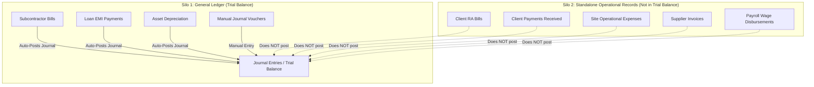

# BuildFlow CRM/ERP — Product Alignment & Gap Audit Report
**Organization:** NSD Earth Movers & Construction Ltd  
**Project:** BuildFlow Construction CRM / ERP Platform  
**Target Audience:** Company Owner, Project Managers, Site Supervisors, Accountants, and Engineering Team  
**Audit Date:** October 18, 2026  
**Status:** Baseline Gap Audit Completed (Evidence-Based Codebase & Live UI Inspection)  

---

## 1. Executive Summary & Verdict

### The Core Finding
BuildFlow has an **exceptionally strong technical and security foundation**:
- Multi-company database tenant isolation is enforced.
- AES-256-GCM authenticated encryption protects durable backups.
- ClamAV fail-closed malware scanning protects private project files.
- The double-entry accounting engine balances to the exact rupee (`₹38,73,344.00 == ₹38,73,344.00`).
- Digital Measurement Book math handles both 3D volumetric ($L \times B \times D$) and truck-trip formulas.
- All 204 automated tests pass cleanly with zero regressions.

**HOWEVER, there is a fundamental product disconnect between the codebase and the day-to-day operational reality of NSD Earth Movers & Construction Ltd:**

1. **The application was built as 20 flat, isolated technical database tables**, rather than an intuitive, task-oriented system that an ordinary construction company owner, site engineer, or accountant can use without training.
2. **Several essential pre-construction and operational workflows are completely missing**:
   - **Quotations / Estimates:** 100% missing (no way to quote a tender or client project before winning it).
   - **Client Management Screen:** Missing (clients exist in the database, but there is no screen to add, edit, or view clients).
   - **Material Supplier Management Screen:** Missing (only subcontractors have a screen; cement/steel vendors cannot be managed).
   - **Site Material Usage / Consumption:** Missing (materials can only be transferred between warehouses; they cannot be issued or consumed on a site).
   - **Team & Permissions UI:** Missing (roles and permissions exist in code, but the owner has no screen to invite a user or assign a role).
3. **The Project Overview does not answer the owner's primary questions:**
   - Opening a project does not show **money received**, **actual project expenses**, **outstanding client balance**, or **required approval actions**.
4. **Financial posting is fragmented across two disconnected systems:**
   - Subcontractor bills, loan EMIs, and asset depreciation automatically post balanced double-entry vouchers to the General Ledger.
   - Client bills, client payments, site expenses, supplier invoices, and payroll disbursements **do NOT post to the General Ledger**, causing the Trial Balance to drift out of sync with day-to-day operations.
5. **The UI is styled as a fixed desktop canvas mockup** (`bg-[#dbe2ea]` with a `min-h-[960px]` rounded window), which stacks 20 menu items vertically on mobile devices and pushes site supervisors 800 pixels down the screen before they can record daily attendance.

---

## 2. The 11 Business Requirements vs. Current Implementation

| # | Business Requirement | Current Implementation Status | Verified Working Code | Gaps, Broken Items & UX Blockers |
|:---:|:---|:---:|:---|:---|
| **1** | **Clients, Projects & Multiple Sites** | **Partially Working** | Projects CRUD (`/projects`), Site logs (`/sites/{id}/logs/create`), worker headcounts, weather tracking. | **1.** No Client management UI (`/clients` route does not exist; no way to create/edit clients). **2.** Clients table exists, but is only an unmanaged dropdown in project creation. **3.** No client GSTIN, PAN, or contact directory. |
| **2** | **Project 360° Financial & Operational Overview** | **Partially Working** | Project details (`/projects/{id}`) shows `contract_value`, `approved_budget`, `progress_percent`, manager, sites list, raw bill list. | **1.** **Money received is missing** (does not sum client payments for this project). **2.** **Actual project expenses are missing** (no cost roll-up of materials, labor, and site expenses). **3.** **Outstanding balance is missing** (`contract/billed - collected`). **4.** **Required actions are missing** (no pending indents, site logs, or bills awaiting sign-off). **5.** Project budget is static—no comparison against actual committed costs. |
| **3** | **Workers, Attendance, Wages, Salaries & Overtime** | **Working with Gaps** | Employee register (`/employees`), Daily muster roll (`/attendance/muster-roll`), check-in/out, overtime recording, monthly payroll batches (`/payroll`), payslips, 1.5x overtime math, daily wage vs salary math. | **1.** No weekly wage / site cash advance management (daily wagers frequently take weekly advances). **2.** Payroll disbursement does NOT post an accounting voucher to the General Ledger. **3.** Form uses technical inputs instead of a fast daily attendance grid. |
| **4** | **Suppliers, Indents, Deliveries, Stock & Site Usage** | **Partially Working** | Material Indents (`/purchase-requests`), 3-tier approval hierarchy, PO generation (`/procurement`), Goods Receipt Note (GRN) inspection, warehouse stock balances, transfers (`/inventory/transfer`). | **1.** **No Supplier Management UI** (no `/suppliers` route; material vendors cannot be created or edited by users). **2.** **Materials used at site is MISSING**: No screen to record "Material Issue to Site" or "Site Material Consumption". Materials only move between warehouses. **3.** Supplier invoices do NOT post to accounting ledger. **4.** No payment recording for supplier invoices. |
| **5** | **Quotations, Client Bills, Payments, Expenses & Budgets** | **Partially Working with Major Gaps** | Client RA Bills (`/billing`), retention withholding (5%), GST calculation (CGST + SGST), client payment recording (`/billing/{id}/payments`), operational expenses (`/expenses`). | **1.** **Quotations / Estimates are 100% MISSING**: No quotation or estimate module exists anywhere in the database or codebase. **2.** **Client Bills and Payments DO NOT post to General Ledger**. **3.** **Expenses cannot be approved or rejected** (ExpenseController lacks approve/reject endpoints). **4.** **Expenses DO NOT post to General Ledger**. **5.** Technical terms ("Outstanding Receivables", "Realized Collections") confuse ordinary users. |
| **6** | **Subcontractors, BOQ Work Orders, Measurement Book, Bills & Retention** | **Working Well** | Subcontractors register (`/subcontractors`), Work Orders with BOQ rate items (`/work-orders`), Digital Measurement Book (`/measurement-books`, L×B×D & trips formula), RA Bills (`/subcontractor-bills`), mobilization advance recovery (₹50k), Section 194C TDS, auto-posts to GL. | **1.** Subcontractor retention is withheld on bills, but there is no workflow to claim/release subcontractor retention when DLP expires. **2.** Four separate menu items in sidebar (`Subcontractors`, `Work Orders`, `Measurement Book`, `Subcontractor Bills`) overwhelm ordinary users. |
| **7** | **Fleet/Equipment, Loans, EMI, Ledger & Financial Reports** | **Partially Working** | Fixed Assets & Fleet register (`/assets`), straight-line & WDV depreciation, Equipment loans (`/loans`), EMI amortization schedules, EMI payments with principal/interest split, Double-entry journals (`/accounting/journals`), Trial Balance (`/accounting/trial-balance`). | **1.** **Missing P&L (Profit & Loss) Statement**: No income statement report. **2.** **Missing Balance Sheet**: No balance sheet report. **3.** **Missing Project Profitability Report**: Cannot view revenue vs costs per project. **4.** Client bills, supplier bills, expenses, and payroll DO NOT auto-post to the ledger, making the Trial Balance incomplete for day-to-day operations. |
| **8** | **Document Vault & Automated Reminders** | **Partially Working** | Document Centre (`/documents`), private encrypted storage, fail-closed ClamAV malware scanning, HTTP 423 quarantine protection, document attachments on projects, work orders, bills; In-app notification center, real-time unread badges. | **1.** **Automated background reminders are MISSING**: Scheduler only runs backup jobs. There are no automated alerts for overdue client bills, upcoming EMI dates, expiring DLPs, or pending approvals. **2.** Clients and Expenses cannot have documents attached (missing from DocumentController `MODEL_MAP`). |
| **9** | **Team Access, User Roles & Permissions** | **Backend Only (NO UI)** | Robust database schema: `roles`, `permissions` JSON, `company_user` pivot with `role_id`, policy checks throughout controllers. | **1.** **NO User / Team Management UI**: There is no screen to invite users, view team members, assign roles, or modify permissions. **2.** Roles and permissions can only be managed via database seeders or tinker. |
| **10** | **Real-Time Updates (WebSockets)** | **Ready / Functional** | Laravel Reverb configured, private channel authorization (`user.{id}`, `company.{id}`, `company.{id}.role.{slug}`), Echo integration in `bootstrap.js` and `app.js`. | **1.** Requires operator to run `reverb:start` on server for real-time broadcasts to function. Falls back gracefully when offline. |
| **11** | **Desktop & Mobile Usability** | **Desktop-Heavy / Mobile Gaps** | Desktop UI is visually polished with modern cards and responsive grid layout. | **1.** Fixed desktop canvas mockup (`min-h-[960px]`, `rounded-[36px]`, `max-w-[1720px]`) causes clipping and awkward scrolling on mobile. **2.** 20-item sidebar stacks vertically above main content on mobile screens, pushing page content down 800+ pixels. **3.** No mobile hamburger menu or bottom navigation bar. |

---

## 3. Module-by-Module In-Depth Audit

### 3.1 Dashboard (`/dashboard`)
* **What Works:**
  - Active projects counter, metric cards, site operations summary, project timeline milestones.
* **What is Broken or Misleading:**
  - **Payables Figure is Incorrect:** `DashboardController.php` lines 34-36 computes Payables solely from `SupplierInvoice`. It **completely omits Subcontractor Bills** (`SubcontractorBill`). In the demo data, ₹5,94,688.00 owed to Apex Heavy Earthmovers is completely invisible on the dashboard.
  - **Pending Approvals Count is Incomplete:** Only counts draft POs and pending supplier invoices. It ignores pending purchase requests (indents), pending Measurement Book entries, pending subcontractor bills, pending payroll batches, and pending site expenses.
* **UI/UX Problem:**
  - Uses accounting jargon: "Receivables" and "Payables" instead of "Money to Receive" and "Money to Pay".
* **Layer:** Business Logic & UI.

### 3.2 Projects & Sites (`/projects`, `/sites`)
* **What Works:**
  - Project creation, site assignment, milestone tracking, daily site logs (workers, weather, remarks), document attachments.
* **What is Missing from Requirement 2:**
  - When opening a project (`/projects/{id}`), the user **cannot see**:
    1. **Money Received:** Total payments collected from the client for this project.
    2. **Actual Expenses Incurred:** Total money spent on materials, labor, subcontractors, and site petty cash for this project.
    3. **Outstanding Money:** Contract value minus total money received.
    4. **Required Actions:** Pending indents awaiting PO conversion, unapproved site logs, or unpaid client certificates.
    5. **Budget Variance:** The approved budget is shown as a static number with no comparison against actual committed costs.
* **Layer:** Business Logic, Controller (`ProjectController@show`), and View (`projects/show.blade.php`).

### 3.3 Clients & Material Suppliers (`/clients`, `/suppliers`)
* **What is Missing:**
  - Neither `/clients` nor `/suppliers` routes exist.
  - The `clients` table exists in MySQL, but has no controller or view. An office employee cannot add a new client (e.g. "Nagpur Municipal Corporation" or "Godrej Properties"), edit their GSTIN, or view all projects belonging to that client.
  - The `suppliers` table contains both material vendors and subcontractors (`vendor_type` column), but only `subcontractors` has a controller (`SubcontractorController`). Material vendors (cement dealers, quarry owners, steel stockists) cannot be added or managed.
* **Layer:** Missing Controllers, Routes, and Views. Reusable Eloquent models `Client` and `Supplier` already exist.

### 3.4 Materials, Procurement & Stock Consumption (`/inventory`, `/procurement`, `/purchase-requests`)
* **What Works:**
  - Site engineers raise material indents (`/purchase-requests/create`).
  - Procurement converts approved indents to Purchase Orders.
  - Storekeeper records deliveries with Goods Receipt Notes (GRN), recording accepted and rejected quantities.
  - Stock transfers between warehouses update the moving-average inventory valuation.
* **What is Incomplete:**
  - **Material Consumption at Site is Missing:** Stock enters warehouses via GRN, but the only way it leaves is via transfer to another warehouse. There is **no "Material Issue / Consumption" form** to record that 100 bags of cement and 2 tons of sand were used on a specific project or site. As a result, warehouse stock accumulates indefinitely, and project material expenses cannot be calculated.
* **Layer:** Business Logic, Database Migration (needs `material_issues` or consumption ledger), Controller, and View.

### 3.5 Client Billing & Operational Expenses (`/billing`, `/expenses`)
* **What Works:**
  - Client RA Bills calculate subtotal, CGST 9%, SGST 9%, and withhold 5% contractual retention.
  - Client payment recording updates invoice balance due.
  - Site expenses can be recorded with payment modes (cash, bank transfer, UPI).
* **What is Incomplete or Broken:**
  - **No General Ledger Integration:** Neither Client Invoices nor Client Payments create double-entry journal vouchers in `journal_entries`. They live in an isolated silo.
  - **Expenses Cannot Be Approved:** `ExpenseController` has only `index`, `create`, and `store`. Non-admin users submit expenses as `pending`, but there is **no route or button to approve or reject them**.
  - **Expenses Do Not Post to General Ledger:** When approved, expenses do not create debit expense / credit cash or bank journal vouchers.
* **Layer:** Controller Logic, Routes, and View.

### 3.6 Subcontractors, BOQ Work Orders & Measurement Book (`/subcontractors`, `/work-orders`, `/measurement-books`, `/subcontractor-bills`)
* **What Works:**
  - This is one of the most complete subsystems in the application:
    - Contractor master with GSTIN, PAN, and TDS Section 194C classification.
    - Work Orders with BOQ rate items.
    - Digital Measurement Book with length, breadth, depth formulas and truck trip multipliers.
    - RA Bills with certified quantities, mobilization advance recovery, and retention holdback.
    - Automatically posts balanced journal entries to GL 2020 (Subcontractor Payables).
* **What is Confusing for Ordinary Users:**
  - It is split into **4 separate top-level navigation items**, cluttering the sidebar.
  - A site supervisor or manager has to jump across 4 different pages to manage a single subcontractor job.
* **Layer:** UI/UX Navigation Consolidation.

### 3.7 Accounting & Financial Reports (`/accounting`)
* **What Works:**
  - Double-entry Chart of Accounts, manual journal voucher posting with debit == credit balance enforcement, counter-entry reversals with audit logging, and Trial Balance report.
* **What is Missing from Requirement 7:**
  - **No Profit & Loss (P&L) Statement:** Cannot view Total Revenue vs Total Construction Costs.
  - **No Balance Sheet:** Cannot view Assets vs Liabilities & Equity.
  - **No Project Costing / Profitability Report:** The owner cannot see whether Project Riverside Residency is profitable or running at a loss.
* **Layer:** Controller (`AccountingController`), Routes, and Views.

### 3.8 Team, Roles & Permissions Management (`/team` or `/settings/users`)
* **What is Missing from Requirement 9:**
  - Role-based authorization is enforced in controllers and middleware, but **there is NO user interface to manage team members or assign roles**.
  - The business owner cannot:
    - Add a new employee or office staff user.
    - Change a user's role (e.g. promote a Site Supervisor to Project Manager).
    - Activate or deactivate user access.
* **Layer:** Missing Controller, Routes, and View. Reusable models (`User`, `Role`, `Company`) already exist.

---

## 4. Financial Data Consistency & Integration Audit

### The Double-Counting & Silo Problem
The audit revealed that **the application currently has two separate financial realities**:

### Consequences for the Business
1. **Misleading Trial Balance:** The Trial Balance currently displays only the seeded manual entries, subcontractor bills, loans, and depreciation. Live client billing and payroll disbursements are omitted from the ledger.
2. **Disconnected Project Profitability:** Because site expenses, material deliveries, and client bills do not aggregate into a single project cost ledger, it is impossible to calculate true project net profit.
3. **Double Counting Risk:** If an accountant tries to fix this by manually typing a Journal Voucher for a client bill or site expense, the operational module and the accounting module will count the transaction independently.

---

## 5. UI/UX & Plain-English Translation Plan

### 5.1 Reorganizing Navigation from 20 Flat Links into 6 Everyday Task Hubs

Currently, the sidebar displays 20 separate technical items. We should consolidate them into **6 logical hubs** based on everyday construction roles:

| Consolidated Hub | Everyday Tasks Included | Who Uses It |
|:---|:---|:---|
| **1. Overview & Projects** | Dashboard, Clients Directory, Projects Register, Sites & Daily Logs, Project 360° Financials | Owner, Project Manager |
| **2. Workforce & Wages** | Staff & Operators, Daily Muster Roll (Fast Headcount Grid), Monthly Wages & Payroll | Site Supervisor, HR, Owner |
| **3. Materials & Equipment** | Material Indents (Requests), Vendor POs & Deliveries, Stock Ledger, Material Site Usage, Machinery & Fleet | Site Engineer, Storekeeper, Procurement |
| **4. Subcontractors** | Subcontractors Directory, Work Orders & BOQ, Digital Measurement Book, Subcontractor Bills | Project Manager, Site Supervisor, Accountant |
| **5. Money & Billing** | Client RA Bills, Money Received (Receipts), Site Expenses & Petty Cash, Company Loans & EMI, Accounting Ledger & Reports (P&L, Balance Sheet) | Accountant, Owner |
| **6. Company & Team** | Team Members & Permissions, Document Vault, Company Settings | Owner, Admin |

### 5.2 Plain-English Terminology Dictionary

| Current Technical / Jargon Term | Plain-English Term for BuildFlow | Context / Help Text |
|:---|:---|:---|
| *Outstanding Receivables* | **Money to Receive (Client Bills)** | Unpaid bills submitted to clients for certified construction progress |
| *Realized Collections* | **Money Received (In Bank)** | Actual payments deposited into company bank accounts |
| *Payables* | **Money to Pay (Vendors & Subcontractors)** | Approved invoices and bills due to material suppliers and subcontractors |
| *Goods Receipt Note (GRN)* | **Material Delivery Receipt** | Inspection record of materials delivered to site or yard |
| *Purchase Request (PR)* | **Material Request (Indent)** | Site supervisor's request for materials needed for site work |
| *Measurement Book (MB)* | **Work Measurement Book** | Official record of physical work completed on site by measurements ($L \times B \times D$) |
| *Subcontractor RA Bill* | **Contractor Progress Bill** | Running Account bill submitted by subcontractor for certified work done |
| *Retention Withheld* | **Security Deposit Held (Retention)** | 5% held back from bills until the Defect Liability Period (DLP) finishes |
| *Trial Balance* | **Accounting Trial Balance** | Mathematical verification that all debits equal all credits across all accounts |

### 5.3 Mobile Usability Fixes
1. **Remove Fixed Desktop Window Frame:** Replace the outer `min-h-[960px] bg-[#dbe2ea]` wrapper with a clean, full-viewport responsive layout (`min-h-screen bg-slate-50`).
2. **Collapsible Mobile Drawer:** Replace the vertical 20-link sidebar stack with a slide-out drawer triggered by a standard hamburger button on screens `< 1024px`.
3. **Mobile-Friendly Attendance:** Ensure the attendance screen fits on mobile screens with quick tap buttons (`Present`, `Half Day`, `Absent`) for site supervisors using smartphones at the jobsite.

---

## 6. Recommended Prioritized Action Plan

To safely turn the existing application into the exact product needed without breaking working functionality, execute this 5-stage plan:

### Phase A: Quick Wins & Navigation Hubs (Zero Risk, High Impact)
1. **Reorganize Navigation:** Group the 20 sidebar links into the 6 everyday task hubs with simple English labels.
2. **Fix Dashboard Payables & Approvals:** Update `DashboardController` to include subcontractor bills in Total Payables, and include all pending approvals (indents, MBs, payroll, expenses).
3. **Mobile Responsive Shell:** Fix `layouts/app.blade.php` to remove the fixed desktop canvas box and add a mobile hamburger menu.

### Phase B: Missing Core Management Screens
1. **Client Management Screen (`/clients`):**
   - Create `ClientController` and views for Client List, Add Client, Edit Client, and Client Projects/Bills history.
2. **Material Suppliers Screen (`/suppliers`):**
   - Create `SupplierController` for material vendors (cement, steel, sand, quarry) separate from subcontractors.
3. **Team & Permissions Screen (`/team` or `/settings/users`):**
   - Create a screen for the company owner to invite team members, assign roles (`Project Manager`, `Site Supervisor`, `Accountant`, etc.), and toggle permissions.
4. **Project 360° Financial Card (`/projects/{id}`):**
   - Update `projects/show.blade.php` to display:
     - Contract Amount
     - Money Received to date
     - Outstanding Money balance
     - Total Project Expenses incurred
     - Required Actions (pending indents, unapproved site logs, pending bills).

### Phase C: Site Material Usage & Quotations
1. **Site Material Issue / Consumption (`/inventory/issue`):**
   - Add a form to issue materials from a warehouse/yard to a specific Project & Site.
   - Record an outflow in `stock_ledger_entries` under transaction type `site_consumption` and charge it as a project cost.
2. **Quotations & Tender Estimates (`/quotations`):**
   - Add a pre-construction quotation builder with line items, tax, and one-click conversion to an active Project once won.

### Phase D: Financial Ledger Unification
1. **Automatic Journal Posting for Operations:**
   - Client Invoice approval $\rightarrow$ Auto-post to GL (Debit Accounts Receivable 1020, Credit Revenue 4010).
   - Client Payment receipt $\rightarrow$ Auto-post to GL (Debit Bank 1010, Credit Accounts Receivable 1020).
   - Approved Site Expense $\rightarrow$ Auto-post to GL (Debit Expense 50xx, Credit Cash/Bank 1010).
   - Payroll Disbursement $\rightarrow$ Auto-post to GL (Debit Wages 5010, Credit Bank 1010).
2. **Financial Reports:**
   - Add Profit & Loss (P&L) Report (`/accounting/profit-and-loss`).
   - Add Balance Sheet Report (`/accounting/balance-sheet`).
   - Add Project Profitability Report (`/projects/{id}/financial-report`).

### Phase E: Background Reminders & Polishing
1. **Scheduled Alerts in `routes/console.php`:**
   - Daily alert for overdue client invoices.
   - Weekly reminder for upcoming loan EMIs.
   - 30-day notice for expiring subcontractor and client Defect Liability Periods.
2. **Expense Approval Workflow:**
   - Add `approve` and `reject` actions to `ExpenseController`.

---

## 7. Conclusion & Next Step Recommendation

**BuildFlow is approximately 70% of the way to the desired product.** The core engine, database schema, security controls, and complex construction math (Measurement Book, retention, depreciation) are complete, reliable, and verified.

The remaining 30% consists of:
1. **Connecting the user experience to everyday tasks** (replacing technical jargon with simple English and organizing the 20 flat menus into 6 hubs).
2. **Adding the 4 missing screens** (Clients, Suppliers, Team/User Management, and Project 360° financial overview).
3. **Closing the operational loops** (Site Material Consumption and automatic ledger posting for client bills and expenses).

**Recommended Next Step:**
Review this audit report and approve beginning with **Phase A (Navigation Consolidation & Dashboard Fixes)** and **Phase B (Client Management & Project 360° Financial Card)**.
