# BUILDFLOW — DATABASE SCHEMA SPECIFICATION

## 1. Relational Entity Relationship Diagram

```mermaid
erDiagram
    COMPANIES ||--o{ COMPANY_USERS : has
    USERS ||--o{ COMPANY_USERS : belongs_to
    COMPANIES ||--o{ PROJECTS : owns
    PROJECTS ||--o{ SITES : contains
    PROJECTS ||--o{ TASKS : has
    COMPANIES ||--o{ EMPLOYEES : employs
    EMPLOYEES ||--o{ ATTENDANCE_PUNCHES : records
    EMPLOYEES ||--o{ DAILY_ATTENDANCE : calculates
    EMPLOYEES ||--o{ PAYROLL_RECORDS : receives
    COMPANIES ||--o{ MATERIALS : inventories
    COMPANIES ||--o{ WAREHOUSES : manages
    WAREHOUSES ||--o{ STOCK_LEDGER_ENTRIES : holds
    MATERIALS ||--o{ STOCK_LEDGER_ENTRIES : tracked_in
    COMPANIES ||--o{ SUPPLIERS : procures_from
    COMPANIES ||--o{ PROCUREMENT_APPROVAL_POLICIES : configures
    COMPANIES ||--o{ PURCHASE_REQUESTS : initiates
    PURCHASE_REQUESTS ||--o{ PURCHASE_REQUEST_ITEMS : contains
    PURCHASE_REQUESTS ||--o{ PURCHASE_REQUEST_APPROVALS : audited_by
    PURCHASE_REQUESTS ||--o{ PURCHASE_ORDERS : converted_to
    SUPPLIERS ||--o{ PURCHASE_ORDERS : fulfills
    PURCHASE_ORDERS ||--o{ SUPPLIER_INVOICES : bills
    COMPANIES ||--o{ CLIENTS : contracts_with
    CLIENTS ||--o{ CLIENT_CONTRACTS : signs
    PROJECTS ||--o{ CLIENT_CONTRACTS : governs
    CLIENT_CONTRACTS ||--o{ CLIENT_INVOICES : associates_with
    CLIENT_CONTRACTS ||--o{ CLIENT_COMPLETION_CERTIFICATES : certifies
    CLIENT_CONTRACTS ||--o{ RETENTION_RELEASE_CLAIMS : claims_against
    RETENTION_RELEASE_CLAIMS ||--o{ RETENTION_CLAIM_INVOICE_ITEMS : draws_from
    CLIENT_INVOICES ||--o{ RETENTION_CLAIM_INVOICE_ITEMS : allocated_to
    RETENTION_RELEASE_CLAIMS ||--o{ RETENTION_CLAIM_PAYMENTS : receives_receipts
    CLIENTS ||--o{ CLIENT_INVOICES : receives_bills
    COMPANIES ||--o{ ACCOUNTS : defines
    ACCOUNTS ||--o{ JOURNAL_ENTRY_LINES : books
    COMPANIES ||--o{ LOANS : manages
    LOANS ||--o{ LOAN_EMI_SCHEDULES : amortizes
    LOANS |o--o| FIXED_ASSETS : finances
    COMPANIES ||--o{ FIXED_ASSETS : owns
    PROJECTS ||--o{ FIXED_ASSETS : deploys
    FIXED_ASSETS ||--o{ ASSET_DEPRECIATION_ENTRIES : depreciates_via
    ASSET_DEPRECIATION_ENTRIES |o--o| JOURNAL_ENTRIES : posts_to
    LOAN_EMI_SCHEDULES |o--o| JOURNAL_ENTRIES : posts_to
    COMPANIES ||--o{ SUBCONTRACTOR_WORK_ORDERS : issues
    SUPPLIERS ||--o{ SUBCONTRACTOR_WORK_ORDERS : contracted_for
    PROJECTS ||--o{ SUBCONTRACTOR_WORK_ORDERS : executes
    SUBCONTRACTOR_WORK_ORDERS ||--o{ SUBCONTRACTOR_WORK_ORDER_ITEMS : defines_boq
    SUBCONTRACTOR_WORK_ORDERS ||--o{ SUBCONTRACTOR_WORK_ORDER_VARIATIONS : amends_via
    SUBCONTRACTOR_WORK_ORDERS ||--o{ MEASUREMENT_BOOK_ENTRIES : measured_in
    SUBCONTRACTOR_WORK_ORDER_ITEMS ||--o{ MEASUREMENT_BOOK_ENTRIES : item_measured
    SUBCONTRACTOR_WORK_ORDERS ||--o{ SUBCONTRACTOR_BILLS : billed_via
    SUBCONTRACTOR_BILLS ||--o{ SUBCONTRACTOR_BILL_ITEMS : items
    SUBCONTRACTOR_BILLS ||--o{ SUBCONTRACTOR_BILL_MEASUREMENTS : draws_measurements
    MEASUREMENT_BOOK_ENTRIES ||--o{ SUBCONTRACTOR_BILL_MEASUREMENTS : claimed_in
    SUBCONTRACTOR_BILLS ||--o{ SUBCONTRACTOR_BILL_PAYMENTS : paid_via
    SUBCONTRACTOR_BILLS |o--o| JOURNAL_ENTRIES : posts_certified_gl
    SUBCONTRACTOR_BILL_PAYMENTS |o--o| JOURNAL_ENTRIES : posts_payment_gl
```

---

## 2. Table Schemas & Fields

### Tenant & Access Control
- `companies`: `id`, `name`, `legal_name`, `tax_id` (GSTIN), `currency` (INR), `created_at`, `updated_at`
- `users`: `id`, `name`, `email`, `password`, `is_active`, `remember_token`, `timestamps`
- `roles`: `id`, `company_id`, `name`, `slug`, `permissions` (JSON), `timestamps`
- `company_user`: `id`, `company_id`, `user_id`, `role_id`, `status` (active/invited/suspended), `timestamps`

### Projects & Site Operations
- `clients`: `id`, `company_id`, `name`, `contact_person`, `email`, `phone`, `gstin`, `address`, `timestamps`
- `projects`: `id`, `company_id`, `client_id`, `code`, `name`, `project_type` (civil/interior/maintenance/earthmoving), `start_date`, `target_date`, `completion_date`, `contract_value` (DECIMAL 15,2), `approved_budget` (DECIMAL 15,2), `status` (planned/active/on_hold/completed/cancelled), `progress_percent` (TINYINT), `manager_id`, `timestamps`
- `sites`: `id`, `company_id`, `project_id`, `name`, `location`, `supervisor_id`, `timestamps`
- `daily_site_logs`: `id`, `company_id`, `site_id`, `log_date`, `work_summary`, `delays`, `worker_count`, `created_by`, `timestamps`

### Workforce & Attendance
- `employees`: `id`, `company_id`, `code`, `first_name`, `last_name`, `employment_type` (full_time/contract/daily_wage), `designation`, `department`, `daily_rate`, `monthly_salary`, `bank_account_no`, `ifsc_code`, `status`, `timestamps`
- `shifts`: `id`, `company_id`, `name`, `start_time`, `end_time`, `grace_minutes`, `timestamps`
- `attendance_punches`: `id`, `company_id`, `employee_id`, `site_id`, `punch_time`, `punch_type` (in/out), `source` (biometric_import/manual/mobile), `device_serial`, `raw_payload`, `timestamps`
- `daily_attendance`: `id`, `company_id`, `employee_id`, `site_id`, `project_id`, `attendance_date`, `status` (present/half_day/absent/on_leave), `worked_hours`, `overtime_hours`, `is_approved`, `approved_by`, `timestamps`

### Materials & Inventory Ledger
- `material_categories`: `id`, `company_id`, `name`, `timestamps`
- `materials`: `id`, `company_id`, `category_id`, `code`, `name`, `unit_of_measure` (MT, bags, cum, sqm, nos), `reorder_level`, `standard_cost`, `timestamps`
- `warehouses`: `id`, `company_id`, `site_id` (nullable), `name`, `type` (central/site_store), `timestamps`
- `stock_ledger_entries`: `id`, `company_id`, `material_id`, `warehouse_id`, `reference_type` (goods_receipt/site_issue/transfer/adjustment), `reference_id`, `quantity` (DECIMAL 12,3), `direction` (in/out), `unit_price`, `total_valuation`, `balance_after`, `timestamps`

### Procurement & Supplier Payables
- `suppliers`: `id`, `company_id`, `name`, `gstin`, `payment_terms`, `bank_details`, `timestamps`
- `purchase_requests`: `id`, `company_id`, `pr_number` (string, unique), `project_id`, `site_id`, `warehouse_id` (nullable), `request_date`, `required_by_date`, `status` (`draft`, `pending`, `approved`, `rejected`, `partially_converted`, `po_created`, `cancelled`), `priority` (`normal`, `urgent`, `critical`), `reason` (text), `rejection_reason` (text, nullable), `requested_by` (foreign key `users`), `submitted_at` (datetime, nullable), `approved_by` (foreign key `users`, nullable), `approved_at` (datetime, nullable), `estimated_total` (DECIMAL 15,2), `is_pricing_complete` (BOOLEAN), `is_over_budget` (BOOLEAN), `budget_overrun_amount` (DECIMAL 15,2), `current_approval_level` (TINYINT), `required_approval_levels` (TINYINT), `budget_override_approved` (BOOLEAN), `budget_override_reason` (text, nullable), `timestamps`
- `purchase_request_items`: `id`, `purchase_request_id`, `material_id`, `specifications` (string, nullable), `quantity_requested` (DECIMAL 12,3), `quantity_ordered` (DECIMAL 12,3), `estimated_rate` (DECIMAL 12,2), `timestamps`
- `procurement_approval_policies`: `id`, `company_id`, `tier_name` (string), `min_amount` (DECIMAL 15,2), `max_amount` (DECIMAL 15,2, nullable), `approval_level` (TINYINT), `role_slug` (string), `requires_finance_review` (BOOLEAN), `requires_owner_approval` (BOOLEAN), `is_active` (BOOLEAN), `timestamps`
- `purchase_request_approvals`: `id`, `purchase_request_id` (foreign key `purchase_requests`), `user_id` (foreign key `users`), `approval_level` (TINYINT), `role_slug_at_approval` (string), `action` (`approved`, `rejected`, `override_approved`), `comments` (text, nullable), `policy_tier_applied` (string, nullable), `request_estimated_total` (DECIMAL 15,2, nullable), `was_over_budget` (BOOLEAN), `timestamps`
- `purchase_orders`: `id`, `company_id`, `supplier_id`, `project_id`, `purchase_request_id` (nullable foreign key `purchase_requests`), `po_number`, `po_date`, `delivery_due_date` (nullable), `subtotal`, `tax_amount`, `total_amount`, `status` (`draft`, `approved`, `partially_received`, `completed`, `cancelled`), `terms_and_conditions`, `created_by`, `approved_by`, `approved_at`, `timestamps`
- `purchase_order_items`: `id`, `purchase_order_id`, `material_id`, `purchase_request_item_id` (nullable foreign key `purchase_request_items`), `quantity_ordered` (DECIMAL 12,3), `quantity_received` (DECIMAL 12,3), `unit_price` (DECIMAL 12,2), `tax_percent` (DECIMAL 5,2), `total_price` (DECIMAL 12,2), `timestamps`
- `goods_receipts`: `id`, `company_id`, `purchase_order_id`, `warehouse_id`, `grn_number`, `received_date`, `timestamps`
- `goods_receipt_items`: `id`, `goods_receipt_id`, `purchase_order_item_id`, `material_id`, `quantity_received`, `quantity_accepted`, `quantity_rejected`, `rejection_reason`, `timestamps`
- `supplier_invoices`: `id`, `company_id`, `supplier_id`, `purchase_order_id`, `invoice_number`, `invoice_date`, `due_date`, `subtotal`, `tax_amount`, `total_amount`, `paid_amount`, `status` (draft/pending_approval/approved/paid/partially_paid), `timestamps`

### Billing & Client Receivables
- `client_invoices`: `id`, `company_id`, `client_id`, `project_id`, `client_contract_id` (nullable foreign key), `invoice_number`, `bill_type` (milestone/progress_ra), `issue_date`, `due_date`, `subtotal`, `cgst_amount`, `sgst_amount`, `igst_amount`, `retention_rate`, `retention_amount`, `total_payable`, `paid_amount`, `status` (draft/submitted/approved/paid/partially_paid/overdue), `timestamps`
- `invoice_payments`: `id`, `company_id`, `client_invoice_id`, `payment_date`, `amount`, `payment_mode`, `transaction_ref`, `timestamps`

### Client Contracts, Retention & Defect Liability (DLP)
- `client_contracts`: `id`, `company_id`, `client_id`, `project_id`, `contract_number`, `title`, `contract_value` (DECIMAL 15,2), `retention_applicable` (BOOLEAN), `retention_rate` (DECIMAL 5,2), `retention_cap_amount` (DECIMAL 15,2, nullable), `release_schedule_type` (`staged_50_50`, `single_full_release`, `custom_milestones`), `dlp_duration_months` (INT), `dlp_start_basis` (`practical_completion_date`, `final_bill_date`, `handover_date`), `require_dlp_clearance_certificate` (BOOLEAN), `require_pcc_certificate` (BOOLEAN), `status` (`draft`, `active`, `completed`, `under_dispute`, `closed`), `timestamps`
- `client_completion_certificates`: `id`, `company_id`, `client_contract_id`, `project_id`, `certificate_type` (`practical_completion`, `dlp_clearance`, `handover_note`, `snag_clearance`), `certificate_number`, `issue_date`, `issuing_authority`, `inspecting_engineer`, `status` (`draft`, `verified`, `rejected`), `all_defects_rectified` (BOOLEAN), `defect_count_reported` (INT), `defect_count_resolved` (INT), `document_path`, `file_hash`, `notes`, `created_by`, `verified_by`, `verified_at`, `timestamps`
- `retention_release_claims`: `id`, `company_id`, `client_contract_id`, `client_id`, `project_id`, `completion_certificate_id` (nullable), `claim_number`, `stage_key`, `stage_name`, `eligible_amount` (DECIMAL 15,2), `claimed_amount` (DECIMAL 15,2), `approved_amount` (DECIMAL 15,2, nullable), `received_amount` (DECIMAL 15,2), `status` (`draft`, `submitted`, `approved`, `rejected`, `client_submitted`, `partially_received`, `received`, `closed`), `submission_date`, `due_date`, `client_reference`, `client_submitted_at`, `rejection_reason`, `notes`, `created_by`, `reviewed_by`, `reviewed_at`, `timestamps`
- `retention_claim_invoice_items`: `id`, `retention_release_claim_id`, `client_invoice_id`, `source_retention_amount` (DECIMAL 15,2), `previously_claimed_amount` (DECIMAL 15,2), `claim_allocated_amount` (DECIMAL 15,2), `timestamps`
- `retention_claim_payments`: `id`, `company_id`, `retention_release_claim_id`, `payment_date`, `amount` (DECIMAL 15,2), `payment_mode` (`bank_transfer`, `cheque`, `cash`, `adjustment`), `reference_number`, `bank_account_id` (nullable), `notes`, `created_by`, `timestamps`

### Financial Accounting & Loans
- `accounts`: `id`, `company_id`, `code` (`1010`, `1020`, `1025`, `1030`, `1040`, `1050`, `1510`, `1520`, `2010`, `2020`, `2030`, `2040`, `4010`, `5020`, `5030`, `5040`), `name`, `account_type` (`asset`, `liability`, `equity`, `income`, `expense`), `sub_type`, `parent_id`, `is_system`, `is_active`, `timestamps`
- `journal_entries`: `id`, `company_id`, `entry_number` (`JV-SCB-...`, `JV-PAY-SCB-...`, `JV-EMI-...`, `JV-DEPR-...`, `JV-REV-...`), `entry_date`, `narration`, `reference_type` (`loan_emi_schedules`, `asset_depreciation_entries`, `retention_release_claims`, `subcontractor_bills`, `subcontractor_bills_reversal`), `reference_id`, `total_amount` (DECIMAL 15,2), `status` (`draft`, `posted`, `reversed`), `reversed_by`, `reversed_at`, `reversal_reason`, `created_by`, `timestamps`
- `journal_entry_lines`: `id`, `journal_entry_id`, `account_id`, `project_id` (nullable cost center), `debit` (DECIMAL 15,2), `credit` (DECIMAL 15,2), `description`, `timestamps`
- `loans`: `id`, `company_id`, `fixed_asset_id` (nullable foreign key to `fixed_assets`), `lender_name`, `loan_account_number`, `loan_type` (`equipment_finance`, `vehicle_loan`, `term_loan`, `working_capital`), `asset_description`, `principal_amount` (DECIMAL 15,2), `annual_interest_rate` (DECIMAL 5,2), `tenure_months` (INT), `monthly_emi` (DECIMAL 15,2), `start_date`, `end_date`, `outstanding_principal` (DECIMAL 15,2), `status` (`active`, `closed`, `defaulted`), `liability_account_id` (foreign key `accounts`), `interest_account_id` (foreign key `accounts`), `timestamps`
- `loan_emi_schedules`: `id`, `loan_id`, `installment_number` (SMALLINT), `due_date`, `principal_component` (DECIMAL 15,2), `interest_component` (DECIMAL 15,2), `total_emi` (DECIMAL 15,2), `remaining_balance` (DECIMAL 15,2), `status` (`pending`, `paid`, `overdue`), `paid_date`, `payment_ref`, `bank_account_id` (nullable foreign key `bank_accounts`), `journal_entry_id` (nullable foreign key `journal_entries`), `timestamps`

### Fixed Assets & Fleet Depreciation
- `fixed_assets`: `id`, `company_id`, `project_id` (nullable deployment cost center), `loan_id` (nullable financing link), `asset_account_id` (foreign key `accounts`, e.g. `1510`), `accumulated_depr_account_id` (foreign key `accounts`, e.g. `1520`), `depr_expense_account_id` (foreign key `accounts`, e.g. `5030`), `asset_code` (string, unique per company), `name`, `category` (`excavator`, `backhoe`, `dozer`, `grader`, `crane`, `tipper_truck`, `compactor`, `concrete_mixer`, `generator`, `other`), `make`, `model`, `serial_number`, `registration_number`, `purchase_date`, `capitalization_date`, `depreciation_start_date`, `acquisition_cost` (DECIMAL 15,2), `eligible_capitalized_costs` (DECIMAL 15,2), `total_capitalized_cost` (DECIMAL 15,2), `residual_value` (DECIMAL 15,2, salvage floor), `useful_life_years` (INT), `useful_life_months` (INT), `depreciation_method` (`straight_line`, `written_down_value`), `depreciation_rate_percent` (DECIMAL 5,2, nullable), `accumulated_depreciation` (DECIMAL 15,2), `current_book_value` (DECIMAL 15,2), `disposal_date`, `disposal_proceeds` (DECIMAL 15,2), `location`, `status` (`draft`, `active`, `idle`, `under_maintenance`, `retired`, `disposed`), `notes`, `created_by`, `timestamps`, `soft_deletes`
- `asset_depreciation_entries`: `id`, `company_id`, `fixed_asset_id` (foreign key `fixed_assets`), `journal_entry_id` (nullable foreign key `journal_entries`), `period_start_date`, `period_end_date`, `financial_year` (string, e.g. `2026-2027`), `depreciation_method` (`straight_line`, `written_down_value`), `opening_book_value` (DECIMAL 15,2), `depreciation_amount` (DECIMAL 15,2), `closing_book_value` (DECIMAL 15,2), `accumulated_depreciation_after` (DECIMAL 15,2), `is_partial_period` (BOOLEAN), `days_in_period` (INT), `status` (`calculated`, `approved`, `posted`, `reversed`), `calculated_at`, `approved_by` (nullable foreign key `users`), `approved_at`, `posted_at`, `notes`, `reversal_reason`, `reversed_at`, `timestamps`. Composite unique index: `['company_id', 'fixed_asset_id', 'period_start_date', 'period_end_date']` (`ade_comp_status_date_idx`)

### Subcontractors, Work Orders, Measurement Book (MB) & Subcontractor Billing
- `suppliers` (extended): Added `vendor_type` (`material_supplier`, `subcontractor`, `equipment_lessor`, `both`), `subcontractor_code`, `work_categories` (JSON array of specialties: earthmoving, excavation, rcc, masonry, roadworks, drainage), `pan_number`, `msme_number`, `bank_name`, `bank_account_number`, `bank_ifsc`, `bank_branch`, `tds_section` (`194C_individual`, `194C_company`, `194J`), `tds_rate` (DECIMAL 5,2), `status` (`active`, `inactive`, `blacklisted`), `notes`.
- `subcontractor_work_orders`: `id`, `company_id`, `project_id`, `site_id`, `subcontractor_id` (foreign key `suppliers`), `work_order_number` (`WO-YYYY-XXXXX`, unique per company), `title`, `scope_of_work`, `work_category`, `work_package`, `start_date`, `completion_date`, `contract_value` (DECIMAL 15,2), `revised_value` (DECIMAL 15,2), `retention_percent` (DECIMAL 5,2, default 5%), `tds_percent` (DECIMAL 5,2, default 1% or 2%), `gst_percent` (DECIMAL 5,2, default 18%), `payment_terms_days` (INT), `status` (`draft`, `approved`, `active`, `completed`, `suspended`, `cancelled`), `terms_and_conditions`, `notes`, `created_by` (foreign key `users`), `approved_by` (foreign key `users`, nullable), `approved_at`, `timestamps`.
- `subcontractor_work_order_items`: `id`, `subcontractor_work_order_id` (foreign key `subcontractor_work_orders`), `item_code`, `description`, `work_category`, `unit_of_measure` (cum, sqm, rmt, mt, nos, trips, hrs), `approved_quantity` (DECIMAL 12,3), `revised_quantity` (DECIMAL 12,3), `unit_rate` (DECIMAL 12,2), `revised_rate` (DECIMAL 12,2), `total_amount` (DECIMAL 15,2), `cumulative_measured_qty` (DECIMAL 12,3), `cumulative_certified_qty` (DECIMAL 12,3), `cumulative_billed_amount` (DECIMAL 15,2), `sort_order`, `timestamps`.
- `subcontractor_work_order_variations`: `id`, `subcontractor_work_order_id` (foreign key `subcontractor_work_orders`), `subcontractor_work_order_item_id` (nullable foreign key), `variation_number` (`VAR-YYYY-XXXXX`), `variation_type` (`quantity_addition`, `rate_revision`, `new_item`, `scope_deduction`), `quantity_delta` (DECIMAL 12,3), `rate_delta` (DECIMAL 12,2), `amount_impact` (DECIMAL 15,2), `justification`, `status` (`draft`, `approved`, `rejected`), `approved_by` (foreign key `users`, nullable), `approved_at`, `timestamps`.
- `measurement_book_entries`: `id`, `company_id`, `project_id`, `site_id`, `subcontractor_id` (foreign key `suppliers`), `subcontractor_work_order_id` (foreign key `subcontractor_work_orders`), `subcontractor_work_order_item_id` (foreign key `subcontractor_work_order_items`), `mb_number` (`MB-YYYY-XXXXX`, unique per company), `measurement_date`, `period_start_date`, `period_end_date`, `work_description`, `location_chainage_reference`, `measurement_method` (`dimensions_lbd`, `unit_count`, `hourly_machine`, `trips_log`, `manual_override`), `multiplier_units` (DECIMAL 8,2, default 1), `length` (DECIMAL 10,3), `breadth` (DECIMAL 10,3), `height_depth` (DECIMAL 10,3), `calculated_quantity` (DECIMAL 12,3), `measured_quantity` (DECIMAL 12,3), `billed_quantity` (DECIMAL 12,3, default 0), `is_override` (BOOLEAN), `override_reason`, `site_remarks`, `status` (`draft`, `submitted`, `approved`, `rejected`, `certified`), `recorded_by` (foreign key `users`), `reviewed_by` (foreign key `users`, nullable), `reviewed_at`, `rejection_reason`, `timestamps`.
- `subcontractor_bills`: `id`, `company_id`, `project_id`, `subcontractor_id` (foreign key `suppliers`), `subcontractor_work_order_id` (foreign key `subcontractor_work_orders`), `bill_number` (`SCB-YYYY-XXXXX`, unique per company), `bill_period_start`, `bill_period_end`, `invoice_date`, `payment_due_date`, `subcontractor_invoice_ref`, `gross_certified_amount` (DECIMAL 15,2), `retention_percent` (DECIMAL 5,2), `retention_amount` (DECIMAL 15,2), `tds_percent` (DECIMAL 5,2), `tds_amount` (DECIMAL 15,2), `gst_percent` (DECIMAL 5,2), `gst_amount` (DECIMAL 15,2), `advance_recovery_amount` (DECIMAL 15,2), `other_deductions_amount` (DECIMAL 15,2), `net_payable_amount` (DECIMAL 15,2), `paid_amount` (DECIMAL 15,2), `balance_due` (DECIMAL 15,2), `status` (`draft`, `measurement_verified`, `certified`, `paid`, `partially_paid`, `rejected`, `reversed`), `journal_entry_id` (nullable foreign key `journal_entries`), `reversal_journal_entry_id` (nullable foreign key `journal_entries`), `certified_by` (foreign key `users`, nullable), `certified_at`, `certification_notes`, `rejection_reason`, `reversal_reason`, `reversed_at`, `reversed_by` (foreign key `users`, nullable), `created_by` (foreign key `users`), `timestamps`.
- `subcontractor_bill_items`: `id`, `subcontractor_bill_id` (foreign key `subcontractor_bills`), `subcontractor_work_order_item_id` (foreign key `subcontractor_work_order_items`), `item_code`, `description`, `unit_of_measure`, `approved_rate` (DECIMAL 12,2), `previous_billed_qty` (DECIMAL 12,3), `current_billed_qty` (DECIMAL 12,3), `cumulative_billed_qty` (DECIMAL 12,3), `current_amount` (DECIMAL 15,2), `cumulative_amount` (DECIMAL 15,2), `timestamps`.
- `subcontractor_bill_measurements`: `id`, `subcontractor_bill_id` (foreign key `subcontractor_bills`), `measurement_book_entry_id` (foreign key `measurement_book_entries`), `allocated_quantity` (DECIMAL 12,3), `allocated_amount` (DECIMAL 15,2), `timestamps`.
- `subcontractor_bill_payments`: `id`, `company_id`, `subcontractor_bill_id` (foreign key `subcontractor_bills`), `journal_entry_id` (nullable foreign key `journal_entries`), `payment_date`, `amount` (DECIMAL 15,2), `payment_mode` (`bank_transfer`, `cheque`, `neft_rtgs`, `adjustment`), `bank_account_id` (nullable foreign key `bank_accounts`), `reference_number`, `notes`, `created_by` (foreign key `users`), `timestamps`.
