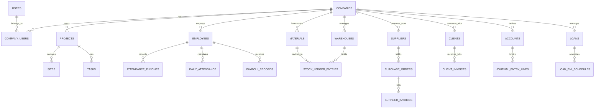

# BUILDFLOW — DATABASE SCHEMA SPECIFICATION

## 1. Relational Entity Relationship Diagram

---

## 2. Table Schemas & Fields

### Tenant & Access Control
- `companies`: `id`, `name`, `legal_name`, `tax_id` (GSTIN), `currency` (INR), `created_at`, `updated_at`
- `users`: `id`, `name`, `email`, `password`, `is_active`, `remember_token`, `timestamps`
- `roles`: `id`, `company_id`, `name`, `slug`, `permissions` (JSON), `timestamps`
- `company_user`: `id`, `company_id`, `user_id`, `role_id`, `status` (active/invited/suspended), `timestamps`

### Projects & Site Operations
- `clients`: `id`, `company_id`, `name`, `contact_person`, `email`, `phone`, `gstin`, `address`, `timestamps`
- `projects`: `id`, `company_id`, `client_id`, `code`, `name`, `project_type` (civil/interior/maintenance/earthmoving), `start_date`, `target_date`, `completion_date`, `contract_value` (DECIMAL 15,2), `approved_budget` (DECIMAL 15,2), `status` (planned/active/on_hold/completed/cancelled), `progress_percent` (TINYINT), `manager_id`, `timestamps`
- `sites`: `id`, `company_id`, `project_id`, `name`, `location`, `supervisor_id`, `timestamps`
- `daily_site_logs`: `id`, `company_id`, `site_id`, `log_date`, `work_summary`, `delays`, `worker_count`, `created_by`, `timestamps`

### Workforce & Attendance
- `employees`: `id`, `company_id`, `code`, `first_name`, `last_name`, `employment_type` (full_time/contract/daily_wage), `designation`, `department`, `daily_rate`, `monthly_salary`, `bank_account_no`, `ifsc_code`, `status`, `timestamps`
- `shifts`: `id`, `company_id`, `name`, `start_time`, `end_time`, `grace_minutes`, `timestamps`
- `attendance_punches`: `id`, `company_id`, `employee_id`, `site_id`, `punch_time`, `punch_type` (in/out), `source` (biometric_import/manual/mobile), `device_serial`, `raw_payload`, `timestamps`
- `daily_attendance`: `id`, `company_id`, `employee_id`, `site_id`, `project_id`, `attendance_date`, `status` (present/half_day/absent/on_leave), `worked_hours`, `overtime_hours`, `is_approved`, `approved_by`, `timestamps`

### Materials & Inventory Ledger
- `material_categories`: `id`, `company_id`, `name`, `timestamps`
- `materials`: `id`, `company_id`, `category_id`, `code`, `name`, `unit_of_measure` (MT, bags, cum, sqm, nos), `reorder_level`, `standard_cost`, `timestamps`
- `warehouses`: `id`, `company_id`, `site_id` (nullable), `name`, `type` (central/site_store), `timestamps`
- `stock_ledger_entries`: `id`, `company_id`, `material_id`, `warehouse_id`, `reference_type` (goods_receipt/site_issue/transfer/adjustment), `reference_id`, `quantity` (DECIMAL 12,3), `direction` (in/out), `unit_price`, `total_valuation`, `balance_after`, `timestamps`

### Procurement & Supplier Payables
- `suppliers`: `id`, `company_id`, `name`, `gstin`, `payment_terms`, `bank_details`, `timestamps`
- `purchase_requests`: `id`, `company_id`, `project_id`, `site_id`, `requested_by`, `status` (pending/approved/rejected/ordered), `timestamps`
- `purchase_orders`: `id`, `company_id`, `supplier_id`, `project_id`, `po_number`, `order_date`, `total_amount`, `status`, `approved_by`, `timestamps`
- `goods_receipts`: `id`, `company_id`, `purchase_order_id`, `warehouse_id`, `grn_number`, `received_date`, `timestamps`
- `supplier_invoices`: `id`, `company_id`, `supplier_id`, `purchase_order_id`, `invoice_number`, `invoice_date`, `due_date`, `subtotal`, `tax_amount`, `total_amount`, `paid_amount`, `status` (draft/pending_approval/approved/paid/partially_paid), `timestamps`

### Billing & Client Receivables
- `client_invoices`: `id`, `company_id`, `client_id`, `project_id`, `invoice_number`, `bill_type` (milestone/progress_ra), `issue_date`, `due_date`, `subtotal`, `cgst_amount`, `sgst_amount`, `igst_amount`, `retention_rate`, `retention_amount`, `total_payable`, `paid_amount`, `status` (draft/submitted/approved/paid/partially_paid/overdue), `timestamps`
- `invoice_payments`: `id`, `company_id`, `client_invoice_id`, `payment_date`, `amount`, `payment_mode`, `transaction_ref`, `timestamps`

### Financial Accounting & Loans
- `accounts`: `id`, `company_id`, `code`, `name`, `account_type` (asset/liability/equity/income/expense), `parent_id`, `is_active`, `timestamps`
- `journal_entries`: `id`, `company_id`, `entry_number`, `entry_date`, `memo`, `reference_type`, `reference_id`, `status` (draft/posted), `posted_at`, `posted_by`, `timestamps`
- `journal_entry_lines`: `id`, `journal_entry_id`, `account_id`, `debit` (DECIMAL 15,2), `credit` (DECIMAL 15,2), `description`, `project_id` (nullable)
- `loans`: `id`, `company_id`, `lender_name`, `loan_type` (equipment_finance/working_capital), `principal_amount`, `interest_rate_percent`, `tenure_months`, `start_date`, `monthly_emi`, `status`, `timestamps`
- `loan_emi_schedules`: `id`, `loan_id`, `installment_no`, `due_date`, `principal_component`, `interest_component`, `total_emi`, `status` (pending/paid), `paid_date`, `timestamps`
