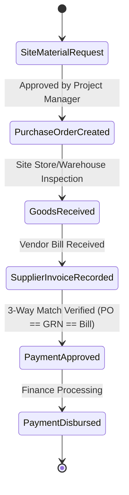
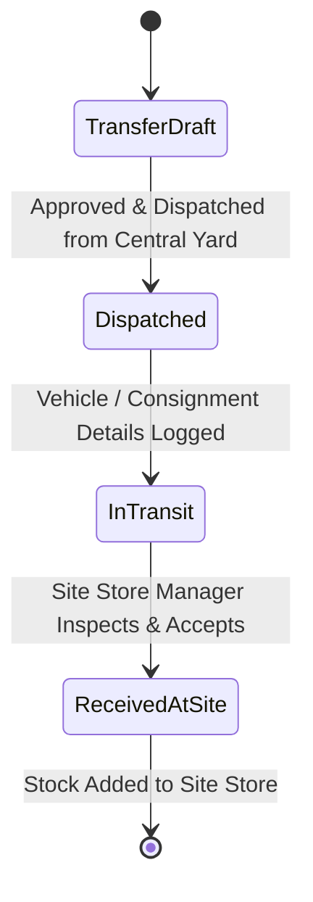
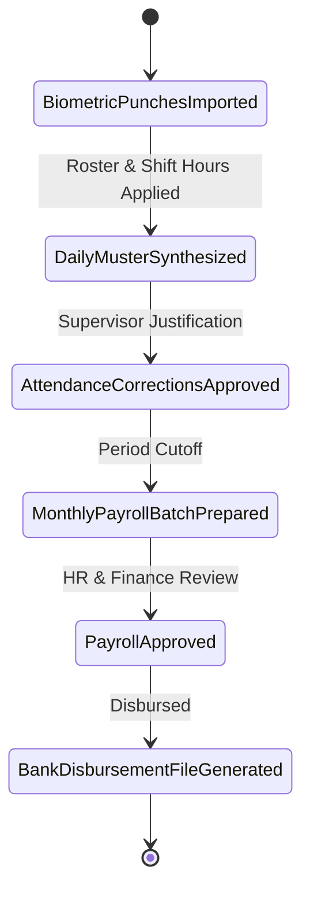
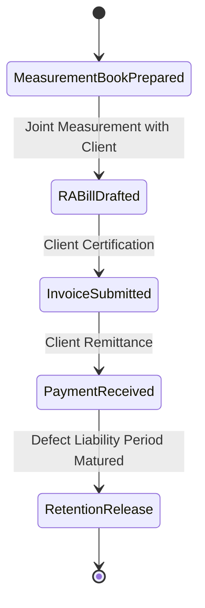

# BUILDFLOW — KEY BUSINESS WORKFLOWS & STATE MACHINES

## 1. Procurement & Payables Workflow (Three-Way Matching)

### Steps & Invariants
1. **Material Request**: A site engineer submits an indent specifying materials, quantity, target site, and need date.
2. **Purchase Order**: Procurement generates a PO against an authorized supplier. PO status moves: `Draft -> Submitted -> Approved -> Sent`.
3. **Goods Receipt Note (GRN)**: Site stores check delivered goods, noting accepted vs rejected quantities. Accepted quantities immediately credit the stock ledger.
4. **Three-Way Matching**: The system validates that the billed unit prices and quantities do not exceed PO rates and GRN received quantities without authorized variances.
5. **Payment Settlement**: Accounts team releases partial or full payment via recorded bank/cheque transaction.

---

## 2. Inventory & Multi-Site Stock Movement Workflow

### Invariants
- **Atomic Operations**: A transfer decreases source warehouse stock and increases destination warehouse stock within a single database transaction.
- **Strict Ledger**: No direct modification of `current_stock` fields without a corresponding `stock_ledger_entries` record.
- **Negative Stock Protection**: Dispatches exceeding available unallocated quantity are rejected unless company override is explicitly configured.

---

## 3. Attendance, Overtime & Payroll Generation

### Invariants
- Raw punches are never deleted or updated.
- Overtime must be verified and approved by the site supervisor before contributing to wage calculations.
- Finalized payroll records are locked against retrospective modification; discrepancies are addressed via retroactive adjustment vouchers in subsequent pay periods.

---

## 4. Client Progress Billing (RA Bills) & Retention

### Calculations
- `Subtotal` = Cumulative Work Done - Previous RA Bills
- `GST` = Applicable CGST + SGST or IGST (e.g. 18%)
- `Retention Amount` = Subtotal * Retention Rate (e.g. 5%)
- `Net Payable` = Subtotal + GST - Retention - TDS Deductions
