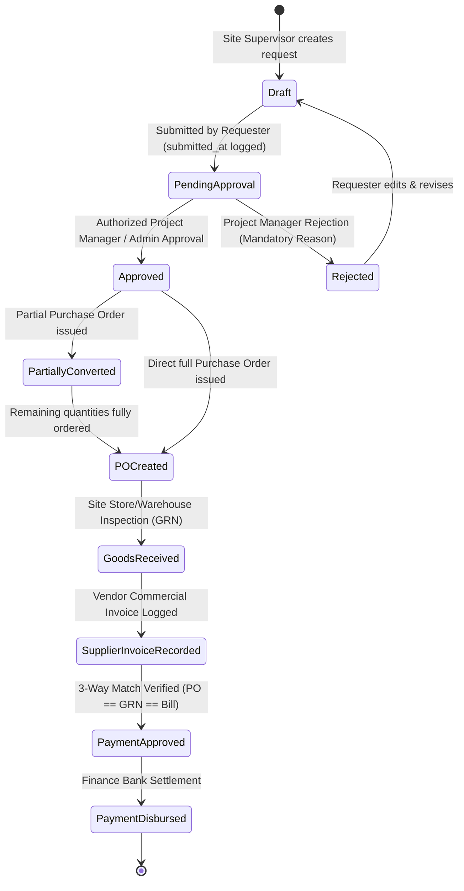
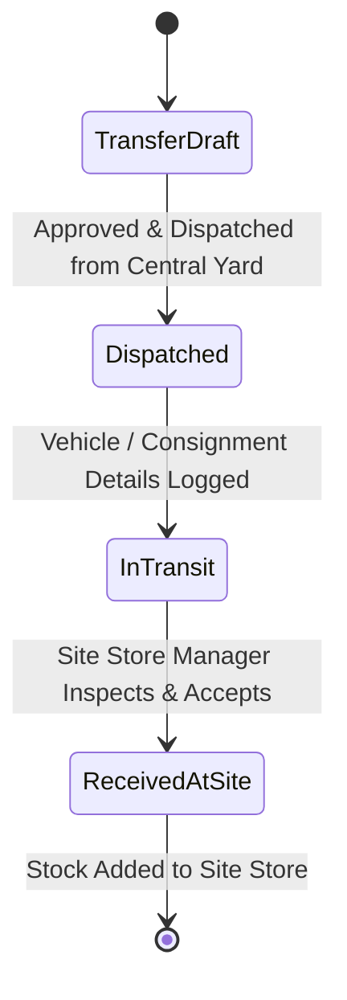
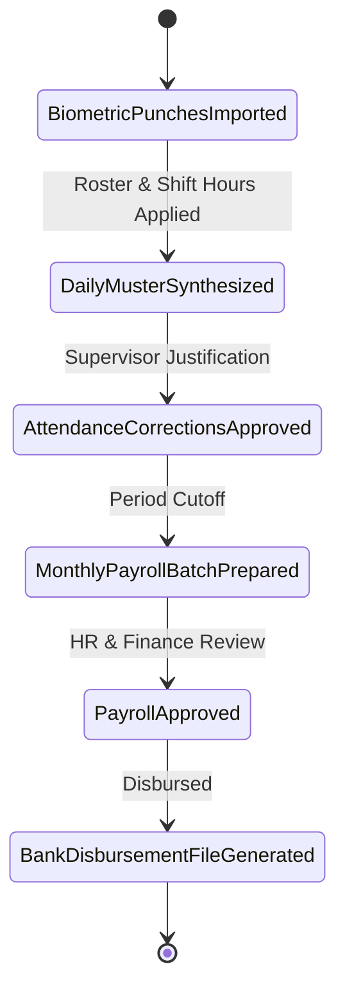
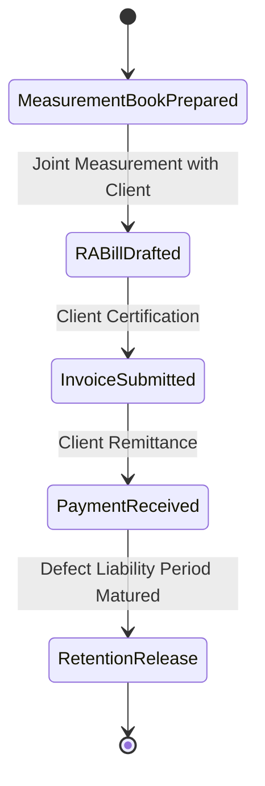
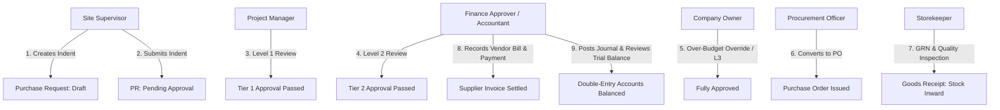
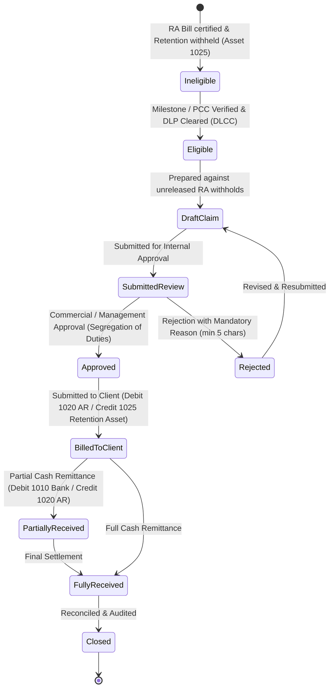

# BUILDFLOW — KEY BUSINESS WORKFLOWS & STATE MACHINES

## 1. Purchase Request (Material Indent), PM Approval & Procurement Conversion

### Steps & Invariants
1. **Material Indent Creation (Site Supervisor)**:
   - Site Supervisor generates a human-readable request reference (`PR-YYYY-XXXXX`).
   - Validates that site belongs to the selected project and user is authorized to manage the site.
   - Itemized lines contain material, positive requested quantity, unit of measurement, specifications, and estimated rate.
   - **Non-Destructive Stock Availability**: Computes ledger-backed available stock at the intended destination warehouse without creating holds, reservations, or deductions. Recommends internal stock transfers from central yards when destination has a shortfall.
2. **Submission, Budget Validation & Multi-Tier Routing**:
   - Requisition status transitions `Draft -> Pending Approval` with recorded `submitted_at` timestamp.
   - **Project Budget Controls**: Evaluates approved expenditure budget against actual posted costs (expenses + supplier bills) and existing commitments (unbilled POs + unconverted PRs) without double counting. If request exceeds budget, flags `is_over_budget = true` with calculated overrun amount.
   - Incomplete pricing is honestly flagged (`is_pricing_complete = false`) rather than assuming zero cost.
   - **Dynamic Approval Policy Evaluation**: Determines required approval levels based on company-configured tiers (e.g. Tier 1: PM, Tier 2: Finance Review, Tier 3: Owner sign-off). Over-budget or critical requests automatically require Company Owner authorization.
3. **Multi-Level Approval Decisions & Segregation of Duties**:
   - Authorized approver for the active tier (`current_approval_level`) reviews the request.
   - **Segregation of Duties**: Requesters are strictly barred from approving their own purchase requests.
   - **Server-Side Enforcement**: Approval actions verify role authority against the configured policy on the server; hiding buttons is insufficient.
   - **Over-Budget Exceptions**: Over-budget requests require a recorded override reason (min 5 characters) and must be authorized by a Company Owner or Administrator.
   - **Sequential Progression**: Once Tier 1 is approved, `current_approval_level` advances to Tier 2 until all configured levels are satisfied, updating status to `approved`.
   - **Decision Logging**: Every decision is permanently audited in `purchase_request_approvals` with approver, timestamp, action, role, policy tier, comments, and budget state.
   - **Rejection**: Requires a mandatory, recorded reason for audit trail compliance. Notifies requester and unlocks request for revision and resubmission.
4. **Procurement Conversion Safeguards**:
   - Actionable only when all required approval levels have been completed and any budget override verified.
   - Enables selecting an approved supplier, partial or full quantities, unit prices, and GST rates (CGST/SGST/IGST).
   - **Pre-Conversion Safeguards**: Rechecks remaining quantities, refreshes stock ledger balances, recalculates project budget impact, and acquires database row locks (`lockForUpdate()`) to prevent race conditions or duplicate conversion.
   - Atomic Database Transaction: Generates `PurchaseOrder` and `PurchaseOrderItem` with foreign key links back to `purchase_requests` and `purchase_request_items`.
   - Status updates atomically: transitions to `partially_converted` if requested items remain, or `po_created` once all items are ordered.
5. **Downstream Integration (GRN & 3-Way Match)**:
   - Converted PO feeds directly into Goods Receipt (GRN) inspection where accepted quantities credit the stock ledger.
   - Supplier commercial invoices match against the PO and GRN for financial accounts settlement.

---

## 2. Inventory & Multi-Site Stock Movement Workflow

### Invariants
- **Atomic Operations**: A transfer decreases source warehouse stock and increases destination warehouse stock within a single database transaction.
- **Strict Ledger**: No direct modification of `current_stock` fields without a corresponding `stock_ledger_entries` record.
- **Negative Stock Protection**: Dispatches exceeding available unallocated quantity are rejected unless company override is explicitly configured.

---

## 3. Attendance, Overtime & Payroll Generation

### Invariants
- Raw punches are never deleted or updated.
- Overtime must be verified and approved by the site supervisor before contributing to wage calculations.
- Finalized payroll records are locked against retrospective modification; discrepancies are addressed via retroactive adjustment vouchers in subsequent pay periods.

---

## 4. Client Progress Billing (RA Bills) & Retention

### Calculations
- `Subtotal` = Cumulative Work Done - Previous RA Bills
- `GST` = Applicable CGST + SGST or IGST (e.g. 18%)
- `Retention Amount` = Subtotal * Retention Rate (e.g. 5%)
- `Net Payable` = Subtotal + GST - Retention - TDS Deductions

---

## 5. Role-Specific Execution Paths & Governance

### Role Governance Invariants
1. **Site Supervisor (`site@buildflow.local`)**:
   - Scope limited to assigned projects and sites.
   - Submits daily site logs, updates worker muster roll, and creates material indents.
   - Gated from viewing wage rates, bank accounts, or financial ledgers (HTTP 403 on direct route access).
2. **Project Manager (`pm@buildflow.local`)**:
   - Manages projects, reviews milestones, and conducts Tier 1 purchase request approvals.
   - Prohibited from self-approving purchase requests they initiated (Segregation of Duties).
3. **HR / Payroll Officer (`hr@buildflow.local`)**:
   - Generates payroll periods from approved attendance muster roll data.
   - Prepares wage batches, calculates statutory deductions (PF) and overtime.
   - Finalizes and disburses payroll; locks historical attendance dates from subsequent edits.
4. **Finance Approver / Accountant (`accounts@buildflow.local`)**:
   - Reviews Tier 2 high-value or over-budget purchase requests.
   - Records client invoice payments with pessimistic locking (`lockForUpdate()`), preventing overpayment.
   - Enforces balanced debit/credit equality on journal entries.
   - Blocked from modifying company procurement approval policies (HTTP 403).
5. **Procurement Officer (`procurement@buildflow.local`)**:
   - Reviews fully approved purchase requests and converts approved line items into Purchase Orders.
   - Blocked from creating unapproved POs directly or bypassing policy thresholds.
6. **Storekeeper (`storekeeper@buildflow.local`)**:
   - Inspects physical deliveries, records delivery challan & vehicle registration, logs accepted vs rejected quantities with mandatory reasons.
   - Inward movements credit `StockLedgerEntry` automatically. Rejections do not inflate inventory valuation.
7. **Company Owner / Administrator (`admin@buildflow.local`)**:
   - Holds company-wide management authority (`*`).
   - Only role authorized to grant budget overrun overrides and configure company approval policy thresholds.

---

## 6. Client Retention Release & Defect Liability Workflow

### Steps & Invariants

1. **Contractual Retention Configuration**:
   - Retention terms are defined per `ClientContract` (e.g. rate 5.0% - 10.0%, maximum retention cap, 12 or 24 months DLP duration, and release schedule e.g. `staged_50_50` or `single_full_release`).
   - Does not assume hardcoded rates or fixed release splits; contracts validate against maximum cumulative withholding limits.
   - Separate client-side retention asset from supplier/subcontractor retention liabilities.

2. **Eligibility & Engineering Certifications**:
   - **Stage 1 (Practical Completion - 50%)**: Requires a verified Practical Completion Certificate (`PCC`) issued by the supervising engineer or consulting authority.
   - **Stage 2 (Defect Liability Expiry - 50%)**: Requires that the Defect Liability Period (`DLP`) has fully elapsed from the start basis date AND an approved DLP Clearance Certificate (`DLCC`) has verified that all snag list items/defects are 100% rectified (`all_defects_rectified = true`, `defect_count_reported == defect_count_resolved`).
   - Ineligible stages display specific contractual blockers (e.g. *"Defect Liability Period active until 08 Oct 2027 (12 months remaining)"* or *"Practical Completion Certificate required"*).

3. **Release Claim Preparation & Traceability**:
   - Claims can only be drafted against eligible, unreleased balances.
   - Claim preparation atomically allocates the release amount across source RA bills (`retention_claim_invoice_items`), tracking `source_retention_amount`, `previously_claimed_amount`, and `claim_allocated_amount`.
   - Pessimistic row locking (`lockForUpdate()`) ensures concurrent users cannot claim the same retained amount twice.

4. **Internal Approval & Segregation of Duties**:
   - Claims require management / finance sign-off before being dispatched to the client.
   - **Segregation of Duties**: The user who prepared/drafted the claim cannot approve their own claim unless they hold the Company Owner / Administrator role.
   - **Rejection**: Requires a mandatory, recorded reason (min 5 characters) and retains full audit history.

5. **Client Submission & Revenue-Neutral Accounting**:
   - Marking a claim as submitted records the client inward reference and dispatch date.
   - **Zero Revenue Duplication**: Revenue was already recognized at the time of original RA billing. Release of retention simply converts a long-term retention receivable asset into a currently due trade receivable.
   - **Balanced Journal Entry**:
     - **Debit**: Account `1020` (Accounts Receivable / Trade Debtors)
     - **Credit**: Account `1025` (Retention Money Withheld by Clients)

6. **Client Remittance & Receipt Settlement**:
   - Authorized finance users record cash/bank receipts against approved/billed claims.
   - Supports partial and final settlement with bank account selection, payment mode (NEFT/RTGS, Cheque, Cash), and UTR reference number.
   - Database row-locking prevents overpayment or double-allocation exceeding `claim->balanceDue()`.
   - **Balanced Receipt Journal Entry**:
     - **Debit**: Account `1010` (Operating Bank Account)
     - **Credit**: Account `1020` (Accounts Receivable)
   - Real-time updates reflect across the live Retention Register and client balance sheets without duplicate balance copies.

