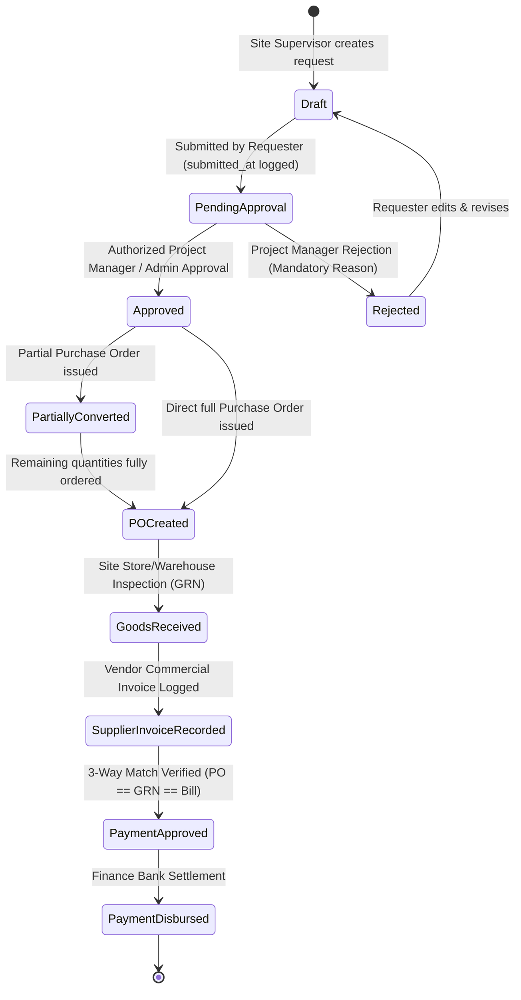
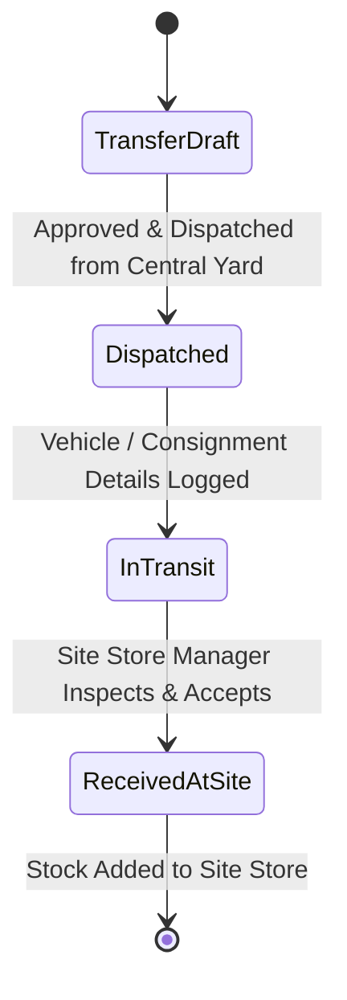
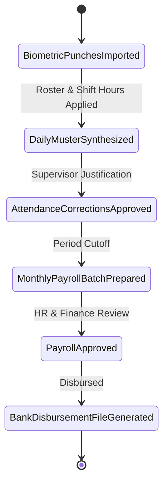
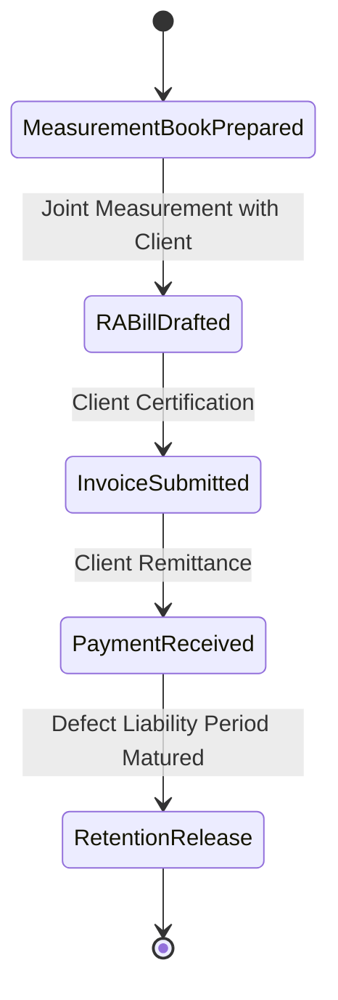
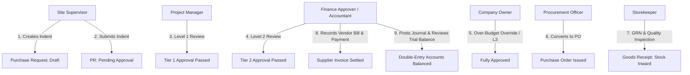
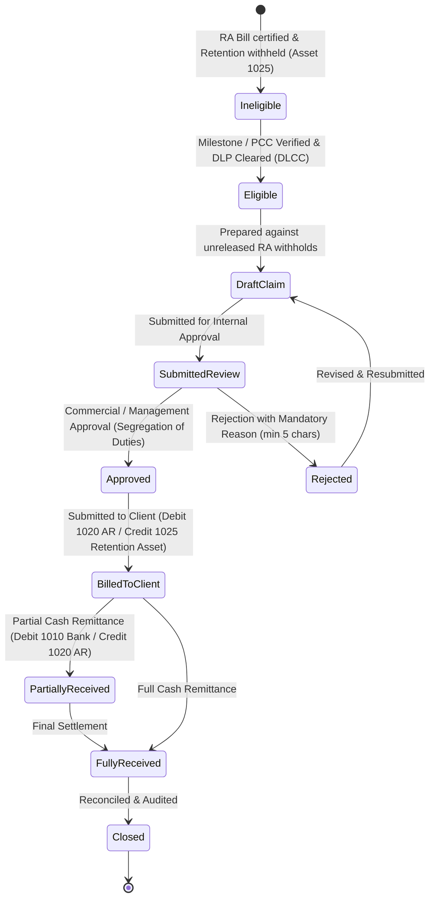
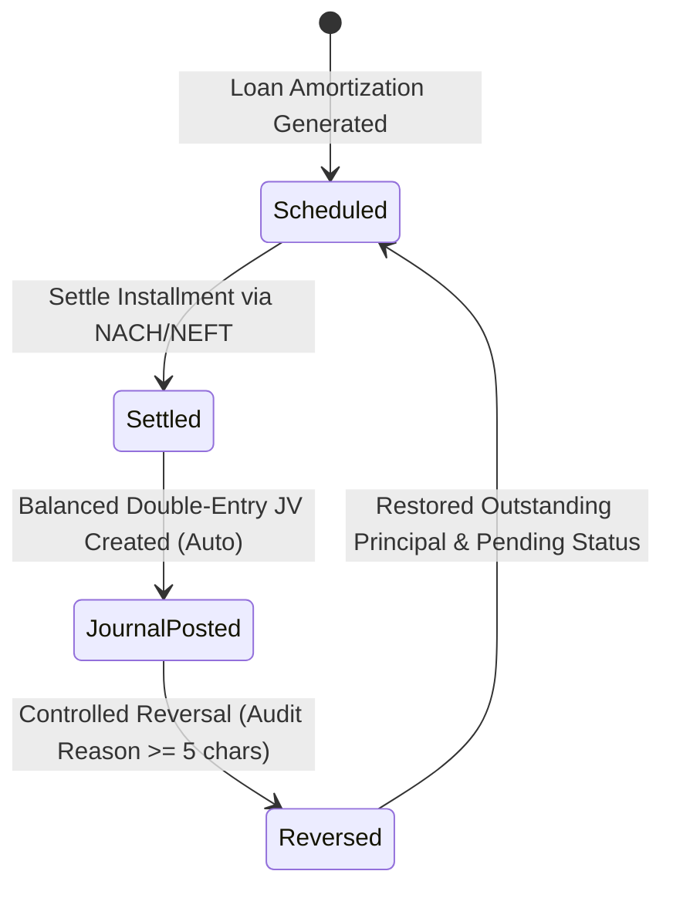
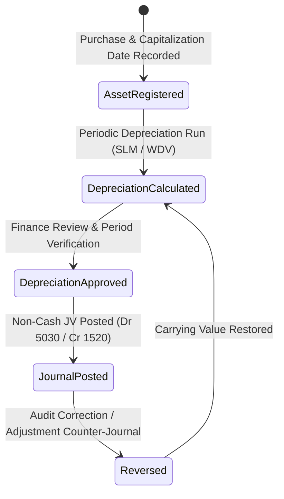
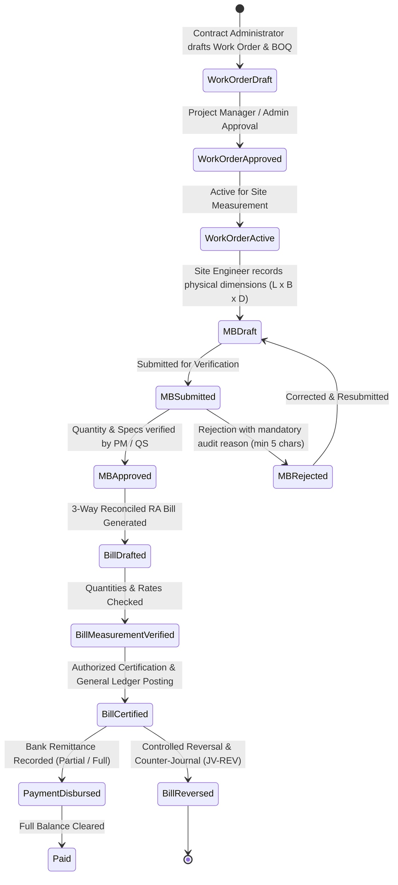
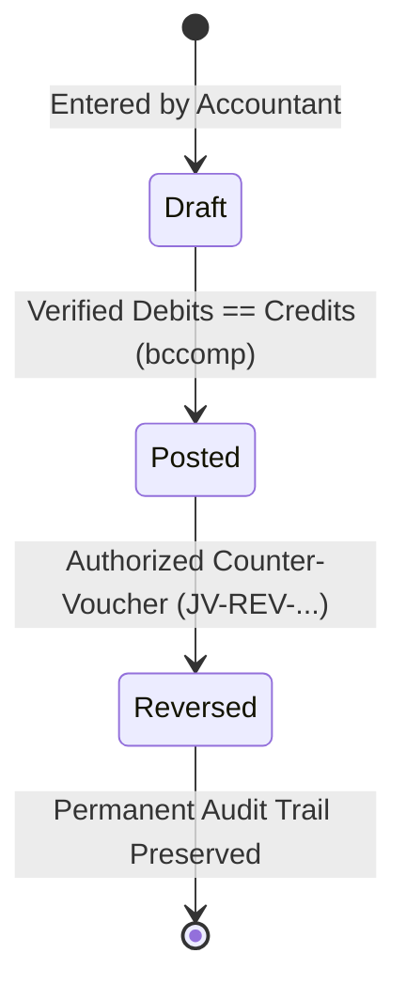

# BUILDFLOW — KEY BUSINESS WORKFLOWS & STATE MACHINES

## 1. Purchase Request (Material Indent), PM Approval & Procurement Conversion

### Steps & Invariants
1. **Material Indent Creation (Site Supervisor)**:
   - Site Supervisor generates a human-readable request reference (`PR-YYYY-XXXXX`).
   - Validates that site belongs to the selected project and user is authorized to manage the site.
   - Itemized lines contain material, positive requested quantity, unit of measurement, specifications, and estimated rate.
   - **Non-Destructive Stock Availability**: Computes ledger-backed available stock at the intended destination warehouse without creating holds, reservations, or deductions. Recommends internal stock transfers from central yards when destination has a shortfall.
2. **Submission, Budget Validation & Multi-Tier Routing**:
   - Requisition status transitions `Draft -> Pending Approval` with recorded `submitted_at` timestamp.
   - **Project Budget Controls**: Evaluates approved expenditure budget against actual posted costs (expenses + supplier bills) and existing commitments (unbilled POs + unconverted PRs) without double counting. If request exceeds budget, flags `is_over_budget = true` with calculated overrun amount.
   - Incomplete pricing is honestly flagged (`is_pricing_complete = false`) rather than assuming zero cost.
   - **Dynamic Approval Policy Evaluation**: Determines required approval levels based on company-configured tiers (e.g. Tier 1: PM, Tier 2: Finance Review, Tier 3: Owner sign-off). Over-budget or critical requests automatically require Company Owner authorization.
3. **Multi-Level Approval Decisions & Segregation of Duties**:
   - Authorized approver for the active tier (`current_approval_level`) reviews the request.
   - **Segregation of Duties**: Requesters are strictly barred from approving their own purchase requests.
   - **Server-Side Enforcement**: Approval actions verify role authority against the configured policy on the server; hiding buttons is insufficient.
   - **Over-Budget Exceptions**: Over-budget requests require a recorded override reason (min 5 characters) and must be authorized by a Company Owner or Administrator.
   - **Sequential Progression**: Once Tier 1 is approved, `current_approval_level` advances to Tier 2 until all configured levels are satisfied, updating status to `approved`.
   - **Decision Logging**: Every decision is permanently audited in `purchase_request_approvals` with approver, timestamp, action, role, policy tier, comments, and budget state.
   - **Rejection**: Requires a mandatory, recorded reason for audit trail compliance. Notifies requester and unlocks request for revision and resubmission.
4. **Procurement Conversion Safeguards**:
   - Actionable only when all required approval levels have been completed and any budget override verified.
   - Enables selecting an approved supplier, partial or full quantities, unit prices, and GST rates (CGST/SGST/IGST).
   - **Pre-Conversion Safeguards**: Rechecks remaining quantities, refreshes stock ledger balances, recalculates project budget impact, and acquires database row locks (`lockForUpdate()`) to prevent race conditions or duplicate conversion.
   - Atomic Database Transaction: Generates `PurchaseOrder` and `PurchaseOrderItem` with foreign key links back to `purchase_requests` and `purchase_request_items`.
   - Status updates atomically: transitions to `partially_converted` if requested items remain, or `po_created` once all items are ordered.
5. **Downstream Integration (GRN & 3-Way Match)**:
   - Converted PO feeds directly into Goods Receipt (GRN) inspection where accepted quantities credit the stock ledger.
   - Supplier commercial invoices match against the PO and GRN for financial accounts settlement.

---

## 2. Inventory & Multi-Site Stock Movement Workflow

### Invariants
- **Atomic Operations**: A transfer decreases source warehouse stock and increases destination warehouse stock within a single database transaction.
- **Strict Ledger**: No direct modification of `current_stock` fields without a corresponding `stock_ledger_entries` record.
- **Negative Stock Protection**: Dispatches exceeding available unallocated quantity are rejected unless company override is explicitly configured.

---

## 3. Attendance, Overtime & Payroll Generation

### Invariants
- Raw punches are never deleted or updated.
- Overtime must be verified and approved by the site supervisor before contributing to wage calculations.
- Finalized payroll records are locked against retrospective modification; discrepancies are addressed via retroactive adjustment vouchers in subsequent pay periods.

---

## 4. Client Progress Billing (RA Bills) & Retention

### Calculations
- `Subtotal` = Cumulative Work Done - Previous RA Bills
- `GST` = Applicable CGST + SGST or IGST (e.g. 18%)
- `Retention Amount` = Subtotal * Retention Rate (e.g. 5%)
- `Net Payable` = Subtotal + GST - Retention - TDS Deductions

---

## 5. Role-Specific Execution Paths & Governance

### Role Governance Invariants
1. **Site Supervisor (`site@buildflow.local`)**:
   - Scope limited to assigned projects and sites.
   - Submits daily site logs, updates worker muster roll, and creates material indents.
   - Gated from viewing wage rates, bank accounts, or financial ledgers (HTTP 403 on direct route access).
2. **Project Manager (`pm@buildflow.local`)**:
   - Manages projects, reviews milestones, and conducts Tier 1 purchase request approvals.
   - Prohibited from self-approving purchase requests they initiated (Segregation of Duties).
3. **HR / Payroll Officer (`hr@buildflow.local`)**:
   - Generates payroll periods from approved attendance muster roll data.
   - Prepares wage batches, calculates statutory deductions (PF) and overtime.
   - Finalizes and disburses payroll; locks historical attendance dates from subsequent edits.
4. **Finance Approver / Accountant (`accounts@buildflow.local`)**:
   - Reviews Tier 2 high-value or over-budget purchase requests.
   - Records client invoice payments with pessimistic locking (`lockForUpdate()`), preventing overpayment.
   - Enforces balanced debit/credit equality on journal entries.
   - Blocked from modifying company procurement approval policies (HTTP 403).
5. **Procurement Officer (`procurement@buildflow.local`)**:
   - Reviews fully approved purchase requests and converts approved line items into Purchase Orders.
   - Blocked from creating unapproved POs directly or bypassing policy thresholds.
6. **Storekeeper (`storekeeper@buildflow.local`)**:
   - Inspects physical deliveries, records delivery challan & vehicle registration, logs accepted vs rejected quantities with mandatory reasons.
   - Inward movements credit `StockLedgerEntry` automatically. Rejections do not inflate inventory valuation.
7. **Company Owner / Administrator (`admin@buildflow.local`)**:
   - Holds company-wide management authority (`*`).
   - Only role authorized to grant budget overrun overrides and configure company approval policy thresholds.

---

## 6. Client Retention Release & Defect Liability Workflow

### Steps & Invariants

1. **Contractual Retention Configuration**:
   - Retention terms are defined per `ClientContract` (e.g. rate 5.0% - 10.0%, maximum retention cap, 12 or 24 months DLP duration, and release schedule e.g. `staged_50_50` or `single_full_release`).
   - Does not assume hardcoded rates or fixed release splits; contracts validate against maximum cumulative withholding limits.
   - Separate client-side retention asset from supplier/subcontractor retention liabilities.

2. **Eligibility & Engineering Certifications**:
   - **Stage 1 (Practical Completion - 50%)**: Requires a verified Practical Completion Certificate (`PCC`) issued by the supervising engineer or consulting authority.
   - **Stage 2 (Defect Liability Expiry - 50%)**: Requires that the Defect Liability Period (`DLP`) has fully elapsed from the start basis date AND an approved DLP Clearance Certificate (`DLCC`) has verified that all snag list items/defects are 100% rectified (`all_defects_rectified = true`, `defect_count_reported == defect_count_resolved`).
   - Ineligible stages display specific contractual blockers (e.g. *"Defect Liability Period active until 08 Oct 2027 (12 months remaining)"* or *"Practical Completion Certificate required"*).

3. **Release Claim Preparation & Traceability**:
   - Claims can only be drafted against eligible, unreleased balances.
   - Claim preparation atomically allocates the release amount across source RA bills (`retention_claim_invoice_items`), tracking `source_retention_amount`, `previously_claimed_amount`, and `claim_allocated_amount`.
   - Pessimistic row locking (`lockForUpdate()`) ensures concurrent users cannot claim the same retained amount twice.

4. **Internal Approval & Segregation of Duties**:
   - Claims require management / finance sign-off before being dispatched to the client.
   - **Segregation of Duties**: The user who prepared/drafted the claim cannot approve their own claim unless they hold the Company Owner / Administrator role.
   - **Rejection**: Requires a mandatory, recorded reason (min 5 characters) and retains full audit history.

5. **Client Submission & Revenue-Neutral Accounting**:
   - Marking a claim as submitted records the client inward reference and dispatch date.
   - **Zero Revenue Duplication**: Revenue was already recognized at the time of original RA billing. Release of retention simply converts a long-term retention receivable asset into a currently due trade receivable.
   - **Balanced Journal Entry**:
     - **Debit**: Account `1020` (Accounts Receivable / Trade Debtors)
     - **Credit**: Account `1025` (Retention Money Withheld by Clients)

6. **Client Remittance & Receipt Settlement**:
   - Authorized finance users record cash/bank receipts against approved/billed claims.
   - Supports partial and final settlement with bank account selection, payment mode (NEFT/RTGS, Cheque, Cash), and UTR reference number.
   - Database row-locking prevents overpayment or double-allocation exceeding `claim->balanceDue()`.
   - **Balanced Receipt Journal Entry**:
     - **Debit**: Account `1010` (Operating Bank Account)
     - **Credit**: Account `1020` (Accounts Receivable)
   - Real-time updates reflect across the live Retention Register and client balance sheets without duplicate balance copies.

---

## 6. Equipment Loan Financing & Automated EMI Accounting Settlement

### Steps & Accounting Rules
1. **Amortization & Schedule Initialization**:
   - Equipment financing loans establish amortized repayment schedules split into **Principal Component** and **Interest Component**.
   - Associated with financed equipment asset (`Loan::fixed_asset_id`) without conflating gross asset acquisition cost with debt liability.
2. **EMI Settlement & Double-Entry Ledger Posting**:
   - Settlement triggers atomic database transaction with pessimistic row-locking (`LoanEmiSchedule::lockForUpdate()`).
   - Prevents duplicate settlement on retry (`schedule->status === 'paid'` or `journal_entry_id !== null`).
   - Verifies exact decimal equality (`bccomp($principal + $interest, $totalEmi, 2) === 0`).
   - Generates immutable General Ledger Journal Entry (`JV-EMI-YYYY-XXXXX`):
     - **Debit**: Account `2010` (Equipment Financing Loans & Borrowings) — Principal repayment reduces debt liability.
     - **Debit**: Account `5020` (Loan Interest & Financing Charges) — Cost of capital charged to finance expense.
     - **Credit**: Account `1010` (Operating Bank Account) — Cash outflow from bank.
   - Project cost-center attribution: If the financed asset is deployed to an active project, lines track `project_id`.
   - Outstanding principal balance on `Loan` is reduced by the principal component; loan automatically marks `closed` once principal reaches zero.
3. **Controlled Reversal Process**:
   - Reversal requires a mandatory audited reason (min 5 characters) and authorization check.
   - Marks original journal entry status as `reversed` (`reversed_by`, `reversed_at`, `reversal_reason`).
   - Posts a counter-balancing journal entry (`JV-REV-YYYY-XXXXX`) swapping debits and credits:
     - **Debit**: Account `1010` (Operating Bank Account)
     - **Credit**: Account `2010` (Loan Liability)
     - **Credit**: Account `5020` (Loan Interest Expense)
   - Restores loan `outstanding_principal` and resets schedule status to `pending`.

---

## 7. Fixed Asset Capitalization & Periodic Depreciation Lifecycle

### Steps & Calculation Rules
1. **Asset Register & Capitalization**:
   - Fixed assets are distinct from consumable inventory stock receipts.
   - Captures asset code, category, make, model, serial number, capitalization date, purchase date, total capitalized cost, salvage residual value, useful life (years/months), depreciation method, and deployed project.
   - Total depreciable basis = `Total Capitalized Cost - Residual Salvage Value`.
2. **Deterministic Periodic Depreciation Engine**:
   - Supports **Straight-Line Method (SLM)**: `Monthly Depr = Depreciable Basis / Useful Life Months`.
   - Supports **Written-Down Value (WDV)**: `Monthly Depr = Opening Book Value * (Annual Rate / 12)`.
   - **Pro-Rata Partial Period Scaling**: If an asset is capitalized mid-month, active days are computed (`activeStartDate->diffInDays(periodEnd) + 1`) and depreciation is scaled proportionally (`fullMonthlyDepr * activeDays / daysInMonth`).
   - **Salvage Value Floor**: Depreciable amount is strictly capped at `max(0, Opening Book Value - Residual Value)`. Assets are never depreciated below residual salvage value.
   - **Duplicate Prevention**: Unique composite constraint `['company_id', 'fixed_asset_id', 'period_start_date', 'period_end_date']` prevents duplicate calculations or postings for the same asset and accounting period.
3. **Non-Cash Accounting Journal Posting**:
   - Depreciation posting is strictly non-cash; bank accounts and loan debt balances are untouched.
   - Generates immutable Journal Entry (`JV-DEPR-YYYY-XXXXX`):
     - **Debit**: Account `5030` (Depreciation Expense - Heavy Equipment & Fleet) — charged to deployed `project_id` cost center.
     - **Credit**: Account `1520` (Accumulated Depreciation - Plant & Machinery) — contra-asset balance sheet account.
   - Atomically updates asset `accumulated_depreciation` and reduces `current_book_value`.
4. **Fleet Period Review & Batch Posting**:
   - Fleet-wide period review screen (`/assets/period-review`) displays active units, unposted depreciation, and already posted GL amounts.
   - "Post All Journals" button executes batch calculation and GL journal creation across all eligible fleet equipment atomically.
5. **Controlled Depreciation Reversal**:
   - Reversal generates counter-journal entry (`JV-REV-YYYY-XXXXX`): Debit `1520` Accumulated Depr / Credit `5030` Depreciation Expense.
   - Restores asset `accumulated_depreciation` and `current_book_value` without deleting historical audit records.

---

## 8. Subcontractor Work Orders, Measurement Book (MB) & Bill Certification Lifecycle

### Steps, Mathematics & Invariants
1. **Subcontractor Work Order & BOQ Definition**:
   - Subcontractor work orders are strictly distinguished from material purchase orders. Material POs acquire goods into warehouse inventory; work orders contract physical construction activities (earth excavation, backfilling, compaction, RCC, drainage).
   - Captures company, project, site, subcontractor (linked vendor), scope, work category, dates, payment terms, retention % (default 5%), TDS % (194C 1% or 2%), and GST % (default 18%).
   - Itemized Bill of Quantities (BOQ): Item code, description, unit of measure (`cum`, `sqm`, `rmt`, `mt`, `nos`, `trips`, `hrs`), approved quantity, unit rate, and total line amount.
   - **Controlled Variations**: Changes to approved quantities or rates require an authorized variation (`VAR-YYYY-XXXXX`) updating `revised_quantity`, `revised_rate`, and work order `revised_value` with full justification and audit trail.
2. **Digital Measurement Book (MB)**:
   - Captures physical site work executed against a specific approved work order line.
   - Deterministic Calculation:
     $$\text{Calculated Qty} = \text{Multiplier Units} \times \text{Length} \times \text{Breadth} \times \text{Height/Depth}$$
     (or unit repetition / trip count / hourly log according to work method).
   - **Manual Overrides**: Permitted only when accompanied by a mandatory authorized override reason.
   - **Cumulative Quantity Limits**: Cumulative measured quantity ($\sum \text{approved MB} + \text{current}$) is validated against the work order item's approved/revised quantity limit. Exceeding limits throws a validation exception unless an authorized variation has increased the contract limit.
3. **Measurement Review & Approval State Machine**:
   - `Draft -> Submitted -> Approved / Rejected -> Certified`.
   - Site Engineers submit measurements; Project Managers or Quantity Surveyors independently review dimensions and field locations.
   - Rejection requires a mandatory reason (min 5 characters), preserving historical records while allowing correction and resubmission.
4. **Three-Way Matching & Running Account (RA) Billing**:
   - Subcontractor RA Bills draw exclusively from `approved` Measurement Book entries for the selected work order.
   - 3-Way Matching Invariants:
     1. Work Order must be approved and active.
     2. Selected MB entries must belong to the active work order and matching subcontractor.
     3. Unbilled quantity check: $\text{Eligible Qty} = \text{Measured Qty} - \text{Previously Billed Qty} > 0$.
     4. Applied unit rates strictly match approved work order BOQ rates.
   - Anti-Duplicate Billing: MB entries transition to `certified` once billed, and `billed_quantity` tracks drawn units. Concurrency locks (`lockForUpdate()`) prevent double billing.
5. **Deductions & Decimal Arithmetic**:
   - Gross Certified Work Value = $\sum (\text{Billed Qty} \times \text{Approved Rate})$.
   - Contractual Retention Withheld = $\text{Gross Work Value} \times \text{Retention } \% / 100$ (withheld liability).
   - Statutory TDS Deduction = $\text{Gross Work Value} \times \text{TDS } \% / 100$ (Section 194C Individual 1% / Company 2%).
   - Eligible Input GST = $\text{Gross Work Value} \times \text{GST } \% / 100$ (Input Tax Credit asset).
   - Mobilization Advance Recovery = Contractual recoupment of advances previously disbursed.
   - Other Authorized Deductions = Site backcharges, diesel supply, or safety penalties.
   - Net Amount Payable = $\text{Gross Work Value} + \text{Input GST} - \text{Retention} - \text{TDS} - \text{Advance Recovery} - \text{Other Deductions}$.
6. **Double-Entry General Ledger Integration**:
   - On Certification (`SubcontractorBillingService::certifyBill`):
     - **Debit**: Account `5040` (Subcontractor & Labour Cost - Direct Project Cost) — with `project_id` cost center.
     - **Debit**: Account `1030` (Input GST Receivable / ITC Asset).
     - **Credit**: Account `2030` (Subcontractor Retention Payable - Current Liability).
     - **Credit**: Account `2040` (TDS Payable under Sec 194C - Current Liability).
     - **Credit**: Account `1040` (Mobilization & Material Advances to Subcontractors - Asset Recoupment).
     - **Credit**: Account `1050` (Other Contractor Deductions & Recoveries - Asset / Contra).
     - **Credit**: Account `2020` (Subcontractor Payable - Trade Payables).
     - Mathematical Balance: $\text{Debits} == \text{Credits}$ verified via `bccomp()`.
   - Distinct Liabilities & Assets: Subcontractor Retention Payable (`2030`) is an obligation to pay the subcontractor upon DLP expiry, completely distinct from Client Retention Receivable (`1025`) owed by clients to NSD. Similarly, Mobilization Advances to Subcontractors (`1040`) is an asset recouped upon bill certification.
   - On Payment Remittance (`SubcontractorBillingService::recordBillPayment`):
     - **Debit**: Account `2020` (Subcontractor Payable).
     - **Credit**: Account `1010` (Operating Bank Account).
     - Updates `paid_amount` and `balance_due`. Overpayment is strictly prevented.
7. **Project Budget Integration & Zero Double Counting**:
   - `ProjectBudgetService` integrates subcontractor costs into budget monitoring:
     - **Committed Cost**: Unbilled balance of approved work orders ($\sum \max(0, \text{Contract Value} - \text{Cumulative Certified Gross})$).
     - **Actual Cost**: Posted certified subcontractor bills ($\sum \text{gross\_certified\_amount}$).
     - Invariant: When a bill is certified, committed cost decreases by the certified amount while actual cost increases by the identical amount. The total project obligation ($\text{Committed} + \text{Actual}$) remains consistent, guaranteeing **zero double counting**.
8. **Controlled Bill Reversal**:
   - Reversal generates counter-journal entry (`JV-REV-SCB-...`) reversing debits and credits:
     - Debit `2020` Subcontractor Payable, Debit `2030` Retention, Debit `2040` TDS, Debit `1040` Advance Recovery (restoring advance asset), Debit `1050` Other Deductions / Credit `5040` Work Cost, Credit `1030` Input GST.
   - Marks original bill journal entry as `reversed` (`reversed_by`, `reversed_at`, `reversal_reason`).
   - Restores MB entries from `certified` back to `approved` and decrements `billed_quantity`, unlinking them for future billing.

---

## 9. General Journal Vouchers, Posted Immutability & Traceable Reversals

### Steps & Lifecycle Controls
1. **Creation & Balance Validation**:
   - Entered via `/accounting/journals/create` or generated through authorized financial services.
   - Exact decimal balance check enforces $\text{Debits} == \text{Credits}$ via `bccomp()`.
   - Atomically records journal header (`JV-YYYY-XXXXX`) and associated debit/credit lines.
2. **Posted Immutability Enforcement**:
   - Model lifecycle events (`JournalEntry::booted()` and `JournalEntryLine::booted()`) enforce financial permanence.
   - Attempted deletion of posted or reversed entries throws `DomainException`.
   - Attempted modification of posted headers (other than reversal status transition) throws `DomainException`.
   - Direct addition, modification, or deletion of posted lines outside the initial creation transaction throws `DomainException`.
3. **Traceable Reversal Workflow (`/accounting/journals/{id}/reverse`)**:
   - Authorized accountants submit a mandatory audit justification (minimum 5 characters).
   - The original entry is marked `reversed` with `reversed_by`, `reversed_at`, and `reversal_reason`.
   - An immutable counter-journal entry (`JV-REV-YYYY-XXXXX`) is posted with inverted debits and credits.
   - Duplicate reversals are strictly rejected at both controller and model layers.
   - Upstream subsystem protection: Journal entries originating from subcontractor bills, equipment loan EMIs, or asset depreciation must be reversed through their operational subsystem to ensure operational tracking (work order quantities, loan balances, asset depreciation) remains synchronized.

