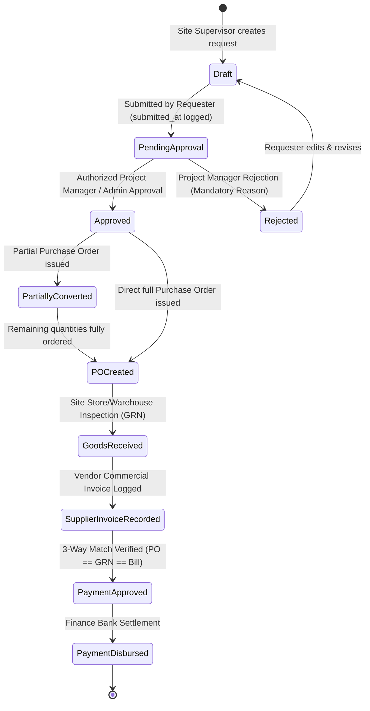
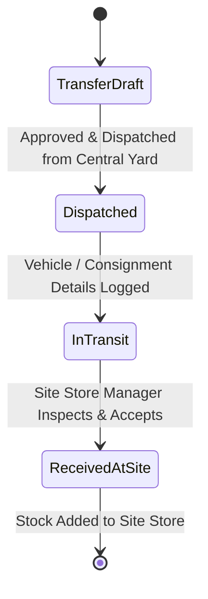
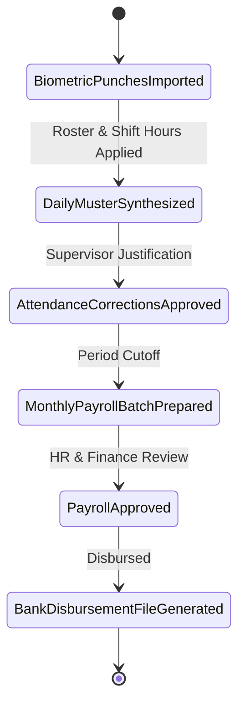
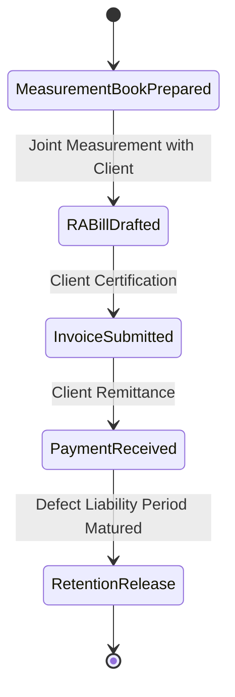

# BUILDFLOW — KEY BUSINESS WORKFLOWS & STATE MACHINES

## 1. Purchase Request (Material Indent), PM Approval & Procurement Conversion

### Steps & Invariants
1. **Material Indent Creation (Site Supervisor)**:
   - Site Supervisor generates a human-readable request reference (`PR-YYYY-XXXXX`).
   - Validates that site belongs to the selected project and user is authorized to manage the site.
   - Itemized lines contain material, positive requested quantity, unit of measurement, specifications, and estimated rate.
   - **Non-Destructive Stock Availability**: Computes ledger-backed available stock at the intended destination warehouse without creating holds, reservations, or deductions. Recommends internal stock transfers from central yards when destination has a shortfall.
2. **Submission, Budget Validation & Multi-Tier Routing**:
   - Requisition status transitions `Draft -> Pending Approval` with recorded `submitted_at` timestamp.
   - **Project Budget Controls**: Evaluates approved expenditure budget against actual posted costs (expenses + supplier bills) and existing commitments (unbilled POs + unconverted PRs) without double counting. If request exceeds budget, flags `is_over_budget = true` with calculated overrun amount.
   - Incomplete pricing is honestly flagged (`is_pricing_complete = false`) rather than assuming zero cost.
   - **Dynamic Approval Policy Evaluation**: Determines required approval levels based on company-configured tiers (e.g. Tier 1: PM, Tier 2: Finance Review, Tier 3: Owner sign-off). Over-budget or critical requests automatically require Company Owner authorization.
3. **Multi-Level Approval Decisions & Segregation of Duties**:
   - Authorized approver for the active tier (`current_approval_level`) reviews the request.
   - **Segregation of Duties**: Requesters are strictly barred from approving their own purchase requests.
   - **Server-Side Enforcement**: Approval actions verify role authority against the configured policy on the server; hiding buttons is insufficient.
   - **Over-Budget Exceptions**: Over-budget requests require a recorded override reason (min 5 characters) and must be authorized by a Company Owner or Administrator.
   - **Sequential Progression**: Once Tier 1 is approved, `current_approval_level` advances to Tier 2 until all configured levels are satisfied, updating status to `approved`.
   - **Decision Logging**: Every decision is permanently audited in `purchase_request_approvals` with approver, timestamp, action, role, policy tier, comments, and budget state.
   - **Rejection**: Requires a mandatory, recorded reason for audit trail compliance. Notifies requester and unlocks request for revision and resubmission.
4. **Procurement Conversion Safeguards**:
   - Actionable only when all required approval levels have been completed and any budget override verified.
   - Enables selecting an approved supplier, partial or full quantities, unit prices, and GST rates (CGST/SGST/IGST).
   - **Pre-Conversion Safeguards**: Rechecks remaining quantities, refreshes stock ledger balances, recalculates project budget impact, and acquires database row locks (`lockForUpdate()`) to prevent race conditions or duplicate conversion.
   - Atomic Database Transaction: Generates `PurchaseOrder` and `PurchaseOrderItem` with foreign key links back to `purchase_requests` and `purchase_request_items`.
   - Status updates atomically: transitions to `partially_converted` if requested items remain, or `po_created` once all items are ordered.
5. **Downstream Integration (GRN & 3-Way Match)**:
   - Converted PO feeds directly into Goods Receipt (GRN) inspection where accepted quantities credit the stock ledger.
   - Supplier commercial invoices match against the PO and GRN for financial accounts settlement.

---

## 2. Inventory & Multi-Site Stock Movement Workflow

### Invariants
- **Atomic Operations**: A transfer decreases source warehouse stock and increases destination warehouse stock within a single database transaction.
- **Strict Ledger**: No direct modification of `current_stock` fields without a corresponding `stock_ledger_entries` record.
- **Negative Stock Protection**: Dispatches exceeding available unallocated quantity are rejected unless company override is explicitly configured.

---

## 3. Attendance, Overtime & Payroll Generation

### Invariants
- Raw punches are never deleted or updated.
- Overtime must be verified and approved by the site supervisor before contributing to wage calculations.
- Finalized payroll records are locked against retrospective modification; discrepancies are addressed via retroactive adjustment vouchers in subsequent pay periods.

---

## 4. Client Progress Billing (RA Bills) & Retention

### Calculations
- `Subtotal` = Cumulative Work Done - Previous RA Bills
- `GST` = Applicable CGST + SGST or IGST (e.g. 18%)
- `Retention Amount` = Subtotal * Retention Rate (e.g. 5%)
- `Net Payable` = Subtotal + GST - Retention - TDS Deductions
