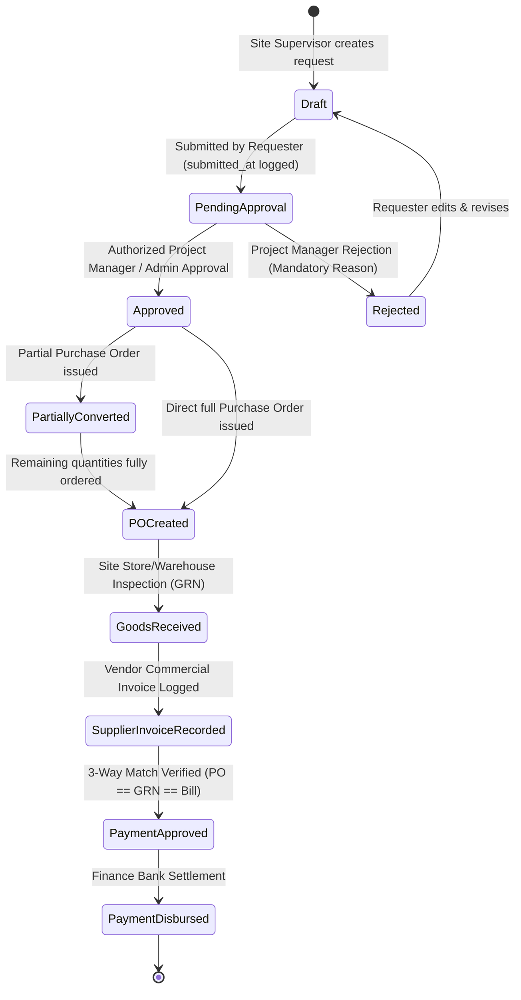
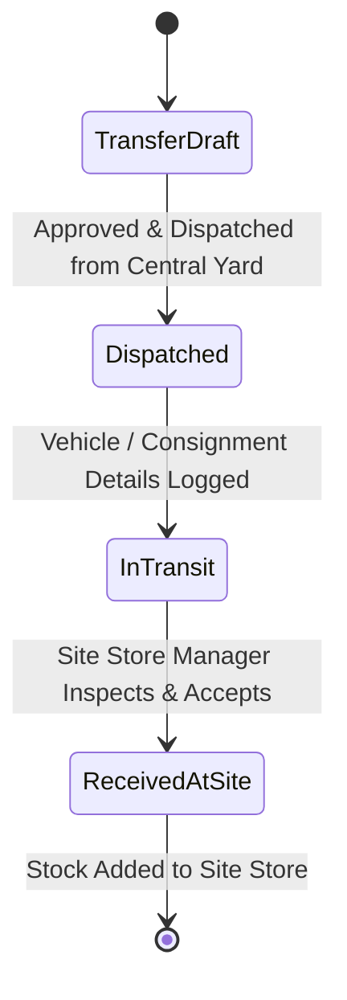
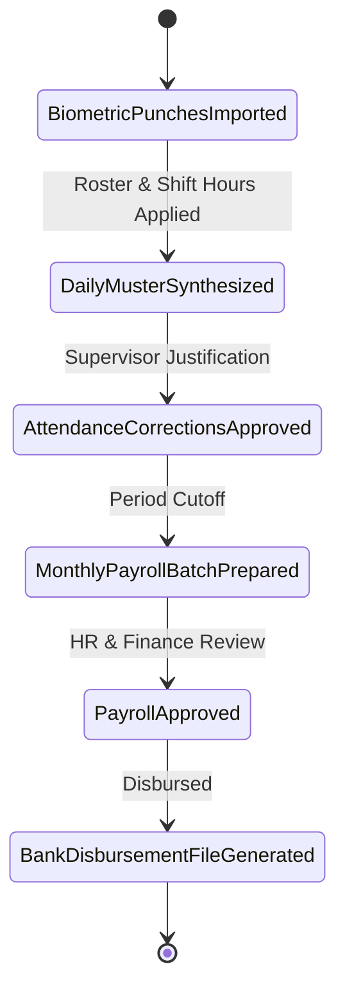
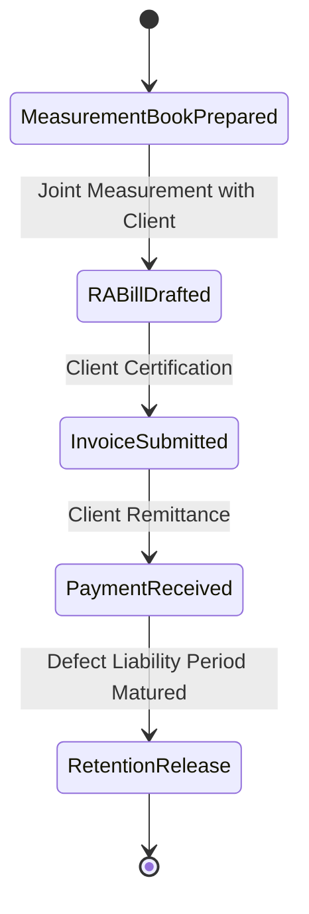

# BUILDFLOW — KEY BUSINESS WORKFLOWS & STATE MACHINES

## 1. Purchase Request (Material Indent), PM Approval & Procurement Conversion

### Steps & Invariants
1. **Material Indent Creation (Site Supervisor)**:
   - Site Supervisor generates a human-readable request reference (`PR-YYYY-XXXXX`).
   - Validates that site belongs to the selected project and user is authorized to manage the site.
   - Itemized lines contain material, positive requested quantity, unit of measurement, specifications, and estimated rate.
   - Shows live contextual yard stock for the selected delivery destination without modifying inventory balances.
2. **Submission & Notifications**:
   - Requisition status transitions `Draft -> Pending Approval` with recorded `submitted_at` timestamp.
   - Automatically notifies the assigned Project Manager via `AppNotification`.
   - Immutability: Once submitted, indents cannot be directly edited without PM review or formal withdrawal.
3. **Project Manager Review & Segregation of Duties**:
   - Authorized PM or company admin reviews line items, need date, and justification.
   - **Segregation of Duties**: A user cannot approve their own purchase request unless holding company owner/admin privileges.
   - **Rejection**: Requires a mandatory, recorded reason (min 5 characters) for audit trail compliance. Notifies requester and unlocks request for revision and resubmission.
   - **Approval**: Sets status to `approved`, stamps `approved_by` and `approved_at`, and notifies the requester.
4. **Procurement Conversion to Purchase Order**:
   - Visible and actionable only by authorized procurement users.
   - Enables selecting an approved supplier, partial or full quantities, unit prices, and GST rates (CGST/SGST/IGST).
   - Atomic Database Transaction: Generates `PurchaseOrder` and `PurchaseOrderItem` with foreign key links back to `purchase_requests` and `purchase_request_items`.
   - Concurrency & Quantity Protection: Line-by-line verification ensures `quantity_to_order <= remaining_quantity`. Increments `quantity_ordered` on the PR item.
   - Status updates atomically: transitions to `partially_converted` if requested items remain, or `po_created` once all items are ordered.
5. **Downstream Integration (GRN & 3-Way Match)**:
   - Converted PO feeds directly into Goods Receipt (GRN) inspection where accepted quantities credit the stock ledger.
   - Supplier commercial invoices match against the PO and GRN for financial accounts settlement.

---

## 2. Inventory & Multi-Site Stock Movement Workflow

### Invariants
- **Atomic Operations**: A transfer decreases source warehouse stock and increases destination warehouse stock within a single database transaction.
- **Strict Ledger**: No direct modification of `current_stock` fields without a corresponding `stock_ledger_entries` record.
- **Negative Stock Protection**: Dispatches exceeding available unallocated quantity are rejected unless company override is explicitly configured.

---

## 3. Attendance, Overtime & Payroll Generation

### Invariants
- Raw punches are never deleted or updated.
- Overtime must be verified and approved by the site supervisor before contributing to wage calculations.
- Finalized payroll records are locked against retrospective modification; discrepancies are addressed via retroactive adjustment vouchers in subsequent pay periods.

---

## 4. Client Progress Billing (RA Bills) & Retention

### Calculations
- `Subtotal` = Cumulative Work Done - Previous RA Bills
- `GST` = Applicable CGST + SGST or IGST (e.g. 18%)
- `Retention Amount` = Subtotal * Retention Rate (e.g. 5%)
- `Net Payable` = Subtotal + GST - Retention - TDS Deductions
