# BUILDFLOW — KEY BUSINESS WORKFLOWS & STATE MACHINES

## 1. Purchase Request (Material Indent), PM Approval & Procurement Conversion

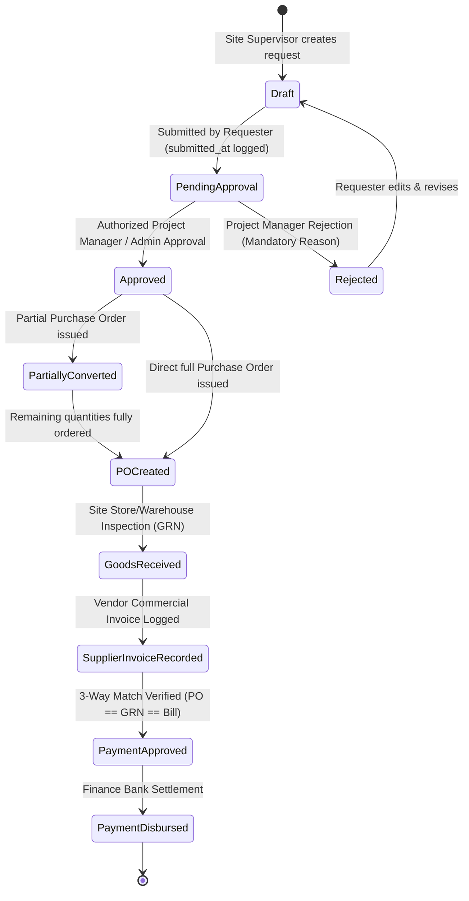

### Steps & Invariants
1. **Material Indent Creation (Site Supervisor)**:
   - Site Supervisor generates a human-readable request reference (`PR-YYYY-XXXXX`).
   - Validates that site belongs to the selected project and user is authorized to manage the site.
   - Itemized lines contain material, positive requested quantity, unit of measurement, specifications, and estimated rate.
   - **Non-Destructive Stock Availability**: Computes ledger-backed available stock at the intended destination warehouse without creating holds, reservations, or deductions. Recommends internal stock transfers from central yards when destination has a shortfall.
2. **Submission, Budget Validation & Multi-Tier Routing**:
   - Requisition status transitions `Draft -> Pending Approval` with recorded `submitted_at` timestamp.
   - **Project Budget Controls**: Evaluates approved expenditure budget against actual posted costs (expenses + supplier bills) and existing commitments (unbilled POs + unconverted PRs) without double counting. If request exceeds budget, flags `is_over_budget = true` with calculated overrun amount.
   - Incomplete pricing is honestly flagged (`is_pricing_complete = false`) rather than assuming zero cost.
   - **Dynamic Approval Policy Evaluation**: Determines required approval levels based on company-configured tiers (e.g. Tier 1: PM, Tier 2: Finance Review, Tier 3: Owner sign-off). Over-budget or critical requests automatically require Company Owner authorization.
3. **Multi-Level Approval Decisions & Segregation of Duties**:
   - Authorized approver for the active tier (`current_approval_level`) reviews the request.
   - **Segregation of Duties**: Requesters are strictly barred from approving their own purchase requests.
   - **Server-Side Enforcement**: Approval actions verify role authority against the configured policy on the server; hiding buttons is insufficient.
   - **Over-Budget Exceptions**: Over-budget requests require a recorded override reason (min 5 characters) and must be authorized by a Company Owner or Administrator.
   - **Sequential Progression**: Once Tier 1 is approved, `current_approval_level` advances to Tier 2 until all configured levels are satisfied, updating status to `approved`.
   - **Decision Logging**: Every decision is permanently audited in `purchase_request_approvals` with approver, timestamp, action, role, policy tier, comments, and budget state.
   - **Rejection**: Requires a mandatory, recorded reason for audit trail compliance. Notifies requester and unlocks request for revision and resubmission.
4. **Procurement Conversion Safeguards**:
   - Actionable only when all required approval levels have been completed and any budget override verified.
   - Enables selecting an approved supplier, partial or full quantities, unit prices, and GST rates (CGST/SGST/IGST).
   - **Pre-Conversion Safeguards**: Rechecks remaining quantities, refreshes stock ledger balances, recalculates project budget impact, and acquires database row locks (`lockForUpdate()`) to prevent race conditions or duplicate conversion.
   - Atomic Database Transaction: Generates `PurchaseOrder` and `PurchaseOrderItem` with foreign key links back to `purchase_requests` and `purchase_request_items`.
   - Status updates atomically: transitions to `partially_converted` if requested items remain, or `po_created` once all items are ordered.
5. **Downstream Integration (GRN & 3-Way Match)**:
   - Converted PO feeds directly into Goods Receipt (GRN) inspection where accepted quantities credit the stock ledger.
   - Supplier commercial invoices match against the PO and GRN for financial accounts settlement.

---

## 2. Inventory & Multi-Site Stock Movement Workflow

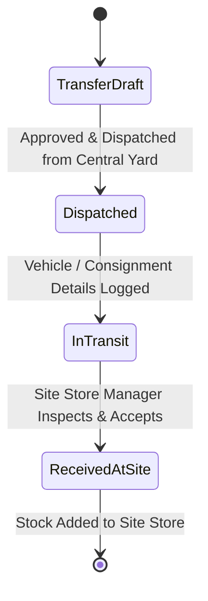

### Invariants
- **Atomic Operations**: A transfer decreases source warehouse stock and increases destination warehouse stock within a single database transaction.
- **Strict Ledger**: No direct modification of `current_stock` fields without a corresponding `stock_ledger_entries` record.
- **Negative Stock Protection**: Dispatches exceeding available unallocated quantity are rejected unless company override is explicitly configured.

---

## 3. Attendance, Overtime & Payroll Generation

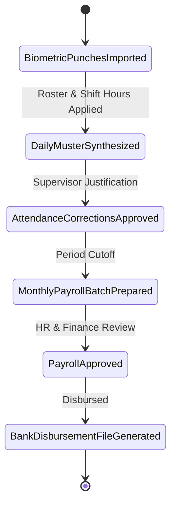

### Invariants
- Raw punches are never deleted or updated.
- Overtime must be verified and approved by the site supervisor before contributing to wage calculations.
- Finalized payroll records are locked against retrospective modification; discrepancies are addressed via retroactive adjustment vouchers in subsequent pay periods.

---

## 4. Client Progress Billing (RA Bills) & Retention

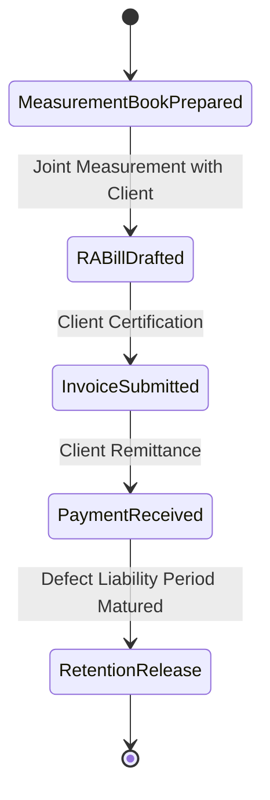

### Calculations
- `Subtotal` = Cumulative Work Done - Previous RA Bills
- `GST` = Applicable CGST + SGST or IGST (e.g. 18%)
- `Retention Amount` = Subtotal * Retention Rate (e.g. 5%)
- `Net Payable` = Subtotal + GST - Retention - TDS Deductions

---

## 5. Role-Specific Execution Paths & Governance

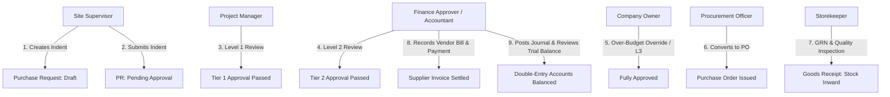

### Role Governance Invariants
1. **Site Supervisor (`site@buildflow.local`)**:
   - Scope limited to assigned projects and sites.
   - Submits daily site logs, updates worker muster roll, and creates material indents.
   - Gated from viewing wage rates, bank accounts, or financial ledgers (HTTP 403 on direct route access).
2. **Project Manager (`pm@buildflow.local`)**:
   - Manages projects, reviews milestones, and conducts Tier 1 purchase request approvals.
   - Prohibited from self-approving purchase requests they initiated (Segregation of Duties).
3. **HR / Payroll Officer (`hr@buildflow.local`)**:
   - Generates payroll periods from approved attendance muster roll data.
   - Prepares wage batches, calculates statutory deductions (PF) and overtime.
   - Finalizes and disburses payroll; locks historical attendance dates from subsequent edits.
4. **Finance Approver / Accountant (`accounts@buildflow.local`)**:
   - Reviews Tier 2 high-value or over-budget purchase requests.
   - Records client invoice payments with pessimistic locking (`lockForUpdate()`), preventing overpayment.
   - Enforces balanced debit/credit equality on journal entries.
   - Blocked from modifying company procurement approval policies (HTTP 403).
5. **Procurement Officer (`procurement@buildflow.local`)**:
   - Reviews fully approved purchase requests and converts approved line items into Purchase Orders.
   - Blocked from creating unapproved POs directly or bypassing policy thresholds.
6. **Storekeeper (`storekeeper@buildflow.local`)**:
   - Inspects physical deliveries, records delivery challan & vehicle registration, logs accepted vs rejected quantities with mandatory reasons.
   - Inward movements credit `StockLedgerEntry` automatically. Rejections do not inflate inventory valuation.
7. **Company Owner / Administrator (`admin@buildflow.local`)**:
   - Holds company-wide management authority (`*`).
   - Only role authorized to grant budget overrun overrides and configure company approval policy thresholds.

---

## 6. Client Retention Release & Defect Liability Workflow

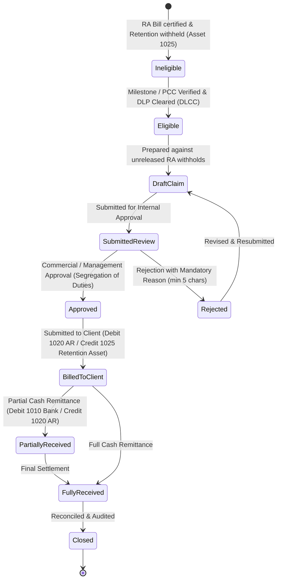

### Steps & Invariants

1. **Contractual Retention Configuration**:
   - Retention terms are defined per `ClientContract` (e.g. rate 5.0% - 10.0%, maximum retention cap, 12 or 24 months DLP duration, and release schedule e.g. `staged_50_50` or `single_full_release`).
   - Does not assume hardcoded rates or fixed release splits; contracts validate against maximum cumulative withholding limits.
   - Separate client-side retention asset from supplier/subcontractor retention liabilities.

2. **Eligibility & Engineering Certifications**:
   - **Stage 1 (Practical Completion - 50%)**: Requires a verified Practical Completion Certificate (`PCC`) issued by the supervising engineer or consulting authority.
   - **Stage 2 (Defect Liability Expiry - 50%)**: Requires that the Defect Liability Period (`DLP`) has fully elapsed from the start basis date AND an approved DLP Clearance Certificate (`DLCC`) has verified that all snag list items/defects are 100% rectified (`all_defects_rectified = true`, `defect_count_reported == defect_count_resolved`).
   - Ineligible stages display specific contractual blockers (e.g. *"Defect Liability Period active until 08 Oct 2027 (12 months remaining)"* or *"Practical Completion Certificate required"*).

3. **Release Claim Preparation & Traceability**:
   - Claims can only be drafted against eligible, unreleased balances.
   - Claim preparation atomically allocates the release amount across source RA bills (`retention_claim_invoice_items`), tracking `source_retention_amount`, `previously_claimed_amount`, and `claim_allocated_amount`.
   - Pessimistic row locking (`lockForUpdate()`) ensures concurrent users cannot claim the same retained amount twice.

4. **Internal Approval & Segregation of Duties**:
   - Claims require management / finance sign-off before being dispatched to the client.
   - **Segregation of Duties**: The user who prepared/drafted the claim cannot approve their own claim unless they hold the Company Owner / Administrator role.
   - **Rejection**: Requires a mandatory, recorded reason (min 5 characters) and retains full audit history.

5. **Client Submission & Revenue-Neutral Accounting**:
   - Marking a claim as submitted records the client inward reference and dispatch date.
   - **Zero Revenue Duplication**: Revenue was already recognized at the time of original RA billing. Release of retention simply converts a long-term retention receivable asset into a currently due trade receivable.
   - **Balanced Journal Entry**:
     - **Debit**: Account `1020` (Accounts Receivable / Trade Debtors)
     - **Credit**: Account `1025` (Retention Money Withheld by Clients)

6. **Client Remittance & Receipt Settlement**:
   - Authorized finance users record cash/bank receipts against approved/billed claims.
   - Supports partial and final settlement with bank account selection, payment mode (NEFT/RTGS, Cheque, Cash), and UTR reference number.
   - Database row-locking prevents overpayment or double-allocation exceeding `claim->balanceDue()`.
   - **Balanced Receipt Journal Entry**:
     - **Debit**: Account `1010` (Operating Bank Account)
     - **Credit**: Account `1020` (Accounts Receivable)
   - Real-time updates reflect across the live Retention Register and client balance sheets without duplicate balance copies.

---

## 6. Equipment Loan Financing & Automated EMI Accounting Settlement

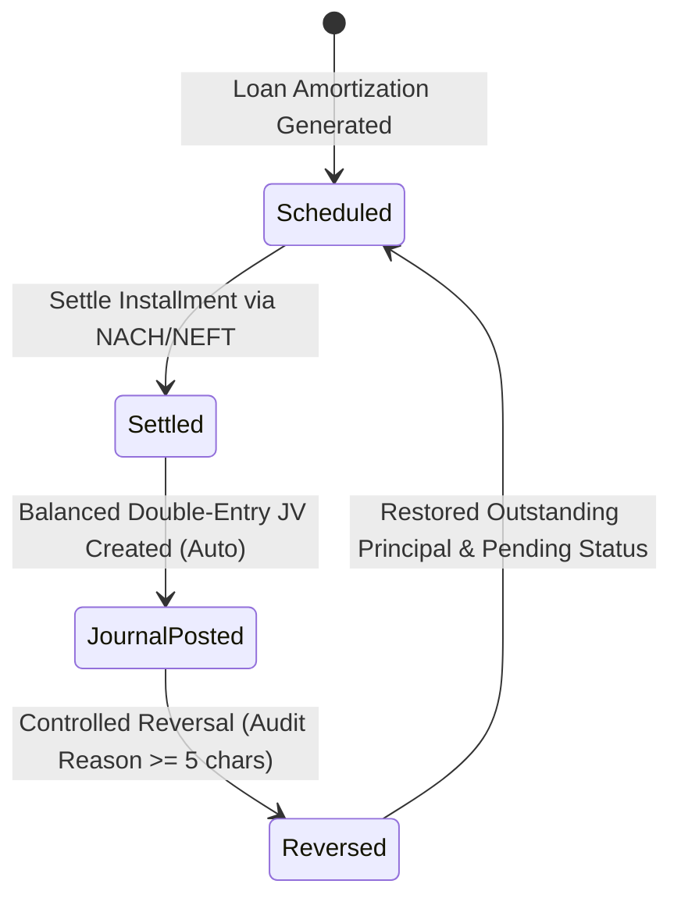

### Steps & Accounting Rules
1. **Amortization & Schedule Initialization**:
   - Equipment financing loans establish amortized repayment schedules split into **Principal Component** and **Interest Component**.
   - Associated with financed equipment asset (`Loan::fixed_asset_id`) without conflating gross asset acquisition cost with debt liability.
2. **EMI Settlement & Double-Entry Ledger Posting**:
   - Settlement triggers atomic database transaction with pessimistic row-locking (`LoanEmiSchedule::lockForUpdate()`).
   - Prevents duplicate settlement on retry (`schedule->status === 'paid'` or `journal_entry_id !== null`).
   - Verifies exact decimal equality (`bccomp($principal + $interest, $totalEmi, 2) === 0`).
   - Generates immutable General Ledger Journal Entry (`JV-EMI-YYYY-XXXXX`):
     - **Debit**: Account `2010` (Equipment Financing Loans & Borrowings) — Principal repayment reduces debt liability.
     - **Debit**: Account `5020` (Loan Interest & Financing Charges) — Cost of capital charged to finance expense.
     - **Credit**: Account `1010` (Operating Bank Account) — Cash outflow from bank.
   - Project cost-center attribution: If the financed asset is deployed to an active project, lines track `project_id`.
   - Outstanding principal balance on `Loan` is reduced by the principal component; loan automatically marks `closed` once principal reaches zero.
3. **Controlled Reversal Process**:
   - Reversal requires a mandatory audited reason (min 5 characters) and authorization check.
   - Marks original journal entry status as `reversed` (`reversed_by`, `reversed_at`, `reversal_reason`).
   - Posts a counter-balancing journal entry (`JV-REV-YYYY-XXXXX`) swapping debits and credits:
     - **Debit**: Account `1010` (Operating Bank Account)
     - **Credit**: Account `2010` (Loan Liability)
     - **Credit**: Account `5020` (Loan Interest Expense)
   - Restores loan `outstanding_principal` and resets schedule status to `pending`.

---

## 7. Fixed Asset Capitalization & Periodic Depreciation Lifecycle

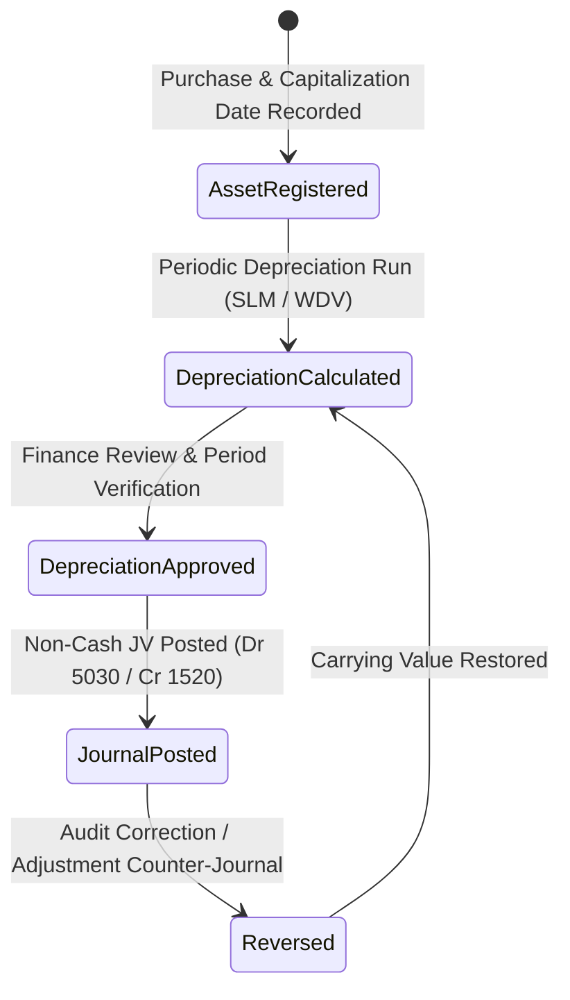

### Steps & Calculation Rules
1. **Asset Register & Capitalization**:
   - Fixed assets are distinct from consumable inventory stock receipts.
   - Captures asset code, category, make, model, serial number, capitalization date, purchase date, total capitalized cost, salvage residual value, useful life (years/months), depreciation method, and deployed project.
   - Total depreciable basis = `Total Capitalized Cost - Residual Salvage Value`.
2. **Deterministic Periodic Depreciation Engine**:
   - Supports **Straight-Line Method (SLM)**: `Monthly Depr = Depreciable Basis / Useful Life Months`.
   - Supports **Written-Down Value (WDV)**: `Monthly Depr = Opening Book Value * (Annual Rate / 12)`.
   - **Pro-Rata Partial Period Scaling**: If an asset is capitalized mid-month, active days are computed (`activeStartDate->diffInDays(periodEnd) + 1`) and depreciation is scaled proportionally (`fullMonthlyDepr * activeDays / daysInMonth`).
   - **Salvage Value Floor**: Depreciable amount is strictly capped at `max(0, Opening Book Value - Residual Value)`. Assets are never depreciated below residual salvage value.
   - **Duplicate Prevention**: Unique composite constraint `['company_id', 'fixed_asset_id', 'period_start_date', 'period_end_date']` prevents duplicate calculations or postings for the same asset and accounting period.
3. **Non-Cash Accounting Journal Posting**:
   - Depreciation posting is strictly non-cash; bank accounts and loan debt balances are untouched.
   - Generates immutable Journal Entry (`JV-DEPR-YYYY-XXXXX`):
     - **Debit**: Account `5030` (Depreciation Expense - Heavy Equipment & Fleet) — charged to deployed `project_id` cost center.
     - **Credit**: Account `1520` (Accumulated Depreciation - Plant & Machinery) — contra-asset balance sheet account.
   - Atomically updates asset `accumulated_depreciation` and reduces `current_book_value`.
4. **Fleet Period Review & Batch Posting**:
   - Fleet-wide period review screen (`/assets/period-review`) displays active units, unposted depreciation, and already posted GL amounts.
   - "Post All Journals" button executes batch calculation and GL journal creation across all eligible fleet equipment atomically.
5. **Controlled Depreciation Reversal**:
   - Reversal generates counter-journal entry (`JV-REV-YYYY-XXXXX`): Debit `1520` Accumulated Depr / Credit `5030` Depreciation Expense.
   - Restores asset `accumulated_depreciation` and `current_book_value` without deleting historical audit records.

---

## 8. Subcontractor Work Orders, Measurement Book (MB) & Bill Certification Lifecycle

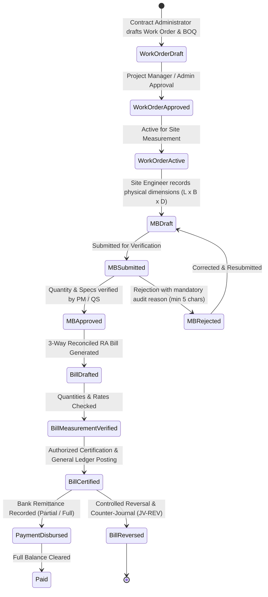

### Steps, Mathematics & Invariants
1. **Subcontractor Work Order & BOQ Definition**:
   - Subcontractor work orders are strictly distinguished from material purchase orders. Material POs acquire goods into warehouse inventory; work orders contract physical construction activities (earth excavation, backfilling, compaction, RCC, drainage).
   - Captures company, project, site, subcontractor (linked vendor), scope, work category, dates, payment terms, retention % (default 5%), TDS % (194C 1% or 2%), and GST % (default 18%).
   - Itemized Bill of Quantities (BOQ): Item code, description, unit of measure (`cum`, `sqm`, `rmt`, `mt`, `nos`, `trips`, `hrs`), approved quantity, unit rate, and total line amount.
   - **Controlled Variations**: Changes to approved quantities or rates require an authorized variation (`VAR-YYYY-XXXXX`) updating `revised_quantity`, `revised_rate`, and work order `revised_value` with full justification and audit trail.
2. **Digital Measurement Book (MB)**:
   - Captures physical site work executed against a specific approved work order line.
   - Deterministic Calculation:
     $$\text{Calculated Qty} = \text{Multiplier Units} \times \text{Length} \times \text{Breadth} \times \text{Height/Depth}$$
     (or unit repetition / trip count / hourly log according to work method).
   - **Manual Overrides**: Permitted only when accompanied by a mandatory authorized override reason.
   - **Cumulative Quantity Limits**: Cumulative measured quantity ($\sum \text{approved MB} + \text{current}$) is validated against the work order item's approved/revised quantity limit. Exceeding limits throws a validation exception unless an authorized variation has increased the contract limit.
3. **Measurement Review & Approval State Machine**:
   - `Draft -> Submitted -> Approved / Rejected -> Certified`.
   - Site Engineers submit measurements; Project Managers or Quantity Surveyors independently review dimensions and field locations.
   - Rejection requires a mandatory reason (min 5 characters), preserving historical records while allowing correction and resubmission.
4. **Three-Way Matching & Running Account (RA) Billing**:
   - Subcontractor RA Bills draw exclusively from `approved` Measurement Book entries for the selected work order.
   - 3-Way Matching Invariants:
     1. Work Order must be approved and active.
     2. Selected MB entries must belong to the active work order and matching subcontractor.
     3. Unbilled quantity check: $\text{Eligible Qty} = \text{Measured Qty} - \text{Previously Billed Qty} > 0$.
     4. Applied unit rates strictly match approved work order BOQ rates.
   - Anti-Duplicate Billing: MB entries transition to `certified` once billed, and `billed_quantity` tracks drawn units. Concurrency locks (`lockForUpdate()`) prevent double billing.
5. **Deductions & Decimal Arithmetic**:
   - Gross Certified Work Value = $\sum (\text{Billed Qty} \times \text{Approved Rate})$.
   - Contractual Retention Withheld = $\text{Gross Work Value} \times \text{Retention } \% / 100$ (withheld liability).
   - Statutory TDS Deduction = $\text{Gross Work Value} \times \text{TDS } \% / 100$ (Section 194C Individual 1% / Company 2%).
   - Eligible Input GST = $\text{Gross Work Value} \times \text{GST } \% / 100$ (Input Tax Credit asset).
   - Mobilization Advance Recovery = Contractual recoupment of advances previously disbursed.
   - Other Authorized Deductions = Site backcharges, diesel supply, or safety penalties.
   - Net Amount Payable = $\text{Gross Work Value} + \text{Input GST} - \text{Retention} - \text{TDS} - \text{Advance Recovery} - \text{Other Deductions}$.
6. **Double-Entry General Ledger Integration**:
   - On Certification (`SubcontractorBillingService::certifyBill`):
     - **Debit**: Account `5040` (Subcontractor & Labour Cost - Direct Project Cost) — with `project_id` cost center.
     - **Debit**: Account `1030` (Input GST Receivable / ITC Asset).
     - **Credit**: Account `2030` (Subcontractor Retention Payable - Current Liability).
     - **Credit**: Account `2040` (TDS Payable under Sec 194C - Current Liability).
     - **Credit**: Account `1040` (Mobilization & Material Advances to Subcontractors - Asset Recoupment).
     - **Credit**: Account `1050` (Other Contractor Deductions & Recoveries - Asset / Contra).
     - **Credit**: Account `2020` (Subcontractor Payable - Trade Payables).
     - Mathematical Balance: $\text{Debits} == \text{Credits}$ verified via `bccomp()`.
   - Distinct Liabilities & Assets: Subcontractor Retention Payable (`2030`) is an obligation to pay the subcontractor upon DLP expiry, completely distinct from Client Retention Receivable (`1025`) owed by clients to NSD. Similarly, Mobilization Advances to Subcontractors (`1040`) is an asset recouped upon bill certification.
   - On Payment Remittance (`SubcontractorBillingService::recordBillPayment`):
     - **Debit**: Account `2020` (Subcontractor Payable).
     - **Credit**: Account `1010` (Operating Bank Account).
     - Updates `paid_amount` and `balance_due`. Overpayment is strictly prevented.
7. **Project Budget Integration & Zero Double Counting**:
   - `ProjectBudgetService` integrates subcontractor costs into budget monitoring:
     - **Committed Cost**: Unbilled balance of approved work orders ($\sum \max(0, \text{Contract Value} - \text{Cumulative Certified Gross})$).
     - **Actual Cost**: Posted certified subcontractor bills ($\sum \text{gross\_certified\_amount}$).
     - Invariant: When a bill is certified, committed cost decreases by the certified amount while actual cost increases by the identical amount. The total project obligation ($\text{Committed} + \text{Actual}$) remains consistent, guaranteeing **zero double counting**.
8. **Controlled Bill Reversal**:
   - Reversal generates counter-journal entry (`JV-REV-SCB-...`) reversing debits and credits:
     - Debit `2020` Subcontractor Payable, Debit `2030` Retention, Debit `2040` TDS, Debit `1040` Advance Recovery (restoring advance asset), Debit `1050` Other Deductions / Credit `5040` Work Cost, Credit `1030` Input GST.
   - Marks original bill journal entry as `reversed` (`reversed_by`, `reversed_at`, `reversal_reason`).
   - Restores MB entries from `certified` back to `approved` and decrements `billed_quantity`, unlinking them for future billing.

---

## 9. General Journal Vouchers, Posted Immutability & Traceable Reversals

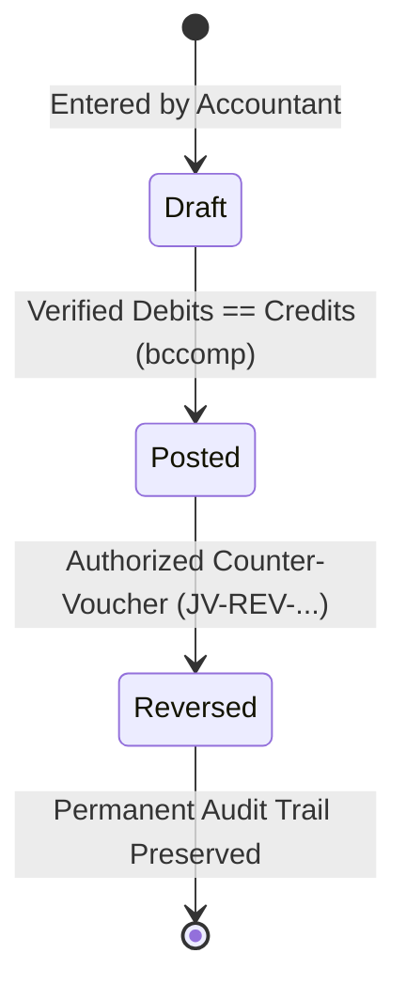

### Steps & Lifecycle Controls
1. **Creation & Balance Validation**:
   - Entered via `/accounting/journals/create` or generated through authorized financial services.
   - Exact decimal balance check enforces $\text{Debits} == \text{Credits}$ via `bccomp()`.
   - Atomically records journal header (`JV-YYYY-XXXXX`) and associated debit/credit lines.
2. **Posted Immutability Enforcement**:
   - Model lifecycle events (`JournalEntry::booted()` and `JournalEntryLine::booted()`) enforce financial permanence.
   - Attempted deletion of posted or reversed entries throws `DomainException`.
   - Attempted modification of posted headers (other than reversal status transition) throws `DomainException`.
   - Direct addition, modification, or deletion of posted lines outside the initial creation transaction throws `DomainException`.
3. **Traceable Reversal Workflow (`/accounting/journals/{id}/reverse`)**:
   - Authorized accountants submit a mandatory audit justification (minimum 5 characters).
   - The original entry is marked `reversed` with `reversed_by`, `reversed_at`, and `reversal_reason`.
   - An immutable counter-journal entry (`JV-REV-YYYY-XXXXX`) is posted with inverted debits and credits.
   - Duplicate reversals are strictly rejected at both controller and model layers.
   - Upstream subsystem protection: Journal entries originating from subcontractor bills, equipment loan EMIs, or asset depreciation must be reversed through their operational subsystem to ensure operational tracking (work order quantities, loan balances, asset depreciation) remains synchronized.

---

## 10. Real-Time Operational Event Dispatch & Notification Lifecycle

BuildFlow couples transactional domain business workflows with an asynchronous, multi-channel notification architecture.

```mermaid
stateDiagram-v2
    [*] --> DBTransaction: User performs action in browser
    DBTransaction --> NotificationCreated: AppNotification record inserted
    NotificationCreated --> DBCommit: Database Transaction successfully commits
    DBCommit --> BroadcastDispatched: DB::afterCommit triggers Reverb event
    BroadcastDispatched --> ClientDelivered: Live push to private channel subscriber
    ClientDelivered --> DropdownViewed: User clicks topbar notification bell
    DropdownViewed --> RecordOpened: User navigates to protected record link
    RecordOpened --> MarkedRead: Notification marked as read
    MarkedRead --> [*]
```

### Business Event Triggers & Routing Matrix
| Business Event | Trigger Location | Target Audience / Channel | Severity | Safe Non-Sensitive Summary |
|---|---|---|---|---|
| **PR Submitted** | `PurchaseRequestController` | Company PMs & Owners (`company.{id}.role.project_manager`) | `warning` | "PR-YYYY-XXXX Submitted: Indent requires review" |
| **PR Approved / Rejected** | `PurchaseRequestController` | Requester User (`App.Models.User.{id}`) | `success` / `danger` | "PR-YYYY-XXXX Approved / Rejected: Reason noted" |
| **PO Issued** | `ProcurementController` | Company Storekeepers & PMs (`company.{id}`) | `info` | "PO-YYYY-XXXX Issued: Awaiting delivery" |
| **GRN Recorded** | `ProcurementController` | Procurement & Accounts (`company.{id}`) | `success` | "Goods Receipt Recorded: GRN-YYYY-XXXX inspected" |
| **Stock Shortage Detected** | `InventoryController` | Procurement Officers (`company.{id}.role.procurement_officer`) | `danger` | "Material Stock Shortage: Stock at or below reorder level" |
| **Muster Roll Submitted** | `AttendanceController` | HR Officers & PMs (`company.{id}`) | `info` | "Muster Roll Submitted: Date records logged for review" |
| **Payroll Batch Submitted** | `PayrollController` | Company Owner & Admin (`company.{id}.role.owner`) | `warning` | "Payroll Batch Submitted: Period awaiting final audit" |
| **Payroll Batch Approved** | `PayrollController` | Accountants & HR (`company.{id}`) | `success` | "Payroll Batch Approved: Ready for disbursement" |
| **Client Invoice Raised** | `BillingController` | Project Manager & Owner (`company.{id}`) | `info` | "RA Bill Generated: Client invoice ready for review" |
| **Subcontractor Bill Certified** | `SubcontractorBillController` | Accounts & Admin (`company.{id}`) | `warning` | "Subcontractor Bill Certified: Payable ledger posted" |
| **Payment Remitted / Received** | `BillingController`, `SubcontractorBillController` | Accounts & PMs (`company.{id}`) | `success` | "Payment Recorded: Financial ledger updated" |
| **Retention Claim Submitted** | `RetentionController` | Client Rep & Accounts (`company.{id}`) | `info` | "Retention Release Claim: Submitted for certification" |
| **Project Status Updated** | `ProjectController` | All Project Team Members (`project.{id}`) | `info` | "Project Status Changed: Milestone state updated" |

### Client-Side Reconciliation & Event Deduplication
1. **Deduplication**: The frontend Alpine store verifies event IDs before insertion (`this.notifications.some(n => n.id === event.id)`), preventing visual duplicates on retried operations.
2. **Reconnection Recovery**: When WebSocket transitions to `connected` after an outage, Alpine immediately queries `/notifications/feed` to retrieve any persisted notifications missed during downtime.
3. **Session Focus Synchronization**: When the browser window regains focus, unread counts reconcile silently via background HTTP request.

---

## 11. Secure Document Management, File Lifecycle & Statutory Immutability

BuildFlow features a centralized, multi-tenant document management system embedded across all construction, procurement, workforce, and financial records. Files are treated as untrusted input and isolated in private storage (`storage/app/private`).

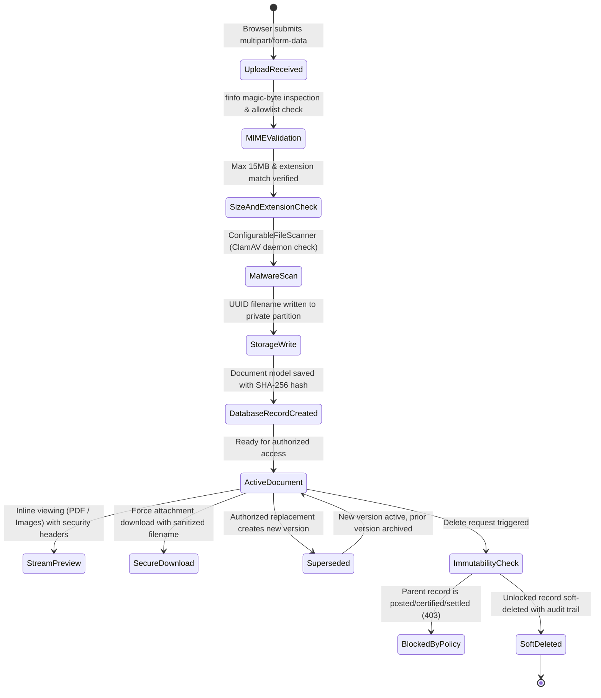

### Steps & Security Lifecycle Controls
1. **Upload, Inspection & Quarantine Pipeline**:
   - Files are uploaded via the reusable `<x-document-manager>` component or direct API.
   - **MIME Inspection**: The server runs `finfo_file` inspecting file magic bytes. Client-declared MIME types and file extensions are never trusted alone.
   - **Allowlist Verification**: Permitted formats are strictly restricted to construction-grade and enterprise documents: PDF, PNG, JPG, JPEG, DWG, DXF, XLSX, XLS, CSV, DOC, DOCX. Executable formats (`.exe`, `.php`, `.sh`, `.bat`, `.js`, etc.) and archive wrappers (`.zip`, `.tar`) are rejected immediately.
   - **File Size Cap**: Configured to 15MB per file maximum.
   - **SHA-256 Checksum**: Computed at ingest and stored in the database for tamper detection and deduplication tracking.
   - **Safe Storage Partitioning**: Storage filenames are generated as cryptographically random UUIDs (`Str::uuid() . '.' . $extension`). Files are written to company-isolated, record-partitioned paths: `companies/{company_id}/{entity_folder}/{record_id}/{uuid}.{ext}` in private storage outside the web root (`storage/app/private`).
   - **Anti-Malware Scanning**: Routed through `FileScannerInterface` and `ConfigurableFileScanner`. When ClamAV daemon is active (`CLAMAV_HOST` / `CLAMAV_PORT`), files are scanned before persistence. If infected, the upload is aborted and quarantined with audit notification.

2. **Authorized Preview & Streaming**:
   - Files are served strictly through authorized controller endpoints (`GET /documents/{document}/preview` and `GET /documents/{document}/download`).
   - Requests enforce tenant membership (`company_id == active_company_id`) and record-level authorization via `DocumentPolicy`.
   - Previews are restricted to safe rendering types (`application/pdf`, `image/png`, `image/jpeg`).
   - Streaming responses enforce strict defense-in-depth headers:
     - `X-Content-Type-Options: nosniff` (prevents browser MIME-sniffing exploits)
     - `X-Frame-Options: SAMEORIGIN` (mitigates clickjacking in iframes)
     - `Content-Disposition: inline` for preview, `attachment` for download with safely sanitized original filename.

3. **Non-Destructive Versioning & Supersession**:
   - Replacing an existing document preserves audit history.
   - The original document status transitions to `superseded`, its `superseded_by_id` pointer is set, and a new `Document` record is inserted with `version = previous_version + 1`.
   - Historical versions remain accessible to auditors but are hidden from standard active operational views.

4. **Statutory Immutability Lock**:
   - Construction contracts, audited payroll records, certified subcontractor bills, approved client invoices, and posted journal vouchers have statutory and legal retention requirements.
   - When a parent business record enters an immutable state:
     - `JournalEntry`: Status `posted` or `reversed`
     - `SubcontractorBill`: Status `certified` or `paid`
     - `ClientInvoice`: Status `approved` or `paid`
     - `PayrollPeriod`: Status `approved` or `disbursed`
     - `Loan`: Status `settled`
   - `DocumentPolicy::delete` and `Document::isParentImmutable()` strictly block file deletion with `HTTP 403 Forbidden` / `DomainException`.
   - File deletion is permitted only on draft, pending, or rejected records by authorized users.

5. **Confidentiality Vault & HR Separation**:
   - Sensitive personal and financial records are flagged with `is_confidential = true`.
   - Categories including `identity_document` (Aadhaar, PAN), `employment_contract`, `bank_proof`, and `statutory_compliance` are visible solely to authorized roles (`owner`, `admin`, `hr_officer`, `accountant`).
   - General site supervisors and project engineers are blocked from discovering or viewing confidential employee or vendor records even within the same tenant.

6. **Central Document Centre (`/documents`)**:
   - Multi-module search engine scoped to the active tenant and the user's role permissions.
   - Provides 4 KPI cards: Total Documents, Total Storage Used, Active Attachments, and Confidential Vault items.
   - Dynamic filters by Module (`Project`, `Site`, `PurchaseRequest`, `PurchaseOrder`, `GoodsReceipt`, `SubcontractorBill`, `Employee`, `PayrollPeriod`, `JournalEntry`, etc.), Document Category, and keyword search against original filenames.
   - Confidential documents are hidden by default and accessible only via an authenticated vault toggle.
   - Inline streaming preview modal allows inspecting drawings, PDFs, and delivery slips without leaving the repository.

---

## 12. Disaster Recovery, Health Monitoring & Production Runbook (Phase 11)

BuildFlow provides verified, zero-downtime disaster recovery procedures and automated operational health monitoring.

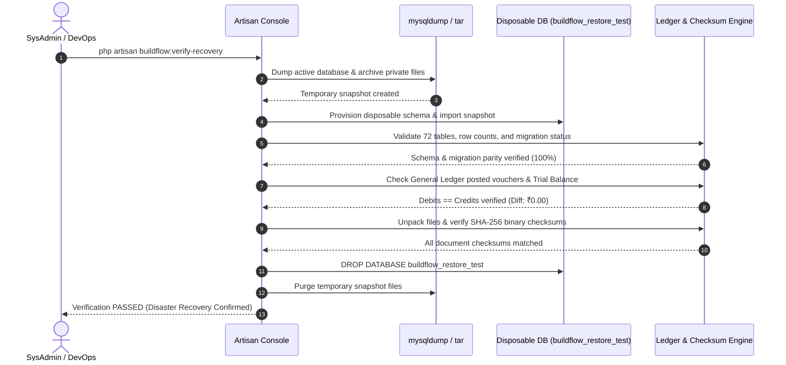

### 1. Disaster Recovery Verification Runbook
To verify database and storage recoverability without affecting live business operations:
1. Run the non-destructive verification command:
   ```bash
   php artisan buildflow:verify-recovery
   ```
2. The command executes in an isolated sandbox:
   - Dumps `buildflow_crm` to `/tmp/buildflow_recovery_*/db_backup.sql`.
   - Packages `storage/app/private` into a compressed archive.
   - Creates a temporary disposable database (`buildflow_restore_test`).
   - Imports the backup into the disposable database.
   - Compares table count and row counts across all 72 tables.
   - Reconciles financial ledgers: verifies that all posted journal entries balance and Trial Balance total debits equal total credits.
   - Validates that document attachments match their registered SHA-256 hashes.
   - Purges disposable databases and temporary artifacts.
3. Schedule regular cron verification:
   ```cron
   0 3 * * 0 cd /var/www/buildflow && php artisan buildflow:verify-recovery >> /var/log/buildflow/recovery.log 2>&1
   ```

### 2. Operational Health Monitoring (`GET /health`)
Configure your load balancer (e.g. AWS ALB, Cloudflare, or Nginx) to query the `/health` endpoint:
- **HTTP 200 OK**: System healthy and ready for traffic.
- **HTTP 503 Service Unavailable**: Database or storage disk failure detected.
- **Payload Inspection**:
  - `checks.database.latency_ms` monitors query performance.
  - `checks.storage.free_space_gb` monitors available disk capacity.
  - `checks.reverb.status` indicates real-time WebSocket daemon availability.
  - `checks.scanner.status` reports anti-malware engine readiness.

### 3. Production Deployment Checklist
When deploying BuildFlow to a live production server:
1. **Environment Setup**:
   - Ensure `APP_ENV=production` and `APP_DEBUG=false`.
   - Set `SCANNER_FAIL_CLOSED=true` to enforce strict anti-malware inspection.
   - Restrict `REVERB_ALLOWED_ORIGINS` to authorized production domains.
2. **Database & Migrations**:
   - Run additive migrations: `php artisan migrate --force`.
   - **Never run** `migrate:fresh`, `migrate:refresh`, `db:wipe`, or seeders on live databases.
3. **Cache Optimization**:
   ```bash
   php artisan config:cache
   php artisan route:cache
   php artisan view:cache
   ```
4. **Service Process Management**:
   - Ensure `supervisor` manages `php artisan reverb:start` and queue workers.
   - Verify Nginx terminates TLS on port 443 and proxies `/reverb/` WebSocket upgrades.

---

## 13. Automated Backup & Disaster Recovery Runbook, Preflight Gate & Release Procedures (Phase 13)

BuildFlow provides a comprehensive, production-grade release engineering system with persistent automated backups, preflight validation, and tested rollback procedures.

### 1. The Four Distinct Operational Pillars

```
+-----------------------------------------------------------------------------------+
| 1. CREATION        | Durable atomic snapshot: MySQL dump + private file archive.  |
| 2. VALIDATION      | Integrity check: SHA-256 digest match, archive format check. |
| 3. RESTORE TEST    | Isolated dry run: disposable DB & temp filesystem sandbox.   |
| 4. RECOVERY RUNBOOK| Human operator procedure: failover, restore, point-in-time.  |
+-----------------------------------------------------------------------------------+
```

### 2. Backup CLI Commands & Operational Options

#### A. Durable Backup Creation
```bash
# Standard hourly backup (with automatic post-creation validation)
php artisan buildflow:backup:create

# Specific frequency tier (hourly, daily, monthly)
php artisan buildflow:backup:create --frequency=daily

# Authenticated AEAD Encrypted backup (AES-256-GCM Format v2)
php artisan buildflow:backup:create --encrypt
```
- **Atomic Execution**: Dumps to `database.sql.tmp` and renames to `database.sql` upon successful exit.
- **AEAD Encryption (v2)**: When `--encrypt` is passed, archives are encrypted using AES-256-GCM authenticated encryption (`BFENC\x02\x01\x0C\x10` envelope) with a 12-byte IV, 16-byte authentication tag, and AAD contextual binding (`BuildFlow-AEAD-v2|{backup_id}|{filename}`).
- **CLI Password Concealment**: MySQL dump commands are spawned using `proc_open` with `MYSQL_PWD` passed in the isolated process environment, preventing database passwords from appearing in `ps aux` process listings.
- **Archive Generation**: Creates `storage.tar.gz` capturing private files (`storage/app/private`).
- **Atomic Manifest**: Writes `manifest.json` with sizes, checksums, table count (72), migration count (16), cipher specs, and key fingerprints.
- **Concurrency Guard**: Atomic lock `buildflow_backup_running_lock` prevents concurrent overlapping executions.
- **Retention Pruning**: Automatically retains configured tiers (24 hourly, 30 daily, 12 monthly) with bounded protected-copy lifecycle management.

#### B. Backup Integrity Validation
```bash
# Validate the most recent durable backup
php artisan buildflow:backup:validate

# Validate a specific historical backup
php artisan buildflow:backup:validate backup_20261018_114834_hourly
```
- Re-reads and parses `manifest.json`.
- Validates presence and non-zero size of database dump and storage tarball.
- Re-computes SHA-256 hashes and compares against recorded manifest digests.
- Tests archive listing (`tar -tzf`) and verifies AEAD authentication tags / test-decrypts encrypted archives without writing plaintext to disk.
- Updates `validation_status` (`valid` / `corrupt`) and `last_validated_at`.

#### C. Secondary Backup Replication
```bash
# Replicate the latest validated backup to secondary off-host storage
php artisan buildflow:backup:replicate

# Replicate a specific historical backup
php artisan buildflow:backup:replicate backup_20261018_114834_hourly

# Run with verbose transfer reporting
php artisan buildflow:backup:replicate -v
```
- Copies snapshot archives and manifest to the secondary destination (e.g. `storage/app/backups_secondary` or cloud storage adapter).
- Calculates remote SHA-256 checksums and performs byte-for-byte transfer parity verification against primary files.
- Writes an atomic `replication_receipt.json` on the secondary destination and updates primary `manifest.json` with `is_replicated = true` and timestamp.
- Implements exponential backoff retries (up to 3 attempts) for transient I/O or network failures.
- Enforces secondary retention pruning (e.g., retaining 24 hourly secondary replicas).

#### D. Isolated Restore & Disaster Recovery Verification
```bash
# Execute isolated restore test on the latest validated backup
php artisan buildflow:verify-recovery

# Target a specific durable backup directory
php artisan buildflow:verify-recovery --backup=backup_20261018_114834_hourly
```
- **Active Database Protection**: Strictly refuses to target the active database (`DB_DATABASE`) or protected databases (`buildflow_crm`, `production`, `live`). Aborts with an error if targeting is unsafe.
- Provisions disposable sandbox database (`buildflow_restore_test`) using environment-isolated `MYSQL_PWD`.
- Restores database schema and records.
- Confirms 100% table count parity (72 tables) and exact row counts.
- Verifies migration count (16 applied).
- Verifies General Ledger Trial Balance balance ($\sum \text{Debits} == \sum \text{Credits}$).
- Unpacks storage archive and verifies SHA-256 binary hash digest matches across all document files.
- On success: Marks backup manifest with `restore_test_status = 'passed'`, `tested_at = now()`, and `is_protected = true`. Rolls over older restore-tested copies to keep protection bounded (`max_protected_restore_copies = 2`).
- Completely drops `buildflow_restore_test` and removes temporary files. Live database is never touched.

### 3. Automated Scheduling, Retention & SLA Configuration

The application defines automated backup jobs in `routes/console.php`:
```php
// Hourly durable backup (creates snapshot, validates, and prunes expired backups)
Schedule::command('buildflow:backup:create --frequency=hourly')
    ->hourly()
    ->withoutOverlapping()
    ->runInBackground();

// Hourly secondary off-host backup replication at :15 past the hour
Schedule::command('buildflow:backup:replicate')
    ->hourlyAt(15)
    ->withoutOverlapping()
    ->runInBackground();

// Daily backup validation run at 02:00 UTC
Schedule::command('buildflow:backup:validate')
    ->dailyAt('02:00')
    ->withoutOverlapping();

// Weekly isolated disaster recovery verification run at 03:00 UTC on Sundays
Schedule::command('buildflow:verify-recovery')
    ->weeklyOn(0, '03:00')
    ->withoutOverlapping();
```

#### Production Crontab Setup
On the production server, configure the single standard Laravel scheduler cron:
```cron
* * * * * cd /var/www/buildflow && php artisan schedule:run >> /dev/null 2>&1
```

#### Recovery-Point Objective (RPO) Policy & SLA
- **Target RPO**: 60 minutes (1 Hour).
- **Execution Grace Period**: 15 minutes to allow for mysqldump, tar compression, and AEAD encryption overhead.
- **Critical SLA Breach Threshold**: 75 minutes. If no validated backup exists with an age under 75 minutes, `/health` transitions to `unhealthy` (HTTP 503) and `buildflow:preflight --strict` exits with code 1.
- **Operational Assumptions**: Requires the host system crontab (`* * * * * php artisan schedule:run`) to be running continuously. Backups must be validated and replication status monitored.

#### Bounded Protected-Copy Lifecycle Policy
- **The Problem**: Marking every successfully restore-tested backup permanently protected (`is_protected = true`) would eventually exhaust host storage disks over months of automated testing.
- **The Policy**:
  - `max_protected_restore_copies = 2`: Only the newest 2 restore-tested backups retain `is_protected = true`.
  - When a new restore test passes, older restore-tested copies are rolled over to `is_protected = false`, allowing normal tier retention (24 hourly, 30 daily, 12 monthly) to prune them safely.
  - **Absolute Invariant**: The retention engine (`BackupManager::pruneOldBackups`) will **NEVER** delete:
    1. Any backup currently marked `is_protected = true`.
    2. The single newest valid backup overall (even if unprotected).
    3. The single newest restore-tested baseline backup (even if unprotected).

---

## 14. Cryptography, Key Management & Safe Disaster Restoration Runbook (Phase 14)

### 1. Backup AEAD Cryptographic Specification

BuildFlow Phase 14 implements an authenticated encryption architecture using standard AES-256-GCM.

```
+-----------------------------------------------------------------------------------------------+
| Bytes 0..7  | Magic Header: "BFENC\x02\x01\x0C" (ASCII "BFENC" + Version 0x02 + Cipher GCM)  |
| Byte 8      | IV Length: 0x0C (12 bytes)                                                      |
| Byte 9      | Tag Length: 0x10 (16 bytes)                                                     |
| Bytes 10..21| Initialization Vector: 12 cryptographically random bytes (random_bytes)         |
| Bytes 22..37| AEAD Authentication Tag: 16-byte Poly1305/GMAC tag from OpenSSL GCM cipher      |
| Bytes 38..N | Ciphertext: AES-256-GCM encrypted payload                                       |
+-----------------------------------------------------------------------------------------------+
```

- **Associated Authenticated Data (AAD)**: Context-bound as `BuildFlow-AEAD-v2|{backup_id}|{filename}`. This prevents ciphertext-swap attacks between different backup files or backup generations.
- **Key Separation**: Backup encryption utilizes `BACKUP_ENCRYPTION_KEY` (a dedicated 32-byte / 64-hex-char secret), falling back to `APP_KEY` if not configured. Plaintext secrets are never stored in manifests or logs. Manifests store only a non-sensitive SHA-256 key fingerprint (`hash('sha256', $key)`).
- **Legacy CBC Compatibility**: Legacy archives created under Version 1 (`BFENC\x01` or standard CBC with prepended 16-byte IV) are transparently decrypted if `allow_legacy_cbc_decrypt` is `true`. A deprecation notice is emitted to operational logs encouraging re-encryption under v2.

### 2. Application Key (`APP_KEY`) vs Credential Rotation Procedures

Misunderstanding key rotation is a common cause of catastrophic data loss. Follow these strict runbooks:

#### A. Initial Provisioning (Day-0 Greenfield Only)
On a brand new installation before any user accounts, active sessions, or encrypted data exist:
```bash
php artisan key:generate
```
> [!CAUTION]
> **NEVER run `php artisan key:generate` on an existing or production deployment!**
> Overwriting `APP_KEY` immediately invalidates:
> - All active user sessions and "Remember Me" authentication cookies.
> - Password reset tokens.
> - Any application data encrypted with Laravel's `Crypt` facade.

#### B. Rotating Application Key (`APP_KEY`) on an Active Deployment
If an application key compromise is suspected on an active system:
1. Schedule an authorized maintenance window and take the application offline: `php artisan down`.
2. Document the old key (`OLD_KEY`).
3. Set the new key in `.env`.
4. If encrypted database columns exist, execute a key re-encryption migration script using `Illuminate\Encryption\Encrypter` with the old key to decrypt and the new key to re-encrypt before committing.
5. Invalidate all active sessions by flushing the session store: `php artisan session:table` or redis flush.
6. Verify access and bring application online: `php artisan up`.

#### C. Rotating Database Credentials (`DB_PASSWORD`)
1. Create or update the user credentials on the MySQL server with least-privilege grants:
   ```sql
   ALTER USER 'buildflow_user'@'localhost' IDENTIFIED BY 'NEW_STRONG_PASSWORD';
   FLUSH PRIVILEGES;
   ```
2. Update `DB_PASSWORD` in `.env`.
3. Clear configuration cache: `php artisan config:clear && php artisan config:cache`.
4. Test database connectivity: `php artisan db:monitor`.

#### D. Rotating Reverb WebSocket Credentials
1. Generate new Reverb App ID, Key, and Secret:
   - `REVERB_APP_ID=<new_id>`
   - `REVERB_APP_KEY=<new_key>`
   - `REVERB_APP_SECRET=<new_secret>`
2. Update `.env` on the server and update `VITE_REVERB_APP_KEY` in frontend build settings.
3. Rebuild frontend assets: `npm run build`.
4. Restart the Reverb supervisor daemon: `sudo supervisorctl restart buildflow-reverb`.

### 3. Production Disaster Restoration Runbook

When catastrophic failure (host hardware loss, disk failure, or severe data corruption) requires a full production restore:

#### Phase 1: Assessment & Maintenance Window
1. Announce an emergency maintenance window to company management.
2. Direct DNS or load balancer to maintenance page or run `php artisan down`.
3. Identify the target recovery point: Select the newest validated, restore-tested backup from primary storage (`storage/app/backups`) or secondary replication storage (`storage/app/backups_secondary`).

#### Phase 2: Live Database Safety Guard
> [!WARNING]
> Restoring a database snapshot will overwrite all tables and discard any transactions recorded after the snapshot timestamp. Ensure management authorizes the recovery point.

1. **Take a Safety Pre-Restore Snapshot** of the current database (even if damaged) before restoring:
   ```bash
   mysqldump -u <user> -p buildflow_crm > /var/backups/buildflow_pre_restore_safety_$(date +%s).sql
   ```
2. Confirm the target database name. The automated restore verification tool (`buildflow:verify-recovery`) will refuse to run against `buildflow_crm`, `production`, or `live`. Production manual restores must be executed explicitly by an authorized sysadmin.

#### Phase 3: Decryption & Restoration Execution
1. If the backup is encrypted, decrypt the database dump and storage archive using `BackupManager`:
   ```bash
   # Validate integrity and AEAD authentication tags
   php artisan buildflow:backup:validate <backup_id>
   ```
2. Restore MySQL schema and records:
   ```bash
   # Secure execution using MYSQL_PWD to prevent CLI process snooping
   export MYSQL_PWD="<production_db_password>"
   mysql -u <production_db_user> -h <db_host> buildflow_crm < "storage/app/backups/<backup_id>/database.sql"
   unset MYSQL_PWD
   ```
3. Restore private storage files:
   ```bash
   tar -xzf "storage/app/backups/<backup_id>/storage.tar.gz" -C storage/app/private/
   ```
4. Fix storage permissions:
   ```bash
   chown -R www-data:www-data storage/app/private
   chmod -R 750 storage/app/private
   ```

#### Phase 4: Post-Restore Verification & Smoke Testing
1. Run database migration check: `php artisan migrate:status` (should show 0 pending migrations).
2. Verify General Ledger Trial Balance balance:
   ```bash
   php artisan tinker --execute="echo app(\App\Services\Accounting\LedgerService::class)->isTrialBalanceBalanced() ? 'BALANCED' : 'IMBALANCE';"
   ```
3. Rebuild application caches:
   ```bash
   php artisan config:cache
   php artisan route:cache
   php artisan view:cache
   ```
4. Query `/health` endpoint to verify database latency, storage disk, and daemon statuses.
5. Log in via browser and perform smoke testing: verify recent projects, client invoices, and muster rolls.
6. Bring the application online: `php artisan up`.

---

## 15. Release Preflight & Go-Live Gate (`buildflow:preflight`)

Run the preflight command before every release or deployment:
```bash
# Advisory mode (shows all 16 checks; warns on missing dev infrastructure; exits 0)
php artisan buildflow:preflight

# Strict production mode (fails with exit code 1 if any mandatory check fails)
php artisan buildflow:preflight --strict
```

### 16 Audited Operational Domains
| Domain | Check Name | Target State | Failure Remediation |
|---|---|---|---|
| **01. Environment** | Application Environment & Debug | `production` / `debug: false` | Set `APP_ENV=production` and `APP_DEBUG=false` in `.env`. |
| **02. Encryption** | Application Key & Backup Cipher | 32-char key / AES-256-GCM v2 | Verify `APP_KEY` exists; ensure `cipher => AES-256-GCM`. |
| **03. Database** | Database Connectivity & Migrations | Connected, 0 pending migrations | Run `php artisan migrate --force`. |
| **04. Accounting** | General Ledger Balance Invariant | Trial Balance balanced (Dr == Cr) | Audit unposted or unbalanced journal entries. |
| **05. Storage** | Private Document Storage Privacy | `serve => false` on local disk | Ensure `config/filesystems.php` has `'serve' => false`. |
| **06. Malware Policy** | Anti-Malware Fail-Closed Policy | `SCANNER_FAIL_CLOSED=true` | Set `SCANNER_FAIL_CLOSED=true` in production `.env`. |
| **07. Scanner Daemon** | ClamAV Daemon Availability | Reachable on TCP 3310 or socket | Start `clamd` service on host or sidecar container. |
| **08. HTTPS & Cookies** | HTTPS & Secure Session Cookies | `https://` base URL & secure cookies | Set `APP_URL=https://...` and `SESSION_SECURE_COOKIE=true`. |
| **09. Reverse Proxy** | Trusted Proxy Configuration | `TRUSTED_PROXIES` restricted | Configure reverse proxy IP/CIDR in `TRUSTED_PROXIES`. |
| **10. WebSockets** | Reverb Daemon & Allowed Origins | Daemon reachable, origins scoped | Start `reverb:start` via supervisor; configure origins. |
| **11. Backup Freshness** | Durable Backup RPO SLA | Age < 60m (grace up to 75m) | Run `buildflow:backup:create --frequency=hourly`. |
| **12. Backup Integrity** | Backup Cryptographic Integrity | Valid SHA-256 & AEAD Tag | Run `buildflow:backup:validate`. |
| **13. Restore Test** | Isolated Restore Verification | Tested restore baseline exists | Run `buildflow:verify-recovery`. |
| **14. Replication** | Secondary Off-Host Replication | Replicated replica exists & verified | Run `buildflow:backup:replicate`. |
| **15. Frontend** | Production Compiled Assets | `public/build/manifest.json` present | Run `npm run build` on deployment host. |
| **16. Auth Security** | Production Demo Credential Guard | Demo accounts masked on login | Verify `APP_ENV=production` suppresses demo credentials. |

---

## 16. Production Release & Rollback Procedures

Follow these sequential steps during a production release:

### 1. Production Release Step-by-Step Runbook
1. **Step 1: Create a Pre-Release Durable Backup & Replicate**
   ```bash
   php artisan buildflow:backup:create --frequency=daily --encrypt
   php artisan buildflow:verify-recovery
   php artisan buildflow:backup:replicate
   ```
2. **Step 2: Enter Maintenance Mode**
   ```bash
   php artisan down --render="errors::503" --secret="<operator-secret-bypass-token>"
   ```
3. **Step 3: Pull Release Code & Install Dependencies**
   ```bash
   git pull origin main
   composer install --no-dev --optimize-autoloader --no-interaction
   npm ci
   npm run build
   ```
4. **Step 4: Execute Additive Database Migrations**
   ```bash
   php artisan migrate --force
   ```
   > [!IMPORTANT]
   > All migrations in BuildFlow are strictly additive. Never run `migrate:fresh`, `migrate:refresh`, or `db:wipe` on a production system.
5. **Step 5: Clear and Rebuild Configuration & Route Caches**
   ```bash
   php artisan config:cache
   php artisan route:cache
   php artisan view:cache
   ```
6. **Step 6: Restart Worker Daemons**
   ```bash
   php artisan queue:restart
   sudo supervisorctl restart buildflow-reverb
   ```
7. **Step 7: Run Production Preflight Audit**
   ```bash
   php artisan buildflow:preflight --strict
   ```
8. **Step 8: Post-Deployment Smoke Test**
   - Query `GET /health` and verify all checks report `ok`.
   - Log in as authorized operator and verify dashboard, project list, and document centre.
9. **Step 9: Exit Maintenance Mode**
   ```bash
   php artisan up
   ```

### 2. Production Rollback Plan

If a release fails post-deployment preflight or exhibits critical runtime faults:

#### A. Code & Asset Rollback (Non-Schema Impacting)
If no database schema changes occurred:
1. Re-enter maintenance mode: `php artisan down`.
2. Checkout the previous release tag: `git checkout <previous-tag>`.
3. Reinstall dependencies: `composer install --no-dev --optimize-autoloader` and `npm run build`.
4. Clear caches: `php artisan config:cache && php artisan route:cache && php artisan view:cache`.
5. Restart workers: `php artisan queue:restart && sudo supervisorctl restart buildflow-reverb`.
6. Bring application back up: `php artisan up`.

#### B. Database Rollback Strategy (Why NOT blind `migrate:rollback`)
In a live ERP with continuous business activity (worker muster rolls, purchase requests, client bills, journal entries), running `php artisan migrate:rollback` can delete live tables or columns containing newly posted business records.
- **Additive Migrations**: Because migrations are strictly additive, newly deployed code should be written to be backward-compatible with the previous schema version.
- **Full Disaster Restoration**: If catastrophic database corruption occurs, perform a clean restore from the pre-release durable backup using the Disaster Restoration Runbook detailed in Section 14.3.


